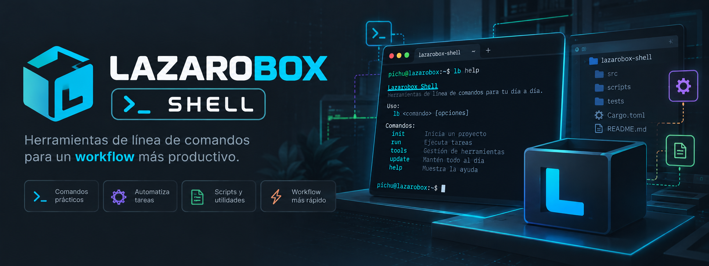
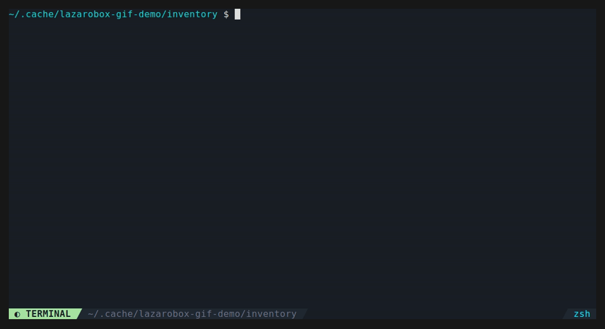

**English** | [Español](README.es.md)

<p align="center">
  
</p>

<p align="center">
  
</p>

# 🚀 LAZAROBOX SHELL (`lazarobox-shell`)

[](https://github.com/pichu2707/lazarobox-shell/actions/workflows/ci.yml)

> AI-powered, domain-agnostic TUI workspace for Developers, SEO/CRO Analysts, and Industrial Automation Engineers. Built in **Rust**.

---

## 📸 Overview & Vision

**`lazarobox-shell`** is an ultra-fast, modular and standalone terminal workspace (TUI) written in **Rust**. It acts as a centralized interface for conversing with Artificial Intelligence models (local ones and through CLIs), terminal panes, and running automation tools under user approval.


Although it was born optimized for workflows in **Software Development, SEO, CRO and Digital Analytics**, its core is designed to be **completely domain-agnostic**, allowing it to scale towards sectors such as **Industrial Automation, IoT, Logistics and SCADA/PLC Telemetry**.

---

## ✨ Design Principles

- **⚡ Zero-Latency Performance and Integrity:** Built 100% in Rust using `tokio` for async and `ratatui` + `crossterm` for fast, lightweight TUI rendering.
- **🎯 Project-Centered Architecture:** Each tab groups a project's terminal panes and chat. Planned: basic dashboards in the shell and data reading, with analytics as the goal.
- **🤖 Multi-Engine AI:** Chat with the `claude`, `codex` and `gemini` CLIs and, over local HTTP, with `Ollama`, `LM Studio`, `llama.cpp` and `vLLM`. The cloud OpenAI API and `opencode` do not have a chat adapter yet.
- **🧩 Extensibility via MCP (Model Context Protocol):** lazarobox uses the MCP servers you configure and exposes its own tools to the CLIs.

---

## 🛡️ Your data: what leaves your machine

Built for teams that care where their data goes. **Today it is a choice, not a lock:** you pick the engine for each task, and lazarobox does not prevent you from using a cloud one.

- **Local AI first:** with Ollama, LM Studio, llama.cpp or vLLM, nothing the model reads leaves your machine. Cloud engines (claude, codex, gemini, opencode) are only used if you choose them, and lazarobox always tells one kind from the other. By default no engine is assigned.
- **No telemetry:** lazarobox does not send usage data. On its own it makes few network calls: the version check on crates.io and, when installing llama-server, the search for a newer build; `[updates] check = false` turns off both (see "Update notices"). In addition, when detecting engines, if you have `codex` or `claude` installed it asks them for the list of models on your account, and that query may connect to their provider. Only when you link Search Console with the lazarobox client, a `GET` to `www.javilazaro.es` that reveals your IP address and the lazarobox version (`User-Agent` header); nothing else. After five days of chat use, if you have `gh` signed in, a query with your `gh` to the GitHub API to find out whether you have already starred the repository; the star is only sent if you press `g`, and `[notices] star = false` turns it off (see "Asking for a star").
- **Tools off until you turn them on:** the model only reads files, panes or Git if you enable that family of tools. With a cloud engine, reading a file, a diff or the list of panes asks for permission first; reading a pane's screen or running a command always asks, with any engine. Known secrets (`sk-…` keys, `Bearer …`) are redacted in what the tools return.
- **CLIs in the jail:** codex and gemini are only launched inside the jail (Landlock on Linux, Seatbelt on macOS). claude uses it when available and warns once when it runs without it.
- **The right model for each task:** each task (chat, summaries, orchestrator) can have its own engine and model, local or commercial, and they are changed from the menu.

**Planned, not available yet:**

- a strict local mode that prevents using cloud engines ([#657](https://github.com/pichu2707/lazarobox-shell/issues/657));
- a per-project engine policy, "local only" or "cloud allowed" ([#658](https://github.com/pichu2707/lazarobox-shell/issues/658));
- settings that an administrator can lock so the user cannot change them ([#659](https://github.com/pichu2707/lazarobox-shell/issues/659));
- team sync with your company's cloud ([#570](https://github.com/pichu2707/lazarobox-shell/issues/570)).

---

## 🎨 Visual Identity (`lazarobox-theme`)

Inspired by the lazarobox color palette (softened dark tones with cyan/turquoise accents):

| Element                        | HEX code              | Description                                                   |
| :----------------------------- | :-------------------- | :------------------------------------------------------------ |
| **Main Background**            | `#181E24`             | Deep dark blue/gray to reduce eye strain                      |
| **Containers and Panels**      | `#202831`             | Dark gray for contrast and elevation                          |
| **Primary Accent / Prompt**    | `#00E5FF` / `#89DCEB` | Cyan / Turquoise for commands, cursor and brand               |
| **AI / MCP Accent**            | `#CBA6F7`             | Violet / Purple for model and tool calls                      |
| **Metrics: Success / Up**      | `#A6E3A1`             | Soft sage green for conversions and SEO improvements          |
| **Metrics: Alert / Warning**   | `#FAB387`             | Warm orange for performance or maintenance alerts             |
| **Metrics: Error / Drop**      | `#F38BA8`             | Sober coral / red for SERP drops or build errors              |

---

## 📦 Installation

From crates.io. You need Rust (with `cargo`) 1.88 or later; if you do not have it, install it first from <https://rustup.rs>. Then, in a terminal:

```bash
cargo install lazarobox-shell --locked    # installs the `lazarobox-shell` binary in ~/.cargo/bin
```

**Install and update with `umask 022`.** With `umask 002` (the default on Ubuntu, Debian and Parrot), `cargo install` leaves `~/.cargo/bin` and the binary group-writable (mode 775) and lazarobox disables the chat tools: anyone in that group could replace the program that runs them. The check is strict on purpose and is not relaxed. To avoid seeing it again, install and update like this:

```bash
(umask 022; cargo install lazarobox-shell --locked)
```

The parentheses start a subshell: `umask 022` only affects that command and does not change your shell's `umask`. Keep in mind that `umask` only applies to files and folders that get created: if `~/.cargo/bin` is already mode 775, you need to run `chmod g-w ~/.cargo/bin` once (and `chmod g-w ~/.cargo/bin/lazarobox-shell` if the binary is also group-writable). If you prefer not to change `umask`, run `chmod g-w ~/.cargo/bin ~/.cargo/bin/lazarobox-shell` after each update. `lazarobox-shell --check-install` tells you, without opening the interface, whether the tools can run with this installation (it exits with 0 if so and with 1, with the reason and the command that fixes it, if not).

`--locked` builds with the same dependency versions that were tested at release time (those in the package's `Cargo.lock`). Without it, cargo re-resolves every dependency to its latest compatible version, which almost always works the same, but a newly published dependency with a bug can break the build.

**Updating.** Inside lazarobox: open the settings menu, go to **Updates** and press `Enter`. A tab opens that downloads and builds the new version (it can take a few minutes; leave lazarobox open). When it says `Updated to X.Y.Z`, restart lazarobox to use it. If lazarobox cannot update itself, it says so and `Enter` or `y` copies the same install command to the clipboard: paste it into a terminal. If your `umask` is `002`, run the command in parentheses, `(umask 022; cargo install lazarobox-shell --locked)`, which does not change your shell's `umask` (or the `chmod g-w` above afterwards), because every install recreates the binary group-writable. The update from **Updates** already does this for you: the `cargo install` that lazarobox launches runs with `umask 022` only for that process, so the binary ends up mode 755 even if your `umask` is `002`; if `~/.cargo/bin` is already 775, the `chmod g-w ~/.cargo/bin` is still needed once.

Platform and terminal support. A terminal counts as supported only when it has a test record in [docs/terminals](docs/terminals/README.md):

| Where | Status | Notes |
| :-- | :-- | :-- |
| Linux | Works | The only platform tested by hand. |
| Kitty, zutty | Recorded, works | Records in [docs/terminals](docs/terminals/README.md). |
| Windows Terminal + WSL | Recorded, with caveats | `Alt+Enter` is full screen and does not reach lazarobox: use `Ctrl+J`. |
| WezTerm (Windows build, WSL domain) | Recorded, with caveats | Same `Alt+Enter` caveat. The Linux build is untested. |
| tmux | Recorded, with caveats | `Ctrl+B` is tmux's prefix and never reaches lazarobox: press it twice or move tmux's prefix. Copy needs `set -g set-clipboard on`. |
| macOS | Builds and passes CI, untested by hand | CI builds lazarobox and passes all its tests on macOS (arm64 and Intel), and tests the real codex inside the Seatbelt jail, but nobody has used the interface by hand on a Mac. |
| Native Windows (cmd, PowerShell, without WSL) | Not supported yet | It does not build; the goal is tracked in #781. Use WSL. |
| Other terminals, Linux console, GNU screen | Untested | No record: it may work, and nothing promises it. |

- **macOS:** the panes' working directory is obtained on Linux through `/proc`; on macOS it is only updated if the shell emits OSC 7.
- **Windows (WSL):** you use lazarobox inside WSL, in the WSL console (for example Windows Terminal); there is no native Windows version. `install-desktop` on WSL prints notes about the launcher: a user entry may not show up in the Windows Start menu (WSLg), in which case you start it from the WSL console.

From source:

```bash
cargo install --path .           # installs lazarobox-shell in ~/.cargo/bin
```

### Desktop launcher

To open lazarobox from an application menu (rofi, GNOME, KDE…) without having a terminal open:

```bash
lazarobox-shell install-desktop                       # installs the "Lazarobox" launcher
lazarobox-shell install-desktop --terminal alacritty  # forces a specific terminal
lazarobox-shell install-desktop --dir ~/project       # the launcher opens lazarobox in that folder
lazarobox-shell install-desktop --uninstall           # removes it
```

It works with any installation (`cargo install lazarobox-shell` or from source) and with any terminal. The command writes `<XDG_DATA_HOME>/applications/lazarobox.desktop` (by default `~/.local/share/applications`; `XDG_DATA_HOME` is only honored if it is an absolute path) and uses absolute paths, because the desktop session often does not have `~/.cargo/bin` in its `PATH`. If the binary is moved, run the command again.

The launcher uses the `lazarobox` icon. Since a `cargo install` binary does not ship separate files, the icons are embedded in the binary and `install-desktop` writes them into the hicolor theme, at `<XDG_DATA_HOME>/icons/hicolor/<size>/apps/lazarobox.png` (256, 128, 48, 32 and 16 pixels) and `scalable/apps/lazarobox.svg`; `--uninstall` removes them too. If an icon cannot be written, the launcher is still installed, the command says so on stderr and exits with an error; run it again after fixing the cause. If you already had the launcher installed, run `install-desktop` again so the logo shows up.

On WSL, if you copy the `.desktop` to `/usr/share/applications` so WSLg shows it in the Start menu (with `~/.local/share/applications` it does not appear), the `lazarobox` icon is now looked up in the system themes, not in `~/.local/share/icons`, and the logo will not show. Copy the icons too (for example `sudo cp -r ~/.local/share/icons/hicolor/. /usr/share/icons/hicolor/`). This is untested on WSLg.

The terminal is chosen in this order:

1. `--terminal <cmd>`.
2. The `$TERMINAL` variable.
3. `xdg-terminal-exec`.
4. The first one found in the `PATH`: `kitty`, `ghostty`, `wezterm`, `alacritty`, `foot`, `gnome-terminal`, `konsole`, `xfce4-terminal`, `x-terminal-emulator`.
5. If none is found, the launcher uses `Terminal=true` and the desktop decides which terminal to open.

For an unknown terminal, `<cmd> -e <lazarobox-shell>` is used and the command says so in its output. Only terminals with a record in [docs/terminals](docs/terminals/README.md) count as tested (today, Kitty and zutty, with the record filled in on 2026-11-01); on the others some keys or the OSC 52 clipboard may not work, and the command warns about it on install without ever refusing to install.

Without `--terminal`, and only if input and output are a terminal (TTY), `install-desktop` asks which one to use: it lists the installed terminals, marks the ones with a record, `Enter` keeps the automatic choice above and `Ctrl+D` cancels without writing anything. With `--terminal` or in a script it does not ask. Paths with special characters from the Desktop Entry specification (spaces, quotes, `$`, `%`…) are rejected instead of escaped. `scripts/install-desktop.sh` remains available as a shortcut that calls this same command.

With `--dir <folder>` the launcher includes `Path=<folder>` and also `--dir=<folder>` in `Exec`, so the folder is respected even if the terminal ignores `Path=`. The path can be relative or start with `~`; it is resolved at install time and must be a folder that exists (otherwise the command fails with one line on stderr and writes nothing). Leading or trailing spaces in the path are not allowed. Running `install-desktop` again without `--dir` removes both.

### Starting folder

lazarobox starts in the first of these folders:

1. `lazarobox-shell --dir <folder>` (absolute, relative to where you launch it, or with `~`).
2. `dir` in `[workspace]` of `config.toml` (absolute or with `~`; an empty string means "unset").
3. The folder it is launched from.

```toml
[workspace]
dir = "~/project"
```

If `--dir` or `dir` are not valid (it does not exist, is not a folder, the value is missing), lazarobox does not exit or write to stderr: it starts in the folder it is launched from and shows a notice inside the application. An invalid `--dir` does not fall back to the `[workspace]` value. `--dir` is only recognized on normal startup and on `install-desktop`.

### Nesting

Each shell pane sets `LAZAROBOX=<pid>` (the pid of the instance that opened it), just like tmux does with `$TMUX`, and programs launched from a pane inherit it. If you run `lazarobox-shell` inside a pane, it does not start: it prints `lazarobox-shell is already running in this terminal; use --force to nest anyway` and exits with code 1, before touching the terminal. To nest on purpose use `lazarobox-shell --force`; keep in mind that both instances will share the same prefix key.

`lazarobox-shell --version` (`-V`) prints the version and `lazarobox-shell --help` (`-h`) the usage; both exit with code 0 without touching the terminal. An unknown option or command prints one line on stderr (`lazarobox-shell: unknown option '<x>' (try --help)`) and exits with code 2, instead of starting the interface.

### Where the configuration lives (`config.toml`)

All the configuration lives in a single file: `~/.config/lazarobox/config.toml` (or `$XDG_CONFIG_HOME/lazarobox/config.toml` if you have that variable). It does not exist until you save something from the menu (`Ctrl+Space m`, `s`); without it the defaults are used. When saving, the status bar says where it wrote it, for example `saved to ~/.config/lazarobox/config.toml`. The menu only changes the keys it edits and preserves the rest of the file, comments included, so you can also edit it by hand; what you change by hand is read when lazarobox starts.

A key that lazarobox does not know inside one of its tables (`[notices]`, `[statusline]`, `[tabbar]`, `[updates]`, `[workspace]` and `[ai]` with all the ones hanging from it) is ignored and a warning is shown on startup with its full path, for example `config: unknown key: ai.tols`; that way typos are visible. The rest of the file is loaded anyway and the menu keeps the key when saving. Root-level keys and tables that are not lazarobox's (for example a `[custom]` table of yours) do not warn.

### When you close lazarobox

On startup, lazarobox launches a watcher (`lazarobox-shell __watch`, a small process in its own session; on Linux `ps` shows it as `/proc/self/exe __watch`) that outlives it. Every process group that lazarobox starts (the claude, codex and gemini turns, your MCP servers, the managed `llama-server` and short checks such as `--version`) is recorded in it, and removed when lazarobox reaps it. When lazarobox ends, however it ends (on exit, if it crashes, with `kill -9` or when the terminal tab is closed; on Linux and macOS), the watcher sends `SIGHUP` and `SIGTERM` to the process groups still recorded, gives them 3 s, sends `SIGKILL` to whatever is still alive and exits.

- **On exit, lazarobox does the same itself, gently:** as soon as it gives you the screen back it sends `SIGHUP` and `SIGTERM` to everything it launched and only sends `SIGKILL` to whatever is still running 2 s later, while it saves the history and memory. A program that ends on receiving the signal waits for nothing more; what it left behind (its children) then receives `SIGKILL`. A turn that is still writing its answer is not cut off before those 2 s. If you close the tab or lazarobox gets killed midway through exiting, the watcher repeats the same sequence, and there too the children a program left have those seconds to finish.
- It only touches a group if its leader process is still the one that was recorded (same start time) or it no longer has a leader: a pid reused by another program never receives the signal.
- `engram serve` is never recorded: it is your memory server, it is shared with other tools and it stays running on purpose.
- Pane shells do not go through the watcher: when lazarobox's terminal closes they receive `SIGHUP`, as in any terminal. What you launched in a pane (`npm run dev &`, `nohup`, `disown`) carries on as in any terminal, but lazarobox warns you:
  - the quit prompt names it: `Quit? still running: sleep 77, npm run dev (y/n)` (at most three, and `+N more` for the rest; if the bar is narrow, only how many). It also names `llama-server (shared)` if the managed llama-server it started is answering another lazarobox (see "Managed llama.cpp");
  - on exit, with the prompt or with `exit` in the last pane, it writes it to your terminal as soon as it gives it back, with its process group so you can stop it (`kill -- -<group>`).
  - It also counts what is in a pane you already closed. A program that left the pane's session (`setsid`) is not named.
- If the watcher cannot start, lazarobox works as before: on exit it stops what it launched, but a crash may leave it running.

---

## 🔒 Stability and compatibility (1.0)

Since 1.0, lazarobox follows [SemVer](https://semver.org): **a change that breaks anything in the "Frozen" table requires a major version** (2.0). Minor versions add features without breaking anything and patch versions fix bugs. 1.0 is for **Linux** only; macOS is still not officially supported (see "Platform and terminal support").

| Frozen since 1.0 | What is promised |
| :--- | :--- |
| `config.toml` | The names of the tables and keys, and the values each one accepts. The current names are the final ones: `[tabbar] position`, `[ai] notify` and `[workspace] dir` (where `true` and `false` remain aliases of `"auto"` and `"off"`). A minor version may add new keys or values; no existing key changes its name, its meaning or stops accepting a value. |
| `chat.db` | The history format (today, schema 3, at `$XDG_DATA_HOME/lazarobox/chat.db`). A new version opens an old `chat.db` and migrates it forward, never backward. A `chat.db` **newer** than the lazarobox opening it is rejected without touching it: the history becomes unavailable (`history unavailable: store schema N is newer than this build`) and the file is not modified, so it is still there when you update again. The migration from schema 2 to 3 is automatic: when opening an earlier `chat.db` the tables are rebuilt in a single transaction, the rows are kept and the file is compacted (`VACUUM`). You can upgrade without losing history; to downgrade, the history is inaccessible until you upgrade again. |
| Command line | The public options and subcommands: `install-desktop` (with `--terminal` and `--uninstall`), `--force`, `--check-install`, `--version` / `-V`, `--help` / `-h` and `--dir <folder>` / `--dir=<folder>` (see "Desktop launcher" and "Nesting"). Removing them or changing their meaning requires a major version. |
| Keys | The `Ctrl+Space` prefix and the keys in the reference in the "Keys" section. The prefix is **not configurable**. The `?` key after the prefix is **reserved** for the future command viewer. |

| Not part of the promise | Why |
| :--- | :--- |
| Internal `__*` subcommands (`__jail-exec`, `__mcp-serve`, `__watch`) | lazarobox launches them on itself; they are not invoked by hand and can change in any version. |
| The text of logs, notices and error messages | They may be reworded in a minor version. Do not depend on them in a script. |
| The layout of the interface (bars, colors, row texts, status bar hints) | It may change in a minor version. What does not change is what each key in the reference does. |

**Upgrading to 1.0.** It is done like any other version: `cargo install lazarobox-shell --locked` (or the **Updates** row of the menu). There is no need to touch `config.toml` or delete `chat.db`: the first time it is opened, an earlier `chat.db` is migrated automatically. Before updating you can copy `~/.local/share/lazarobox/chat.db` if you want to be able to go back to an earlier version with the exact history of that moment; without a copy, going back leaves the history unavailable until you update again.

---

## ⌨️ Keys: the `Ctrl+Space` prefix

Everything that is not typing in a pane starts with the `Ctrl+Space` prefix; then you press the key, or the group and the key (for example `w` and `v`). While the prefix is waiting, the status bar shows the possible keys. `Esc` or an unassigned key cancels it without typing anything.

| Key after `Ctrl+Space` | Action                                                              |
| :------------------------ | :------------------------------------------------------------------ |
| `h` `j` `k` `l`           | Moves focus left, down, up or right                                 |
| `w` `v` / `w` `h`         | Splits the pane to the right / downward                             |
| `w` `q`                   | Closes the pane (asks for confirmation)                             |
| `w` `r`                   | RESIZE mode: `h` `j` `k` `l` move the border, `Esc` exits          |
| `w` `z`                   | Zooms the pane or returns it to its size                            |
| `t` `n` / `t` `c`         | New tab / closes the tab (asks for confirmation)                    |
| `g` `b` / `g` `B`         | Next / previous tab                                                 |
| `b` `1`…`b` `9`           | Goes to tab N                                                       |
| `[`                       | COPY mode (see [COPY mode](#-copy-mode))                            |
| `m`                       | Opens the menu                                                      |
| `c`                       | Opens an AI chat                                                    |
| `n` / `o` / `s` / `T`     | In a chat: note, memory block, summary, tags                        |
| `e` / `a`                 | In a chat: run its code block in a pane, approval mode              |
| `q`                       | Quits lazarobox (asks for confirmation)                             |
| `W`                       | In a chat with the orchestrator: opens the selected worker's transcript |
| `r` `r` / `r` `d`         | In a chat with the orchestrator: resumes / discards the interrupted run (see [Agent orchestrator](#agent-orchestrator-experimental)) |
| `?`                       | Reserved for the future command viewer; does nothing today          |
| `Ctrl+Space`              | Sends the prefix itself to the program (a NUL byte)                 |
| `Ctrl+]` (alias)          | Does the same as `Ctrl+Space`; twice sends the program the 0x1D byte |

**`Ctrl+]` alias.** If your terminal swallows `Ctrl+Space`, use `Ctrl+]` (or `Ctrl+5`, which many terminals send as the same byte) as the prefix: the whole key tree above works the same. Consequence: **a single press of `Ctrl+]` or `Ctrl+5` no longer reaches the pane's program**; two are needed (`Ctrl+]` `Ctrl+]` sends 0x1D). It affects vim's tag jump and telnet's escape.

**Prefix check.** The first time it starts in a terminal, lazarobox waits up to 10 s for you to press `Ctrl+Space` and saves the result per terminal; if it does not arrive, it warns you to use `Ctrl+]`. Typing normally does not count or get blocked. `lazarobox-shell --check-prefix` repeats the check. The saved row is named after the terminal: `TERM_PROGRAM` if set (inside tmux the row is `tmux (kitty)`, `tmux (WezTerm)` and so on, named after the outer emulator when it can be found, else plain `tmux`; it is fixed at startup and the variables may name the first terminal that attached), else Windows Terminal, kitty, WezTerm, Alacritty, Konsole or VTE when their own variable is set, and for a generic `TERM=xterm-256color` the terminal's process name when it can be found locally (for example `xterm-256color (zutty)`; read from `/proc` on Linux, not over ssh). Inside tmux, `Ctrl+B` is tmux's prefix, not lazarobox's: see [docs/terminals](docs/terminals/README.md).

**Held keys.** Most terminals send a held key as repeated presses. Therefore, the same key again within 500 ms counts as the same held press: in the menu, confirmations and chat, a key that decides (save, cancel, send, copy, approve or reject) acts **only once**, and the one that closed the menu, a confirmation or RESIZE does not reach the pane underneath. Typing and moving work as always. If you want to deliberately press the same decision key twice, leave half a second pause.

**Backspace arriving as `Ctrl+H`.** Some terminals send `^H` for Backspace. In text fields (the chat message, notes, the summary, tags and menu fields) `Ctrl+H` deletes like Backspace; a shell pane receives the byte as is.

### Key reference by view

This section and the prefix table above are the **single reference** for keys; the other sections of the README link to it instead of repeating it. The `Ctrl+Space` prefix and its `Ctrl+]` alias **cannot be configured**. Unless stated otherwise, keys are pressed without modifiers (`y` is lowercase; `Y` does not count).

**Chat, conversation**

| Key | Action |
| :--- | :--- |
| `Enter` | Sends the message |
| `Alt+Enter` / `Ctrl+J` | Line break in the message |
| `Ctrl+U` | Clears the message |
| `Esc` / `Ctrl+C` | Cancels the response in progress; with no response in progress they do nothing |
| `Ctrl+R` | Shows or hides the model's last reasoning block |
| `Ctrl+Y` / `Ctrl+B` | Copies the last response / its last code block (OSC 52) |
| `PageUp` / `PageDown` | Scrolls the conversation |
| `Ctrl+G` | Opens the review of an orphan batch (badge `orphan N · Ctrl+G`) |
| `Ctrl+O` | With the orchestrator enabled in the menu: turns ORCH on or off in this pane (see [Agent orchestrator](#agent-orchestrator-experimental)) |
| `Alt+↓` / `Alt+↑` | With the orchestrator enabled: selects the next / previous running worker. With a worker selected, the first `Ctrl+C` cancels only that worker and the next one cancels the run |
| `←` `→` `Home` `End` `Backspace` `Delete` | Edit the message (`Ctrl+H` deletes like `Backspace`) |

**Approving a tool or a command** (including the `Ctrl+Space` `e` confirmation). While waiting, the other keys do nothing. A freshly opened notice does not yet accept `y`, `n` or `Esc` (in case the key was meant for the message); `Ctrl+C` always works.

| Key | Action |
| :--- | :--- |
| `y` | Approves |
| `n` / `Esc` | Rejects |
| `p` | On a command, moves to the next shell pane as the target (wraps around at the last one) |
| `Ctrl+C` | Rejects and cancels the response in progress |

**Reviewing a batch or a commit**

The first row of the review starts with the chat's folder (`~` for `$HOME`; if it is long it is cut at the front and keeps the end), so you see where it will be written before pressing `y`. The folder only takes the space the counter leaves: if less than 8 columns remain it is omitted, and it never pushes out the delay or the state of `y`.

| Key | Action |
| :--- | :--- |
| `↑` `k` / `↓` `j` | Scrolls one row |
| `PageUp` / `PageDown` / `Home` / `End` | Scrolls by pages / to the start / to the end |
| `y` | Approves, only once you have seen the whole batch and the delay has passed. If you press `y` with unseen lines, it does not approve: the counter warns for 2 s how many are left (`y needs every line seen: N left, scroll ↓`) |
| `n` / `Esc` | Rejects, after the same delay (immediately if the batch cannot be reviewed) |
| `Ctrl+C` | Rejects and cancels the response in progress |

**Conversation list**

| Key | Action |
| :--- | :--- |
| `j` `↓` / `k` `↑` | Moves the selection |
| `Enter` | Resumes the conversation: loads the full history and continues in the same one, with its saved profile |
| `n` / `Esc` | Starts a new conversation |
| `a` | Toggles between the project's conversations and those of all projects |
| `Del`, then `Enter` | Deletes the conversation; any other key cancels. No letter opens or confirms the deletion, so typing right after opening the chat deletes nothing. If there are deletable notes in engram, the question also offers `Tab` (deletes the conversation and then its notes; see "Project memory (engram)") |
| `t` | Edits the row's tags |

**Chat folder picker** (when opening a chat with a broad or unknown folder, or when resuming a conversation without a usable folder). No key reaches the message while it is open; a held key edits but never decides, except `Esc`, which cancels even if held.

| Key | Action |
| :--- | :--- |
| `↑` / `↓` | Moves the highlighted row |
| Text, `Backspace`, `Delete`, `←` `→` `Home` `End`, `Ctrl+U` | Edit the path (`~` and `~/…` are valid; a relative path starts from the folder the chat would have) |
| `Tab` | Completes folder names. Does nothing while candidates are still being searched (`still looking for folders`) or if held down |
| `Enter` | Opens the typed path (it wins over the row) or, with the field empty, the highlighted row |
| `Esc` | Keeps the current folder and leaves the line `chat folder is …; use /cd <folder> to change it` |

**`/cd` confirmation** (appears when sending a `/cd <folder>` message; `Tab` on that line completes the path).

| Key | Action |
| :--- | :--- |
| `y` | Checks the folder one last time and changes it (it may still reject it); a held `y` never confirms |
| While the folder is being checked (after `y`) | Only `Esc` cancels; the other keys do nothing |
| `n` / `Esc` | Cancel, even if held |
| Any other | Cancels, unless it is a held key (the `Enter` that sent `/cd` counts as held for 500 ms) |

**Chat editors**

| Editor | Keys |
| :--- | :--- |
| Tags (`Ctrl+Space` `T`, or `t` in the list) | A comma-separated line. `Enter` saves, `Esc` discards, `Ctrl+U` clears the line |
| Note (`Ctrl+Space` `n`) | `Tab` / `Shift+Tab` switch field; in the category field, `←` `→` change it. `Enter` saves from the title and adds a line in the content; `Ctrl+S` saves; `Esc` closes without saving |
| Summary (`Ctrl+Space` `s`) | `Enter` adds a line; `Ctrl+S` approves (also on the second secret-masking pass); `Esc` discards |
| `engram serve` offer | With an empty message: `y` accepts it; `n` / `Esc` leave it for later. Any other key is typed into the message |

In the note and summary editors, `↑` `↓` move the cursor between content lines; `Ctrl+C` never exits lazarobox.

**Menu** (`Ctrl+Space` `m`)

| Key | Action |
| :--- | :--- |
| `Tab` / `Shift+Tab` | Next / previous tab |
| `1`…`5` | Goes to the tab with that number: `1` Settings, `2` Models, `3` Tools, `4` Connectors, `5` Chat |
| `j` `↓` / `k` `↑` | Next / previous row |
| `l` `→` `Space` / `h` `←` | Next / previous value of the row (`Enter` also advances to the next) |
| `s` | Saves to `config.toml` (`Enter` never saves or closes the menu) |
| `Enter` | On rows with an action: opens the AI picker, updates (**Updates**), opens the form (**Feedback**) or asks for the token (Hugging Face) |
| `r` | On **Updates**, checks now; on the AI rows, re-detects engines and models |
| `t` | On **Notify** and **Sound**, checks and fires a test notice |
| `d` | On the Hugging Face account row, forgets the token; in the ollama model list, on a downloaded model, asks for confirmation to delete it |
| `Esc` | See "`Esc` by view" |

**COPY mode** (`Ctrl+Space` `[`)

| Key | Action |
| :--- | :--- |
| `h` `j` `k` `l` | Moves the cursor |
| `0` / `$` | Start / end of the line |
| `gg` / `G` | First / last line |
| `Ctrl+D` / `Ctrl+U` | Half page down / up |
| `v` / `V` | Starts selection by characters / by lines |
| `y` | Copies the selection (OSC 52) and exits |
| `Esc` | Clears the selection; with no selection, exits |
| `q` / `i` | Exit (in a chat pane, `i` does nothing) |
| `Ctrl+Y` / `Ctrl+B` | Chat only: copy the last response / its last code block without exiting |

**RESIZE mode** (`Ctrl+Space` `w` `r`): `h` `j` `k` `l` move the pane border one cell; `Esc` exits. Any other key, including `Ctrl+Space`, is ignored and the mode continues.

**Confirmations** (quit, close pane, close tab): only `y` confirms. `n`, `Esc`, `Y` or any other key rejects it.

**`Esc` by view.** It does not mean the same everywhere; this is how it stands in 1.0:

| View | `Esc` |
| :--- | :--- |
| Shell pane | Reaches the program (byte `0x1b`) |
| Pending prefix or group | Cancels, without typing anything |
| Quit, close pane and close tab confirmations | Rejects, like any key other than `y` |
| RESIZE | Exits |
| COPY (shell and chat) | Clears the selection; with no selection, exits |
| Menu, top level | Cancels: discards what is unsaved and closes the menu |
| Menu: task picker, install wizard, Hugging Face screens | Goes back one level (from the Hugging Face popular list, to the search field) |
| Menu: Hugging Face token field | Closes the field; a check in progress is cancelled and nothing is saved |
| Menu: Feedback form | Closes it, back to its row (also after sending) |
| Chat, conversation | Cancels the response in progress; without one, does nothing |
| Chat, tool approval and `Ctrl+Space` `e` confirmation | Rejects, once the notice already accepts an answer |
| Chat, batch or commit review | Rejects, after the delay (an orphan batch is discarded) |
| Chat, `engram serve` offer | For later, like `n` |
| Chat, conversation list | Starts a new conversation, like `n` |
| Chat, tags editor and summary draft | Discards the edit |
| Chat, notes editor | Closes it without saving |

A held `Esc` acts only once in all these views except in a shell pane.

---

## 📋 COPY mode

`Ctrl+Space` and `[` enter COPY mode. Move the cursor with `h` `j` `k` `l`, select with `v` (characters) or `V` (whole lines) and copy with `y`: the text reaches the system clipboard through OSC 52 and you return to the TERMINAL. `Esc` clears the selection (and a second press exits). Selections over 75,000 bytes are not copied.

In an AI chat pane it works the same and copies clean text: without the drawing prefixes (`›`, `┊`, `•` and the indentation), with lines split by width joined back together and without the key hints. Inside the chat's COPY mode, `Ctrl+Y` copies the last response and `Ctrl+B` its last code block, without leaving the mode.


**Copy chain.** When copying, lazarobox always sends OSC 52 to the terminal and, in addition, uses a local tool if it finds one: `wl-copy` (Wayland), `xclip` or `xsel` (X11) and, on WSL, `powershell.exe` with `Set-Clipboard`, or `clip.exe` if it is not there. `powershell.exe` receives the text in UTF-8 and stores it exactly, without the `<feff>` that `clip.exe` left when pasting; line breaks become `\r\n`, as `clip.exe` did. `clip.exe` only receives the byte order mark when the text is not ASCII, because without it it gets short texts wrong. Over SSH no local tool is used, because the clipboard that matters is your machine's. The notice says what really happened: `Copied (xclip)` if the tool finished well; `xclip failed; sent via OSC 52 (...)` if it failed; and `No paste? Install wl-copy or xclip (OSC 52 sent)` if only OSC 52 was sent, because nothing confirms it arrived. A selection too large for OSC 52 is only copied with a local tool, and if that fails it says so.

Inside tmux, OSC 52 needs `set -g set-clipboard on` in `tmux.conf`; with tmux's default `set-clipboard external` tmux drops it and nothing is copied; the copy notice then reads `No paste? In tmux, set -g set-clipboard on (OSC 52 sent)` (see [docs/terminals](docs/terminals/README.md)).

---

## 🖱️ Scrolling

- **Mouse wheel:** scrolls the pane under the pointer, without changing focus. In a shell pane it walks through the history (3 lines per step); in `less`, `man` or `vim` the wheel reaches the application; in the AI chat it scrolls the conversation. Any key pressed in the pane (or a paste) returns to the live screen.
- **Links:** a click on an `https://` or `http://` link visible in a pane or in the chat opens it in the browser, also on local addresses such as `http://localhost:3000`. It opens when you release the button on the same cell, so dragging opens nothing. A link split across several rows opens whole. If there is no browser, it is copied and a notice says so. Links that an AI CLI such as Claude Code draws with other text, such as an icon `⧉` (OSC 8 links), work too: the first click shows where the link goes (`Link to <url>: click it again to open it`) and a second click on it opens it.
- **Links with the keyboard:** `Ctrl+Space` and `u` lists the links visible in the focused pane, also with `mouse` turned off; a link drawn with other text is listed by its URL. `1`…`9` and then letters open each row, `Enter` opens the selected one, `y` copies it, `j`/`k` move the selection and `Esc` closes.
- **Native selection:** with mouse capture on, hold a modifier while dragging to select text with the terminal: `Shift` in Kitty and most Linux terminals, `Option` in macOS Terminal and iTerm2.
- **COPY mode:** `Ctrl+Space` and `[` works in shell and chat panes. Move with `j`/`k` (line), `Ctrl+u`/`Ctrl+d` (half page), `gg` (start) and `G` (end); `Esc` or `q` exits. `v`, `V` and `y` select and copy (see [COPY mode](#-copy-mode)).
- **`[+N]` indicator:** a scrolled pane shows in its top-right corner how many lines remain below; the status line shows the position (`↑N/total`) of the focused pane.
- **Turning off capture:** `mouse = false` in `config.toml` (or the `Mouse` row of the Settings section of the `Ctrl+Space m` menu) leaves the wheel and selection to the terminal. It is on by default.

---

## ⚙️ Menu: Settings section

`Ctrl+Space` and `m` opens the menu. With the AI section, the menu is split into five tabs, **Settings**, **Models**, **Tools**, **Connectors** and **Chat**, which you switch with `Tab` and `Shift+Tab` or by jumping with `1`…`5` (the numbers are fixed: `4` is always Connectors). **Connectors** is not shown until it has rows, so `Tab` skips it and `4` warns in the footer that there are no connectors yet; without the AI section only **Settings** exists and `2`…`5` warn that the AI section is not available. A number outside `1`…`5` warns with `Tabs are 1-5` and `Tab` with a single tab warns with `No other tabs`; the notice disappears on the next key. `j`/`k` move and wrap within the active tab, and each tab remembers its row. When opened, the menu always starts on **Settings**. The update notice is only shown on that tab, and its label carries a `*` while an update is pending. Inside a picker, the `custom…` field or the privacy warning, `Tab` and the numbers do not switch tabs (in text fields, a number is typed like any other character). Its **Settings** section has, in this order:

| Row | What it does | Key in `config.toml` |
| ---- | -------- | ---------------------- |
| `Statusline position` | Status bar at the top or bottom (`h`/`l`) | `[statusline] position` |
| `Tab bar position` | Tab bar at the top or bottom | `[tabbar] position` |
| `Mouse` | Mouse capture | `mouse` |
| `Build jobs` | Parallel builds of new panes and of `run_command` in the chat: `auto` or from `1` to the number of cores (see below) | `[build] jobs` |
| `Notify` | Notice when a chat response finishes (`off`, `auto`, `desktop`, `bell`); `t` tests it | `[ai] notify` |
| `Sound` | The notice's own sound; `t` tests it | `[ai] notify_sound` |
| `llama-server idle` | Minutes of inactivity after which the managed llama-server stops: `5 min`, `15 min`, `30 min` or `never` | `[ai.servers.llamacpp] idle_minutes` |
| `Usage (alpha)` | Opens the AI usage view: usage line, status bar segment and billing for claude, codex and gemini (see "AI usage"); shows `line on · bar on` | `[ai.usage]`, `[ai.usage.billing]` |
| `Updates` | Running version and available update (see below) | `[updates] check` (file only) |
| `Feedback` | Opens the form to report a bug or propose an idea (see below) | — |

`Notify` and `Sound` used to be in the **AI** section; they only change place, and their keys and behavior stay the same.

**`Build jobs`.** Each new shell pane receives `CARGO_BUILD_JOBS` and `CMAKE_BUILD_PARALLEL_LEVEL` with the number of builds that `cargo` and CMake can launch at once. By default both use one job per core and do not look at memory, so a machine with many cores and little RAM runs out of memory on a full build. With `auto` (default), lazarobox uses the smaller of the cores and the RAM divided by 2 GiB, and never less than 1. The row shows what comes out on this machine, for example `auto (3)` with 16 cores and 7.6 GB. From `auto`, `l` goes to `1, 2, …` up to the cores and `h` jumps straight to the maximum: useful for leaving a long build working or for lowering it while you do other things. In `config.toml`:

```toml
[build]
jobs = "auto"   # or a number, for example jobs = 4
```

- The change applies to panes opened afterwards; an already open pane keeps its value (`export CARGO_BUILD_JOBS=…` in it changes it by hand).
- If your `~/.zshrc` (or `~/.bashrc`) exports either variable, that one wins, because the shell reads it on startup.
- `run_command` in the chat always uses the menu value, and a change applies from the next command. Its environment is built clean, so what your shell exports does not reach it.
- The commands the chat launches with `run_command` do not receive it yet.

### Feedback: bugs and ideas from the terminal

From a chat you do not need to go to the menu: type `/feedback <text>` in the composer and press `Enter`. This same form opens with the first line as the title and the rest as the description; if there is only one line, it goes in both fields, and you can always edit them. The text does not reach the model or get added to the conversation, and nothing is published until you press `Ctrl+S`. To send the model a message that starts with that word, type `//feedback`.

`Enter` on **Feedback** opens a short form:

- **Kind**: `Bug report` or `Idea or goal` (`←`/`→`).
- **Title** and **Description** (`Tab` moves to the next field; in the description, `Enter` adds a line).
- **Attach the environment** (`Space` turns it on or off): the lazarobox version, the system (and whether it is WSL), the shell, the terminal (`TERM_PROGRAM`) and the detected AI engines with their version. You see it in full before sending; it never includes paths, usernames or keys.

`Ctrl+S` sends the issue to GitHub with your own `gh` (`gh issue create`): bug reports with the `bug` label or ideas with `idea` (ideas reach the project's Goals board). The issue follows the shape of the repository's forms: a `### What happened` section (or `### The idea`) with the description and, if you attach it, `### Environment`. After pressing `Ctrl+S`, the footer says `Looking for similar issues, then sending…` until it finishes; when sending from the list of similar issues, it says `Sending to GitHub…`. When done, the form shows `Sent:` and the issue link, which opens with `Ctrl+O` or a click. If `gh` fails, the form keeps everything you typed and the footer shows its message; `Ctrl+S` retries. **lazarobox only sends something when you press `Ctrl+S`, and always through your `gh` session: it does not store any GitHub token.** GitHub only keeps the labels if you have write permission on the repository.

Before creating anything, `Ctrl+S` looks for similar open issues, so as not to duplicate one that already exists. It searches with the title's keywords (`gh issue list --state open --search`) and only shows those that share at least two words with it. If there are any, the form lists them (`#583 …`) instead of the fields. `↑`/`↓` picks one; `Enter` adds your description and the environment as a comment on that issue (`gh issue comment`), without creating another, and shows the comment link. If the comment fails, including for not having `gh` or not being signed in, the form says why and keeps the chosen issue, and `Enter` tries again; it never takes you to a new issue's page. If none is yours, `Ctrl+S` creates the issue anyway, and `Esc` returns to the fields. If there is no similar one, or the search fails or takes more than 10 seconds, the issue is created as usual.

If `gh` is not installed or you have not signed in (`gh auth login`), `Ctrl+S` opens the pre-filled issue page in the browser and the form explains why. `Ctrl+O` opens that same page directly, to review and send it from there (with `xdg-open`; on WSL with `wslview` or `rundll32.exe url.dll,FileProtocolHandler`; on macOS with `open`; if none exists, it copies the link to the clipboard with OSC 52).

Before sending anything, the title and description go through the same secret filter as the memory notes; if it masks something, the form shows it (`Secrets were masked; review and press Ctrl+S again`) so you can review it. A link over 8000 characters cannot be opened (`Too long for a link: shorten the description`), but it can be sent with `Ctrl+S`.

From the web, GitHub's issue forms ask for the same data.

---

## 🔔 Update notices (`[updates]`)

lazarobox can tell you that a new version is available on crates.io. When there is one, the status bar shows `update 0.16.0` and the menu shows a note telling you to go to **Updates**. The **Updates** row of the menu shows the version you are running (`Updates  0.15.3`); if there is a new one, the name carries a `*` and the value says the version (`* Updates  0.16.0 available`).

**`Enter` on `Updates`** only acts if an update is available (otherwise the footer says `up to date` and nothing happens):

- **You installed with `cargo install`** (the running binary, with paths resolved, including `~/.cargo` symlinks, is under `$CARGO_HOME/bin`, or `~/.cargo/bin` if `CARGO_HOME` is not set): lazarobox closes the menu and opens a **new tab**, which becomes the active one, and directly runs `cargo install lazarobox-shell --locked --version <version> --root <root>`, without a shell, where `<version>` is exactly the one the Updates row announces (cargo installs exactly that version or fails, instead of installing a different one) and `<root>` is the folder containing that `bin`; this way cargo always installs on top of the running binary, even if `CARGO_INSTALL_ROOT` or `install.root` point elsewhere. Closing the menu this way is equivalent to pressing `Esc`: anything you have not saved in the menu is discarded. It is a normal pane: you see the build, and its first lines, written by lazarobox, say in plain words that it is updating, that it may take a few minutes and that you should not close lazarobox, and then what is being run (`running /home/u/.cargo/bin/cargo install lazarobox-shell --locked --version 0.16.2 --root /home/u/.cargo`).
  - **Which `cargo`:** the one next to the running binary (`<CARGO_HOME>/bin/cargo`) and, if it does not exist, the first one on the login `PATH` that lazarobox already uses (never the current directory). It is run as found (the rustup proxy decides based on the name it is launched with). It must be trusted: neither it nor any folder above it may be under `/tmp` or writable by others, and group write permission is only accepted (the normal case with umask 002) if the folder or file is yours, its group is yours and that group is private, that is, it is named like your user and has no members other than you. A shared group (`users`, `staff`) or a root folder with group write are rejected. The folders that contain the link to `cargo` (for example `~/.cargo/bin`) are checked too, and checked again when pressing `Enter`, in case something changed since startup. It is a looser rule than the one for the AI CLIs, which still requires that not even the group can write. If it does not comply, nothing is run and the command is shown as in the next case.
  - **`umask`:** the `cargo install` runs with `umask 022` only for that process (through `/bin/sh -c 'umask 022 && exec "$0" "$@"'`, which passes the arguments as they are, without interpreting them), without touching lazarobox's `umask` or that of your shells. This way the new binary does not end up group-writable with a `umask` of `002`, and the tools' trust check keeps passing after updating.
  - **Environment:** cargo receives a pane's normal environment (lazarobox's plus `TERM`/`COLORTERM`), with the login `PATH`; it is not scrubbed like the AI CLIs', because cargo needs your `RUSTUP_*`, proxy, certificates, etc. It runs from your home folder, not from a project's.
  - **Result:** if it finishes well, the tab closes by itself, a notice says `Updated to X.Y.Z. Restart lazarobox to use it.` and the row changes to `X.Y.Z installed: restart` until you restart. If it fails, the tab **stays open** with a last line in plain words (`The update did not finish (error N)`, `The update could not start` or `The update stopped unexpectedly`) followed by the command to run it by hand, so you can read cargo's error; close it whenever you want (`Ctrl+Space`, `w`, `q`). **Restart lazarobox** to use the new version: the running process is not replaced.
- **Any other installation** (distribution package, tarball, local build) or without `cargo` on the `PATH`: **nothing is run**. The menu note says `lazarobox cannot update itself here. Run:` with the command `cargo install lazarobox-shell --locked`, and the footer says why (`installed another way`, `Rust is not installed`, `Rust folder is too open` or `folder name is unusual`); without Rust, the note first says `Install Rust first (rustup.rs), then run:`. `Enter` or `y` copies the command to the clipboard (OSC 52).

There is no switch: `[updates] check` is only changed in the file.

**Configuration** (`config.toml`):

```toml
[updates]
check = true   # default; false = no network calls and no notices
```

With `check = false` lazarobox makes no request, does not read the cache and shows nothing. A value that is not `true` or `false` is reported once on startup, like any other configuration problem, and the default value is used.

**What is sent.** A single `GET https://crates.io/api/v1/crates/lazarobox-shell`, made with the system `curl` (HTTPS only, no redirects, 5 s limit), with the headers `User-Agent: lazarobox-shell/<version> (+https://github.com/pichu2707/lazarobox-shell)` and `Accept: application/json`. Nothing else: no identifiers, no cookies, no telemetry. If `curl` is not installed, the check silently does nothing. Relative or empty `PATH` entries are never used to find `curl`, `cargo` or the AI CLIs. `curl` respects your usual proxy and certificate environment (`HTTPS_PROXY`, `ALL_PROXY`, `NO_PROXY`, `SSL_CERT_FILE`, `CURL_CA_BUNDLE`); only `~/.curlrc` is ignored.

**How often.** On startup, in the background, and at most once every 24 hours while the cached version is newer than the one you run. In between, the last response from `update-check.json` is read from lazarobox's data directory (`$XDG_DATA_HOME/lazarobox/`, or `~/.local/share/lazarobox/`), so a known update keeps showing on every startup without a new request. The cache records which lazarobox version wrote it (`checked_by`). If another version wrote it (or an old one, without that field) and its newest version is equal to or lower than the one you run, for example after updating, it is checked on the next startup without waiting 24 h; if this same version wrote it, the once-a-day limit applies. Known limit: if two lazarobox versions share the same data directory and are used at the same time, each startup of the one that did not write the cache may make a request (at most one per startup; never more than one a day for the same version). A failed check (no network, timeout, status error, unreadable response) is silent, keeps the newer version already known and is retried after one hour. If the cache cannot be written (read-only directory), nothing is checked, so as not to query the API on every startup. Pre-release versions are never announced.

**Check now.** On the **Updates** row, `r` asks crates.io at that moment, without looking at the cache or the 24-hour limit. While it lasts, the row says `checking…`; afterwards it shows the result like any other check (and saves it in the cache). A failed check silently goes back to what was already known. With `check = false`, or after installing a version in this session, `r` does nothing and the footer does not offer it.

---

## ⭐ Asking for a star (`[notices]`)

Once you have used the chat on at least five different days (days with a complete response in `chat.db`), lazarobox may ask you for a star on GitHub, once per run, in the help line of the focused chat: `Enjoying lazarobox? g: star it on GitHub with gh · any other key: not now`. It only appears with the chat idle, the composer empty and no pending approval in any pane; never during a turn.

- **`g`** with `gh` installed and signed in: `gh api -X PUT user/starred/pichu2707/lazarobox-shell` with your own `gh`, and a line in the chat with the result. If it fails, the repository page is opened. Without `gh` (or without a session), `g` opens `https://github.com/pichu2707/lazarobox-shell` in the browser (or names it, if there is nothing to open it with). In any case it is not asked again.
- **Any other key** dismisses it and reaches the composer as usual. It is asked again only with a lazarobox version newer than the one at dismissal and after at least 60 days.

**What is queried.** Only when the conditions above are met and you have `gh` with a session, on startup, `gh api user/starred/pichu2707/lazarobox-shell` (a read: if you have already starred it, it is never asked). Without `gh` nothing is queried. The star is never sent on its own: only with your `g`. The response is saved in `star.json` in lazarobox's data directory (`$XDG_DATA_HOME/lazarobox/`, or `~/.local/share/lazarobox/`), mode 0600; it is not sent anywhere else.

**Configuration** (`config.toml`):

```toml
[notices]
star = true   # default; false = no query and no notice
```

---

## 🤖 AI menu

`Ctrl+Space` and `m` opens the menu; the **Models** tab (`2`, or `Tab` from Settings) shows the general engine (**Set all tasks**) and one row per task. `Enter` on a task row opens its two-level picker (engine and model); `Esc` goes back one level. The `custom…` row lets you type or paste a model name. `r` on a task row or inside the picker re-detects the engines.


After the task rows (the last two, `orchestrate` and `simple`, are the coordinator's and the `simple` worker's in the [orchestrator](#agent-orchestrator-experimental)), the **Models** tab continues with the section **ODD + RDD roles**: `Set all ODD + RDD roles`, `judge-a` and `judge-b` (the [acceptance judges](#agent-orchestrator-experimental); `Set all tasks` does not touch them), and ends with the **Hugging Face** row (see "Downloading models from Hugging Face"). An unassigned judge row reads `(default)`; its picker has `(default)` as the first entry and a local server on it carries no `not recommended` mark. The **Tools** tab (`3`) has the rows **Tools**, **Search**, **Write**, **Exec**, **Git**, **Git write**, **Issue draft**, **Approval** and **Orchestrator**, and the **Chat** tab (`5`) has **Profile**, **Context** and **Memory**. **Approval** toggles with `h`/`l` (or the arrows) between `ask`, `auto` and `run`, the approval mode for commands a model asks for (`ai.tools.approval`); `s` saves it to `[ai.tools]` in `config.toml`, `Esc` discards it. The change does not act on an open chat or on a pending approval: it only reaches chat panes you open afterwards and the next conversation change.

`s` saves the choice in the `[ai]` table of `config.toml` (and each task's in `[ai.tasks.*]`); `Esc` at the top level discards it. `Enter` never saves or closes the menu. While the choice differs from the saved one, the menu footer shows `unsaved changes · s to save · Esc discards`.

The Ollama model catalog is informational only and may be out of date. Catalog models that are not installed appear as `download required` and cannot be chosen. To use one, download it from the `download from Ollama…` row (see "Downloading models from Ollama") or install it yourself (`ollama pull <model>`), and press `r`. lazarobox only downloads three things, and only when you confirm: GGUF models from Hugging Face (see "Downloading models from Hugging Face"), Ollama models through your own Ollama server (see "Downloading models from Ollama") and, as the only exception to "lazarobox installs nothing", `llama-server` (see "Installing llama-server (the exception)"). No chat conversation ever asks a server to download a model.

These engines are detected: `ollama`, `lmstudio`, `llamacpp` and `vllm` (local servers) and the CLIs `claude`, `codex`, `gemini` and `opencode`. Servers are queried on their usual port (or the one you set in `[ai.servers]`, see below) and CLIs are looked up in the `PATH`. The menu marks as `detected · not in chat yet` the detected engines that do not have a chat adapter yet (today only `opencode`), and does not let you choose them.

**Tool marks.** In the Ollama model list, an installed model that declares tool support carries `🔧` next to `✓` (`llama3:8b ✓ 🔧`) when it has 3B parameters or more, and `tools: unreliable` if it is smaller, because small models tend to fail when calling tools. A model without support, with unknown support or of unknown size carries no mark. The mark is informational: it does not prevent choosing the model, and it is also shown with `[ai.tools] enabled = false`. On `TERM=linux` (the Linux console) or with a non-UTF-8 locale, `🔧` is written `tools`. To find out whether a model declares tools, detection sends a `POST /api/show` request per model to your Ollama server on `127.0.0.1` (at most 32 per detection, 4 at a time and 2 seconds in total; the result is remembered by digest while lazarobox is open). Nothing is sent anywhere else, and detection still does not touch `/api/pull`, `/api/delete` or `/api/push`.

If your terminal has no emoji font, `🔧` is drawn as an empty box (typical symptom in zutty with `TERM=xterm-256color`): lazarobox cannot detect this, so force the text mark with `[ai] tool_mark = "text"`. Values: `"auto"` (default: the rule above), `"emoji"` (always `🔧`, also on the Linux console or with a non-UTF-8 locale) and `"text"` (always `tools`, in every list where the mark appears). Any other value goes back to `"auto"` and is reported on startup (`ai.tool_mark: expected "auto", "emoji" or "text"`). It is read on startup: restart lazarobox after changing it.

In the engine list, detected `claude`, `codex` and `gemini` carry `🔧` (or `tools` on `TERM=linux` or with a non-UTF-8 locale) after their status: their tools are verified. `opencode`, `ollama`, an undetected engine, a refused one (`refused`) and `claude` when it asks to be updated (`update needed`) do not carry it, and neither do a CLI's model rows. It is also shown with `[ai.tools] enabled = false`.

On the Ollama download screens, a `Popular` row carries `🔧` if the library card declares `tools` and the largest size that fits your PC is 3B or more (`tools: unreliable` if smaller); each `Sizes` row uses the size of its own tag. There are no new requests: the mark comes from the card already read. The confirmation screen carries no mark.

Detection is read-only and only uses `127.0.0.1`: no credentials or data from your panes are sent, and nothing is run except `--version` of the CLIs found.

If a server listens on another port (for example, because its own is taken), set it in `config.toml`. Detection and chat use that same port, always on `127.0.0.1`:

```toml
[ai.servers.llamacpp]
port = 39080
```

`ollama`, `lmstudio`, `llamacpp` and `vllm` are valid; a port outside 1–65535 or that is not a number is ignored with a notice on startup and the usual one is used. The menu only writes llamacpp's `managed` and `model` (below) and preserves the rest of the table when saving. A `port` changed by hand applies when lazarobox restarts.

**Ollama context window.** lazarobox reads each model's maximum window from the same `POST /api/show` response that detection already uses (no new requests) and asks Ollama for a `num_ctx` equal to the smaller of that window and a cap, so that models with huge windows do not reserve so much video memory. Every turn of the same model carries the same values, so Ollama does not reload the model between messages. The history that is sent subtracts the system prompt and the tools from the window: the oldest messages are omitted first, always in pairs (question and answer), and the conversation shows `earlier messages are not sent to the model`. If the most recent message and the setup already exceed the window, it is sent anyway and the conversation warns about it. If a model's window cannot be read, no `num_ctx` is sent, the history is limited to 12,000 characters minus what the system prompt and tools take (never less than 4,000) and the status bar warns once per model (`window unknown for <model>: 12k chars`).

```toml
[ai.servers.ollama]
num_ctx_cap = 16384        # optional: cap on the context tokens requested (default 16384)
```

`num_ctx_cap` is a whole number from 1024 to 1048576. A higher cap uses more video memory (the context cache grows with it) and keeps more history; a lower one saves memory and trims sooner. An incorrect value is replaced with the default with a notice on startup (`ai.servers.ollama.num_ctx_cap: expected a whole number of tokens from 1024 to 1048576`). The menu does not write this key and preserves it when saving. How long the model stays loaded is set with `keep_alive` (below). When lazarobox knows the model's window, it sends the cap and a Modelfile's `PARAMETER num_ctx` is not respected. When it does not know it, it does not send `num_ctx` and the Modelfile's value (or Ollama's default) applies. The too-large-message notice (`this message and the setup are about … tokens`) appears once per streak, and again only after a send that fits. An orchestrator worker on Ollama sends its prompt in a single message: if the prompt and the setup do not fit in that window, its transcript starts with `the worker prompt and setup are about … tokens, over the …-token window: the server may cut them`, because Ollama trims it without warning.

An installed server (its binary is in the `PATH`) that does not respond appears in the picker as `not running`. When you choose it, the menu says which port it looks for it on and how to start it, for example `llamacpp not running on 127.0.0.1:39080 · start it, then press r: llama-server --port 39080 -m <model.gguf>`. Enter or `y` copies that line; start the server, press `r` and its models appear. lazarobox does not start the server for you, except llama.cpp's if you ask it to (below).

**Ollama and llama.cpp prompt cache.** Two optional keys adjust how each server reuses one message's work for the next. Without `cache_prompt`, lazarobox sends nothing to llama.cpp and it uses its usual value; without `keep_alive`, it sends Ollama `30m`:

```toml
[ai.servers.ollama]
keep_alive = "30m"      # how long the model stays loaded after a message

[ai.servers.llamacpp]
cache_prompt = true     # reuses the part of the prompt that does not change
```

- `keep_alive` accepts a duration like Ollama's (`"30m"`, `"1h30m"`, `"45s"`), a whole number of seconds, or `-1` to never unload it and `0` to unload it when done. Without the key, lazarobox sends `30m` to Ollama (Ollama, on its own, unloads it after 5 minutes); a set value is sent as is.
- `cache_prompt` is `true` or `false`; it is sent both to the managed llama-server and to one you start yourself.
- Each key goes only to its server, in chat, summaries, compaction and orchestrator agents. An incorrect value is ignored with a notice on startup. They are read when lazarobox starts: a change in the file applies on restart.

**The model name must match `--alias`.** A `llama-server` announces its model in `/v1/models` with the id you give it with `--alias`; without `--alias` it uses the GGUF file's path or name. lazarobox compares that id with the configured model: if they do not match, the chat says `llamacpp: the server at 127.0.0.1:<port> does not serve "<model>": start llama-server with --alias <model>, …` and then the ids it serves (at most three) (the task row and the picker mark `not served`). There is nothing to download: start `llama-server` with `--alias <model>` (for example `llama-server -m qwen.gguf --alias qwen`) or configure the model with the name it serves.

**llama.cpp managed by lazarobox.** If you do not want a tab open with `llama-server`, lazarobox can start and stop it for you:

```toml
[ai.servers.llamacpp]
managed = true
model = "/path/to/model.gguf"
args = ["-ngl", "99", "-c", "16384"]   # optional
idle_minutes = 15                       # optional: 0 = never stop it
```

**From the menu, without editing anything.** With `llama-server` installed but not responding (or, if it is already managed, even if another `llama-server` responds on the port), the llamacpp model picker lists, marked `lazarobox starts it`, the `.gguf` files it finds in:

- `~/.local/share/llama.cpp/models` (or `$XDG_DATA_HOME/llama.cpp/models`);
- the llama.cpp cache: `$LLAMA_CACHE`, or `~/.cache/llama.cpp` (on macOS also `~/Library/Caches/llama.cpp`);
- the Hugging Face cache: `$HF_HUB_CACHE`, `$HF_HOME/hub` or `~/.cache/huggingface/hub`.

When you choose one and save, the menu writes `managed = true` and that `model` and lazarobox starts `llama-server` right then, without restarting: the status bar says `starting llama-server with <file>…` and then `llama-server is ready` or why it did not start. For a split model (`-00001-of-00003.gguf`) only the first part appears, which loads the others; vision projectors (`mmproj`) do not appear. Without any `.gguf` the note for starting it by hand remains. `llama-server` loads a single model: choosing another one for any task moves the tasks that used the previous one to it, and on saving the previous server is stopped and the new one is started. If you change your mind and no task keeps the model, nothing is saved or started.

- In the model picker, the configured `model` appears as `lazarobox starts it` even if the server is not running, and it can be chosen.
- Starting lazarobox launches nothing. The first chat message with llamacpp (or saving the menu after choosing a model, above) starts `llama-server --host 127.0.0.1 --port 39281 -m <model>` and waits for it to respond (up to 90 s while the model loads); subsequent messages reuse the same server.
- It uses port 39281, unusual on purpose; `port` changes it. Each model has its own server: if there is another one on that port, lazarobox tries the next seven (39282-39288).
- `args` adds arguments to `llama-server` after the ones lazarobox sets, for example `-ngl 99` (layers on the GPU), `-c 16384` (context) or `--jinja`. Each element of the list is an argument as is, without going through any shell (`"--alias", "my model"` are two). It is only configured in the file; the menu does not touch it. If the list includes something lazarobox sets (`--host`, `--port`, `-m` or `--model`, also as `--port=8080`) or is not a list of strings, it is ignored entirely with a notice on startup.
- It stops only after `idle_minutes` minutes without use (15 by default), to free GPU memory; the next message starts it again and waits for the model to load. A message that is still being answered is never cut off: the time counts from when it finishes. `0` never stops it. In the menu, the `llama-server idle` row of Settings goes through `5 min`, `15 min`, `30 min` and `never` (`h`/`l`) and is saved with `s`; the change applies immediately, without restarting. A value in the file outside those steps (for example `45`) is shown as is. An incorrect value is replaced with 15 with a notice on startup.
- It stops when you quit lazarobox, also if you close the terminal tab. If lazarobox crashes or is force-closed, the watcher stops it (see "When you close lazarobox"), also on macOS; on Linux, in addition, the kernel kills it along with lazarobox.
- If on those ports there is already a ready `llama-server` with the same model file (another open lazarobox, or one you started in a terminal), lazarobox uses it as is and starts nothing. That server is not its own: it does not stop it on exit, on inactivity or when changing model; if it disappears, the next message starts its own. It only uses one whose socket belongs to your user, so that another user on the machine cannot impersonate it and read your messages (on Linux it looks in `/proc/net/tcp`; on macOS, with `lsof`).
- If something else responds on a port (another model, a server that is still loading, another program), lazarobox does not touch it and starts its own on the first free port: using another model, more or less powerful, is never blocked by the one already running. If all eight ports are taken, it starts nothing and the chat says `llama-server not started: no free port on 127.0.0.1 from 39281 to 39288`.
- Whoever starts a server is the one who stops it. While it is answering another lazarobox, the idle stop waits and starts counting again from then. On exit, the prompt names it, `Quit? still running: llama-server (shared) (y/n)`, because quitting cuts that response; the other one's next message starts a server of its own. If at that moment it is not answering anyone, quitting cuts nothing and it is not named.
- The tabs and panes of a single lazarobox share its server: this only happens between different lazarobox instances, in another window or another tab of your terminal with its own lazarobox.
- Its output goes to `~/.local/state/lazarobox/llama-server.log` (or `$XDG_STATE_HOME/lazarobox`), which is emptied on every start. If it does not start, the chat shows its last line.
- `model` must be an absolute path: `~` is not expanded and a relative path would be read from the folder where you started lazarobox.
- Before each start it is checked that the `model` file exists. If it is missing, nothing is started and the chat says `llama-server not started: model file not found: <path>`. It is not checked when loading the configuration: if the model is on a disk you mount later, the next message already works.
- `llama-server` is looked up in the login `PATH` that lazarobox already uses (never in the current directory), so it also works if you open lazarobox from the desktop launcher. The model name in the chat task does not matter (llama-server ignores it); without an assigned model the path is sent.
- An incorrect value of `managed` or `model` is ignored with a notice on startup, and the server is not managed.

Limits of this phase:

- Custom endpoints are not supported: the host is always `127.0.0.1`.
- Shell aliases are not detected: the binary must be in the `PATH`.
- When started from a desktop launcher or rofi, the `PATH` is usually minimal. lazarobox asks your login shell once (`$SHELL -l -i -c`; `/bin/sh` if `$SHELL` is not set) and puts its folders at the start of the `PATH`, followed by the process's missing ones, both to detect the CLIs and to launch them in the chat: this way the same executable as in your terminal is chosen, and an old copy in `/usr/local/bin` does not hide yours. The shell starts with the process's `PATH` plus `/usr/local/bin:/usr/bin:/bin`, so that your rc files (`brew shellenv`, nvm) find `tr`, `readlink` and the like. If `$SHELL` fails, `/bin/bash -l -c` is tried once (unless `$SHELL` is already bash; it reads the login files but not `~/.bashrc`); between the two queries they share a total limit of about 3 s. If both fail or take too long, the process's `PATH` is used as is. The process environment is not modified. The query runs your interactive rc files on startup, so any daemon they launch (for example `ssh-agent`, or a tmux or zellij autostart) is also started at that moment.

### Installing llama-server (the exception)

lazarobox does not install programs: it detects the ones you already have. **`llama-server` is the only exception**, and only if you ask for it: with llamacpp as `not installed`, its model list offers `install llama-server…`. Nothing is downloaded until you confirm each step with `y`.

| Topic | What it does |
|------|----------|
| What is downloaded | The `llama-<tag>-bin-…tar.gz` file of the latest release of [ggml-org/llama.cpp](https://github.com/ggml-org/llama.cpp/releases) that has a build for your system. You choose the variant: CPU, Vulkan (Linux only and only if a Vulkan driver is installed) or Metal (macOS). |
| From where | Only from `github.com/ggml-org/llama.cpp`, with the system `curl` (HTTPS). The URL is built by lazarobox; no other is followed. No GitHub token is read. |
| How it is verified | The file's sha256 is compared with the `digest` GitHub publishes; if it does not match, it is deleted and nothing is extracted. If `gh` is installed and signed in, `gh attestation verify` is also run and a failure stops the installation; without `gh` (or without a session) the wizard warns that the attestation was not verified and continues. Before activating it, `llama-server --version` is run; if it fails, it is not activated. |
| Where it ends up | `$XDG_DATA_HOME/lazarobox/llama.cpp/` (by default `~/.local/share/lazarobox/llama.cpp/`): one folder per version and `current` pointing to the active one. The previous version is kept so you can go back by hand. |
| Order in the `PATH` | The `current` folder is added **at the end** of the `PATH`: a `llama-server` of your own (the system's) always wins. If there is already one, `install llama-server…` is not offered. |
| Version notices | With an installation of its own, when opening llamacpp it asks once per run whether there is a newer version (of the same variant you installed, Vulkan too) and, if there is, the footer says so, unless it already shows another notice. It is never installed on its own. It is not asked with `[updates] check = false`, and without network it says nothing. |
| How to remove it | With an installation of its own, the llamacpp list offers `remove the llama.cpp install`: it asks `y`/`n` and deletes the whole `$XDG_DATA_HOME/lazarobox/llama.cpp/`. If the managed `llama-server` is running, it is stopped before deleting. It never touches a system `llama-server`. You can also delete that folder by hand. |

If you prefer to do it yourself, the `I'll do it myself (copy instructions)` row copies to the clipboard how to do it by hand and downloads nothing. When finished, the wizard offers to download a model from Hugging Face.

### Downloading models from Hugging Face

The llamacpp model list ends with the `download from Hugging Face…` row; without `llama-server` installed it is still available (the download only needs `curl`) and warns that `llama-server` is needed to run the model. From there:

1. **Choose a model from the list.** On entering, the most downloaded GGUF text models **that fit in your PC's memory** are shown, with their estimated size (`Qwen/Qwen3-4B-GGUF  630088 ↓  ~2.5 GB`): you choose with `j`/`k` and `Enter`, without typing anything. The size is estimated from the model's parameters at about 5 bits per parameter (like `Q4_K_M`), and a model fits if it takes at most 70% of the RAM.
   **Or search.** `Esc` in that list opens the search field: type a text to search GGUF repos (most downloaded first) or paste its id, `owner/repo` (for example `Qwen/Qwen2.5-0.5B-Instruct-GGUF`). When searching, everything is shown, and what does not fit in your PC carries the mark `too big for this PC`.
2. **Choose the file.** Only the `.gguf` files are listed with their quantization and size (`Q4_K_M  1.1 GB  …`). A model split into parts counts as one, with the size of all of them. The first row states the license.
3. **Confirm.** Before downloading anything, it shows which file it is, its size, the repo, the **license and a link to read it**, the destination folder and the free space. Nothing is downloaded until you press `y`; `n` or `Esc` goes back. If there is not enough space, it says so and `y` does nothing.
4. **Download.** It runs in the background, one at a time. The row shows `↓ 42% <file> · <license>` and the status bar `↓ 42%`. `Enter` on the row offers to cancel it; what was already downloaded is kept and, if you choose the same file again, it continues where it left off. When finished, the size and the sha256 published by the Hub are checked; a file that does not match is deleted.
5. **Use it.** When finished, the model appears in the same list and, when chosen, the managed `llama-server` starts it (see "Managed llama.cpp").

**Where it is stored.** In the standard Hugging Face cache, the same one the model list reads and that `hf`, `huggingface_hub` and llama.cpp use: `$HF_HUB_CACHE`, or `$HF_HOME/hub`, or `~/.cache/huggingface/hub`, with its usual structure (`models--<owner>--<repo>/blobs`, `snapshots`, `refs`). To delete a model, use `d` on its row (see "Deleting a model"), or `hf cache delete`.

**Hugging Face account.** Public repos do not need an account. For gated or private ones, connect your account in the last row of the Models tab, `Hugging Face`:

- `Enter` opens a field where you paste an access token (it shows as `••••`). Below it appears the link to create a read one, `https://huggingface.co/settings/tokens/new?tokenType=read`, on a line of its own so the terminal leaves it clickable; `Ctrl+O` opens it in the browser, and with `Mouse` on, clicking that line also works. lazarobox checks it with the Hub and shows your username. If the Hub rejects it, it says `Hugging Face did not accept the token` and saves nothing. `Esc` while it is being checked cancels it and does not save the token either.
- The token is saved in the same file as `hf auth login`: `$HF_TOKEN_PATH`, or `$HF_HOME/token`, or `~/.cache/huggingface/token`, with `0600` permissions. It never goes to `config.toml`, nor is it shown, nor does it appear on any process's command line.
- With a connected account, `Enter` offers to disconnect it (`y/n`), which deletes that file. `d` does the same with any saved token, even if it could not be verified (no network, or a token the Hub no longer accepts).
- If the `HF_TOKEN` variable is set, it takes precedence over the file, and the row says so: `token set (HF_TOKEN)`.

**What is sent.** Only while you are in this flow (never on startup or in the background), with the system `curl`, only over HTTPS to `huggingface.co` (downloads follow its redirects to its CDN, also HTTPS only):

- the search (`/api/models?search=…&filter=gguf`) and, on entering, the list of the most downloaded (`/api/models?filter=gguf&pipeline_tag=text-generation`);
- the repo's data and its file list;
- the files you confirm;
- with an account, the `/api/whoami-v2` check.

The token goes in the `Authorization` header and only to `huggingface.co`; `curl` does not forward it to the CDN. As in the version check, `curl` respects your proxy and certificates and `~/.curlrc` is ignored. Without `curl` on the `PATH`, the flow says `Hugging Face needs curl on the PATH`.

### Downloading models from Ollama

With the Ollama server running (detected as `available`), the ollama model list ends with the `download from Ollama…` row. Without a server the row does not appear, because it is the server that downloads. From there:

1. **Choose a model.** Up to 20 of the most popular models in Ollama's library **that fit in your PC's memory** are shown, with their downloads and the sizes that fit (`llama3.2  86.3M pulls  1b 3b`), without typing anything. Embedding models and models that only work in the cloud are left out. The size is estimated as on Hugging Face: 5 bits per parameter, and it fits if it takes at most 70% of the RAM. "Effective" sizes (`e2b`, `e4b`) do not say how much the download takes, so they do not count for that estimate.
2. **Choose the size.** Each tag appears as `<model>:<tag>` with its exact size, the sum of the layers of its manifest (`llama3.2:3b  2.0 GB`). What does not fit carries the mark `too big for this PC` and can still be chosen. If a manifest could not be read, the row says `size unknown`.
3. **Confirm.** Before downloading anything, the model and its size are shown, the **license** (the first line of each license layer, or `license: not stated`) with the link to read it (`https://ollama.com/library/<model>:<tag>`), the folder where Ollama stores models and the free space. Nothing is downloaded until you press `y`; `n` or `Esc` goes back.
4. **Download.** Your Ollama server does it, in the background. Only one download runs at a time, whether from Hugging Face or Ollama: while one runs, `Enter` on the other's row says `a download is already running`. The row shows `↓ 42% <model>:<tag> · <license>` and the status bar `↓ 42%`. `Enter` on the row offers to cancel it; Ollama keeps what was already downloaded and, if you choose the same tag again, it continues where it left off.
5. **Use it.** When finished, the engines are re-detected and the model appears in the ollama list.

**Where it is stored.** Where your Ollama server stores it; lazarobox never writes to its store. Normally it is `$OLLAMA_MODELS`, `~/.ollama/models` or, with the Linux service, `/usr/share/ollama/.ollama/models`. The confirmation shows the first of those folders it finds, and if it finds none it says `the Ollama server's models folder`. To delete a model, press `d` on its row (see "Deleting a model") or use `ollama rm <model>`.

**Deleting a model.** In the ollama model list, with the cursor on a downloaded model (`✓`), the footer shows `d delete`. `d` opens a confirmation with the name, the size and the warning that it cannot be undone. Only an unmodified `y` confirms it; any other key goes back and a held key does not count. The deletion is done by your Ollama server (`DELETE /api/delete` on `127.0.0.1`, with the name in the JSON body). When finished, a notice says the result and the engines are re-detected. Since Ollama shares layers between models, the size is a maximum: the notice says `freed up to …` and less may be freed.

In the llama.cpp model list, `d` works the same on a `.gguf` file that the model search found. The confirmation names the file, its folder and its size (`size: measuring…` until lazarobox measures it; `y` waits until it has it). A split model (`-00001-of-00003.gguf`) is deleted whole, with all its parts, and the size is their sum. If the file is in the Hugging Face cache, shared with `hf`, `huggingface_hub` and llama.cpp, the confirmation warns that those tools will have to download it again; the snapshot link and its blob are deleted together, a blob that another snapshot still uses stays, and a snapshot or repository folder that ends up empty is deleted (with its `refs/` and the empty `.no_exist` markers, only if nothing else remains). Before deleting, lazarobox checks everything again: the file, with links followed, has to be inside the model folders; it has to be a normal `.gguf`, or a link to a blob of its same repository; and only files and already-empty folders are deleted, never a whole folder. `.incomplete` files from a half-finished download and `mmproj` are not touched. A model used by a task, the managed llama-server's model or one the llama-server has loaded is rejected, and the notice says who is using it. The rows of a llama-server that lazarobox does not manage have no `d`: they only give a name, not a file. If something fails halfway, the notice says what was deleted and what was not.

A model in use cannot be deleted, and the notice says who is using it: a task that has it assigned, in the draft or in the saved configuration (assign it another one first), or a chat turn running with that model. While a download runs it cannot either (`a download is already running`). It is checked when pressing `d` and again when pressing `y`.

**What is sent.** Only while you are in this flow, never on startup or in the background, and without credentials:

- with the system `curl` and only over HTTPS: the page `https://ollama.com/library?sort=popular` on entering, one manifest from `registry.ollama.ai` per tag on the sizes screen and one request per license layer in the confirmation;
- after `y`, a single `POST /api/pull` request to your Ollama server on `127.0.0.1` (on its port, the one from `[ai.servers]` if you changed it), with `{"model":"<model>:<tag>","stream":true}`.

**The page may change.** The list comes from Ollama's library web page, which is not a published API and may change at any time. If it cannot be read or brings no models, the list shows the catalog included in lazarobox, with the notice `could not read the Ollama library; showing the built-in list` in front.

---

## 💬 AI chat (experimental)

`Ctrl+Space` and `c` opens a chat pane with a model, without leaving the workspace. It is an **experimental** feature. It works with **Ollama** (local: it must be installed and running with `ollama serve`, and the chosen model must be downloaded with `ollama pull <model>`), with the local servers **llama.cpp** (`llama-server`), **LM Studio** and **vLLM**, which talk over HTTP to `127.0.0.1`, and with the **claude**, **codex** and **gemini** CLIs, which use your own login (see "CLI engines: claude, codex and gemini").

The chat keys (send, cancel, copy, approve, review, editors) are in the [key reference](#key-reference-by-view).

**The waiting line.** While no byte of the response has arrived, the last line of the conversation says who is being waited for: `waiting for the model…` (after 3 s without a response, `still waiting for the model…`), `running <tool>…` while a tool runs, or `waiting for your answer…` while an approval notice is open. With a local server (Ollama, llama.cpp, LM Studio, vLLM) the long waiting line adds the seconds the request clock has run and its limit, for example `still waiting for the model… 45s (gives up at 120s)`; as soon as the server starts responding (even if only with the headers, or with text that lazarobox holds back), the limit shown becomes the inactivity one, 60 s from the last read lazarobox knows of (for example `gives up at 73s`), with up to 1 s of margin below, and is capped at the 15 min of the whole turn; one known exception: in the retry without tools, the first seconds of the new request still show the previous limit; the seconds are counted from the request clock's slowness notice, start again with each request that follows a tool and are only shown while the line waits for the model (under an approval notice or with a tool running the line carries no seconds). With claude, codex and gemini no seconds or limit are shown: their inactivity limit (300 s) resets with every read, which lazarobox does not see from the pane. In a narrow pane the line is shortened (first the limit is omitted, then the seconds) and never changes height. With an approval notice open, a key that is not `y`, `n`, `p`, Esc or Ctrl+C, and a paste, do not reach the composer: the notice `Answer the pending confirm first` is shown, and an answer that arrives before the notice can take it never approves anything: in a normal notice (`y`, `n` or Esc) it shows `Prompt just opened: answer again in a moment`; in a batch review `n` and Esc show it, while `y` keeps its own hint in the view and does not show that notice.

While a reasoning block is in progress, the waiting line is not drawn: none of these labels appears until the reasoning ends (reasoning counts as the first byte).

**The chat folder.** The tools (read, search, write, run, git) work inside a single folder, the _chat folder_:

- It starts as the current folder of the pane **with focus** at the moment you press `Ctrl+Space` and `c`. A later `cd` in a shell does not move it: it is changed with the picker when opening the chat or with `/cd` (below).
- The CLIs (**codex**, **claude**, **gemini**) run in a private folder of their own (`cli-cwd`; with gemini connected, a `work` folder per turn) and reach the project only through lazarobox's tools. Asking the model to `cd` is of no use.
- With the chat folder at `$HOME`, a parent folder or `/`, the model's `run_command` tool runs nothing (`where commands cannot run`). With a cloud engine, in addition, every command from your pane in `run` mode asks for confirmation (`the chat's folder is your home or /`).
- If you launch lazarobox from rofi or a desktop launcher, it starts in `$HOME`: when opening the chat the folder picker appears and you choose the project without leaving lazarobox.

#### The folder picker and `/cd`

When opening a chat, if its folder is **broad or unknown** (`$HOME`, an ancestor of `$HOME` such as `/home`, `/`, a system folder or one outside `$HOME`, or a pane that has not reported its folder) the picker appears before the conversation list. With a project folder the chat opens as usual. No folder is chosen without you pressing a key, not even the current one or the last one used.

The chat's read tools reach `$HOME` and, on WSL, the Windows drives (`/mnt/c`, `/mnt/d`…, the ones `/proc/mounts` lists as drvfs). On a drive everything can be read except the Windows system folders (`Windows`, `Program Files`, `Program Files (x86)`, `ProgramData`, `$Recycle.Bin`, `System Volume Information`, `Recovery`, what a Windows update leaves behind (`Windows.old`, `$Windows.~BT`, `$Windows.~WS`, `$WinREAgent`), and `pagefile.sys`, `hiberfil.sys` and `swapfile.sys`), other users' profiles (only your profile and `Public`) and, inside those two, `AppData`, `NTUSER.DAT*` and the same secret folders and files as in `$HOME` (`.ssh`, `.aws`, `.env`…), case-insensitively. Any DOS short name (a `~` followed by a digit, such as `PROGRA~3`) is also rejected, because drvfs resolves it to the long folder; a file of yours with such a name (`copy~1.txt`) is not read either. Your profile is found on startup with `cmd.exe /d /c echo %USERPROFILE%`; while it does not respond, or if it fails, only `Public` is read. A project folder on a drive (`/mnt/c/Users/<you>/Documents/app`) is valid as the chat folder; the drive root, `Users` and your profile root are broad, like `$HOME`, and are only accepted when typed. Writing, running commands (`run_command`) and using git in a folder on a drive needs your permission: right after choosing it in the picker, confirming a `/cd` or resuming a conversation in it, the chat asks `Allow writes, commands and git in <folder>? (y/n)`. Only an unmodified lowercase `y` grants it; any other answer leaves the chat read-only, and each write, command or git verb answers `path not available: the chat's folder <folder> is on a Windows drive, where writes, commands and git need your permission; ask the user to run /cd <folder>`. The permission covers that folder and its subfolders, lives in memory until you close the application and is lost when you change folder: it is not saved with the conversation, so when resuming it the question is asked again, and a new chat does not inherit it either. `/cd` to the current folder asks again as long as you have not granted it. It is never asked in a broad folder (the drive root, `Users`, your profile root), where nothing is written and no commands or git are run, nor while the chat is busy; the model cannot open the question or answer it. With permission the same rules as in `$HOME` still apply (`.git/`, `node_modules/`, `.env`…), and commands and git run in that folder inside the same jail as in `$HOME`, which also does not accept the drive root, `Users`, any `Users/<name>`, the Windows system folders or a DOS short name as a root, case-insensitively. Each command and each `git add` or `git commit` still asks you as in `$HOME`. On drvfs, `git init` leaves `core.filemode=false`. Outside `$HOME` and the drives nothing changes: if the chat was opened in such a folder and you close the picker with `Esc`, the chat stays in it and warns with `the file tools cannot read <folder>: it is outside your home folder; move the project into your home folder, or use /cd with a folder inside it`; move the project to your home folder or switch with `/cd` to a folder inside it (`/cd` rejects those outside). If the model tries to read a SQLite database, the tool answers that it is not text and suggests proposing a `sqlite3` command in your pane; like any other command, it waits for you to review it and press Enter.

Candidates, each one once: the folder you were in when opening the chat, the last folder used, the git root of the tab's panes, the recent folders in the history and the last shell cwd. Only the first can be `$HOME`: when the pane you open the chat from is in `$HOME` (or in a broad folder that the picker accepts when typed, such as `/home`), that folder is the first row, marked `current ⚠` and preselected, with a warning about what it implies: in a broad folder the chat's tools do not write, do not run commands (`run_command`) and do not use git, with any engine. A single Enter leaves you where you are; the last folder used moves to the second row. `/`, system folders and those outside `$HOME` are never a row, and the picker that opens when resuming a conversation does not have it. At most 12 rows. If there are none, only the path field remains.

The picker's keys are in ["Key reference by view"](#key-reference-by-view).

A rejected path (`folder not found`, `not allowed`) leaves the picker open with the text and the reason. `/` is always rejected, like the system folders; `$HOME` is accepted only if you type it or press Enter on the `current` row. A held key edits but never decides (except `Esc`, which cancels). While the folder is being checked when opening the chat (up to 3 s if the disk is slow) the chat ignores keys and pastes, and the note, summary, tags, memory, run-in-pane and approval actions answer `Choose the chat folder first`.

Picker and `Tab` notices in `/cd`: `still looking for folders` (candidates are still being searched), `no matching folder` (nothing completes) and `folder check is busy, try again` (a previous check is still on the disk). If the folder you choose is taken by another action, the picker stays open with the reason.

**`/cd <folder>`** changes the folder of an already open chat. It is a command of yours: it does not reach the model, it works even if there is no engine and asks for confirmation with `y` (any other key cancels and the text stays in the message). `Tab` completes the path (see the key reference). To really send a message that starts with `/cd`, type `//cd`.

- It is rejected while there is a pending approval, a running command, the model responding, batch writes awaiting review, a note being saved, a note or summary editor open or a message waiting to be sent.
- A held `y` never confirms. An `Enter` pressed right after the one that sent `/cd` counts as the same held key (500 ms) and does not cancel; `Esc` or `n` always cancel.
- When the folder changes, the _system prompt_ and the tool session are rebuilt, and the memory (engram) moves to the new project. The model receives the change notice once.
- The folder is saved with the conversation in `chat.db` (`folder` column: the **path** is saved; without history nothing is saved). When resuming a conversation it returns to its folder if still valid; if it does not exist, is not saved or is broad, the picker is shown over the conversation and `Esc` keeps the pane's folder.

**Profiles and prompts:** `profile = "analyst"` or `"programmer"` (default) in `[ai]`, or the Profile row of the AI menu, chooses the built-in _system prompt_. You can replace it with `~/.config/lazarobox/prompts/<profile>/<task>.md` (then `general.md`; max 16 KiB). The prompt includes a workspace context block (project, branch, relative directory, OS, shell and date; never absolute paths or content); it is turned off with `context = false` or the Context row of the menu.

**Notice on finish:** `notify` in `[ai]` (or the Notify row of the Settings section of the menu, which cycles through the values with `h`/`l`) notifies when a response finishes on its own and you are not looking at it (another pane, tab or unfocused window). A cancellation of yours never notifies. Values:

| Value       | What it does                                                                                                      |
| ----------- | ----------------------------------------------------------------------------------------------------------------- |
| `"off"`     | Nothing (default).                                                                                                |
| `"bell"`    | Only the terminal bell (BEL).                                                                                     |
| `"desktop"` | Only a desktop notification with `notify-send`. If it is unavailable or fails, the bell rings.                    |
| `"auto"`    | Always the bell **and**, if `DISPLAY` or `WAYLAND_DISPLAY` is set and `notify-send` is in the `PATH`, the notification. |

```toml
[ai]
notify = "auto"
```

The old values still work: `true` is equivalent to `"auto"` and `false` to `"off"`. The bell alone depends on each terminal (yours may have the sound off, or tmux / zellij may filter it), which is why the desktop notification exists.

The desktop notification is run with `notify-send` (title `lazarobox`; the text is fixed and only names the pane: `Answer ready in pane N` or `Turn failed in pane N`, never the response). How it works:

- **It is checked once on startup, in the background, and again with `t`.** The check looks at the session (display, bus), looks for `notify-send` and the sound players in the login `PATH` that the CLIs already use (never the current directory), and saves the result. No notice ever waits for that check: if it has not finished yet (or failed), desktop and sound count as unavailable for that notice and, in `"desktop"` mode, the bell rings. A tool installed after startup is seen after pressing `t` or restarting. A slow or old check never overwrites a more recent one, and if the check fails due to an internal error, `t` says so (`the check failed`) and checks again.
- **No shell**, with an argument vector, off the interface thread, leaving no zombie processes. What is run is the checked real path (with the original name as `argv[0]`), and right before running it it is checked again that it is still trusted; if it no longer is, it counts as unavailable.
- **`PATH` trust:** a `notify-send` (or a player) under `/tmp` or `/var/tmp`, or whose file or folder is writable by group or others, is ignored, and the next `PATH` entry is tried.
- **Scrubbed environment:** the child process only receives `PATH`, `HOME`, `USER`, `LOGNAME`, `LANG`, `LANGUAGE`, `LC_*`, `DBUS_SESSION_BUS_ADDRESS`, `DISPLAY`, `WAYLAND_DISPLAY`, `XDG_RUNTIME_DIR`, `XAUTHORITY`, `XDG_CURRENT_DESKTOP`, `XDG_SESSION_TYPE`, `XDG_DATA_DIRS`, `XDG_DATA_HOME`, `XDG_CONFIG_HOME`, `XDG_CONFIG_DIRS`, `PULSE_SERVER`, `PULSE_RUNTIME_PATH`, `PIPEWIRE_RUNTIME_DIR` and `PIPEWIRE_REMOTE`; no other variable (API keys, tokens).
- **Only with a desktop session:** `DISPLAY` or `WAYLAND_DISPLAY`, and a session bus (`DBUS_SESSION_BUS_ADDRESS` or the `$XDG_RUNTIME_DIR/bus` socket). Over SSH it is not available: only if `SSH_CONNECTION` or `SSH_TTY` is set **and** there is no `WAYLAND_DISPLAY` nor a local `DISPLAY` (`:N`, no host); this way an SSH variable inherited by a local tmux server does not disable the desktop, and a forwarded `DISPLAY` (`localhost:10.0`) does count as remote.
- **Time limits:** 2 s per program (`notify-send` or each player; past the limit it is killed and counts as a failure), 4 s the whole send, 12 s the sound chain (each player fits, so each failure can be explained) and 3 s the `t` check.
- **A burst does not pile up processes:** there is only one send in progress at a time, one sound at a time and one test at a time; those that arrive meanwhile are dropped. In `"auto"` the bell does ring on every response; in `"desktop"`, a dropped, unavailable or failed send makes the bell ring (also if the send task died from an internal failure).
- On exit, lazarobox waits at most 1 s for the blocked threads.

**Own sound:** in `"auto"` and `"desktop"`, lazarobox also plays a sound (`[ai] notify_sound = true`, default; Sound row of the Settings section of the menu), because a daemon such as dunst does not make sound on its own. It tries, in order, `canberra-gtk-play -i message-new-instant`, then `pw-play <file>` and then `paplay <file>`, with each of the files that exist among `/usr/share/sounds/freedesktop/stereo/message-new-instant.oga` and `complete.oga`. Only an exit with code 0 within 2 s counts as success: a player that is still running past the limit is killed and the next candidate is tried (the same as on a start error or a failed exit). If none works, it does nothing. In `"desktop"` mode, if `notify-send` is unavailable the bell rings and the own sound may also play: they overlap, this is expected. Same rules as `notify-send`: no shell, scrubbed environment, `PATH` trust and nothing over SSH or without a session.

**Testing the configuration:** on the Notify (or Sound) row of the Settings section of the menu, `t` checks the machine again and fires right now a notice with the mode and sound shown by the row (even if not saved and regardless of focus; the text is `Test notification`). Only one test at a time (while it runs, the footer says `test running`). The footer of those rows (until the next key) says what happened: `sent: bell + desktop + sound (pw-play)` (with the player that worked), or why not, for example `desktop unavailable: no notify-send on PATH`, `no session bus`, `SSH session`, `notify-send on PATH is untrusted (...)` or `no sound: no player worked (canberra-gtk-play: still running after 2 s, killed, ...)`.

To close the pane: `Ctrl+Space`, `w`, `q`. The response is shown while it is generated; if the model "thinks" (for example `qwen3`), the status bar shows a `thinking` indicator and the reasoning goes in a separate block.

**Engine and model:** the chat uses the `chat` task. It is chosen in the AI menu (`Ctrl+Space` and `m`) or by hand in `config.toml`:

```toml
[ai.tasks.chat]
engine = "ollama"
model = "llama3.2"   # or any model you have downloaded
```

If the `chat` task has no engine of its own, it uses the general engine (`[ai]`). The pane says what is missing when there is no engine, it is not running or it is not supported.

**History compaction:** when a long chat overflows the model's window, lazarobox summarizes what falls out with a model and sends it as an inert block instead of losing it. The summary never goes to an engine you have not chosen: it uses the `summarize` task only if you set it explicitly in `[ai.tasks.summarize]`; otherwise it uses the chat's engine and model (never the general one). It costs an extra call every few sends; `[ai.chat] compaction = "off"` turns it off and the notice that old messages are not sent remains (default `"auto"`; any other value is a configuration error).

```toml
[ai.chat]
compaction = "off"   # "auto" (default) | "off"
```

**Privacy:**

- With **Ollama**, **LM Studio**, **llama.cpp** and **vLLM** everything is local: the chat only talks to `127.0.0.1` on each server's usual port (11434, 1234, 8080 and 8000, or the one in `[ai.servers]`) and sends no credentials (engram's optional memory has its own section below).
- With **claude, codex and gemini** the conversation (your messages, the profile prompt and, if you enable it, the project memory) **is sent to the CLI's provider**, with your account and under their terms. lazarobox does not read or copy your credentials.
- Conversations are saved in an **unencrypted** `chat.db`, plain text with `0600` permissions, at `$XDG_DATA_HOME/lazarobox/chat.db` (by default `~/.local/share/lazarobox/chat.db`). To delete them all, close lazarobox and remove that file (and the auxiliary `chat.db-journal` files if they exist). A conversation is deleted separately from the list (`d`, then `y`).
- The model's reasoning is shown in the pane but **never** saved in `chat.db` (see "Conversation history").

Limits of this version:

- `opencode` is detected, but does not have a chat adapter yet. The menu marks it `detected · not in chat yet` and does not let you choose it.
- Chat with `llama.cpp` (`llama-server`) is tested with recorded responses from a real server; `lmstudio` and `vllm` use the same format (`/v1/chat/completions` with SSE) but have not yet been recorded or tested with a real server. None of the three shows reasoning; `lmstudio` and `vllm` also do not offer tools to the model (those of `llama.cpp` are described in "Tools with llama.cpp").
- A conversation's extra tags come back in alphabetical order when it is reopened.

### Run a command from the chat

When the last answer of a chat ends with a shell code block (` ```bash `, `sh`, `shell` or `zsh`), a hint under the block names the binding: `Ctrl+Space`, then `e`. It works with every engine, because it reads the block of the answer and needs nothing from the model.

`e` opens a confirmation over the composer: `run in pane N (<cwd>)`, the exact command and the keys. The target is the shell pane of the current tab that you used last; a chat or a pane of another tab is never a target.

| Key       | Action                                                                 |
| :-------- | :--------------------------------------------------------------------- |
| `y`       | Types the command into the target pane. **It never presses Enter.** (A model's command in `run` mode is run instead, see below.) |
| `n` / `Esc` | Declines. Nothing is written.                                        |
| `p`       | Moves the target to the next shell pane of the tab (with wrap).        |
| `Ctrl+C`  | Cancels the answer in progress and declines.                           |

Every other key is swallowed while the confirmation is open, and a held key or a paste never answers it. You review the typed line in your own shell and run it yourself with Enter. A multi-line command is sent as one bracketed paste, so the shell shows it as an editable buffer; if the shell did not ask for bracketed paste, a multi-line command is refused. A pane that runs a full-screen app (an editor, a pager) is refused, and the command is checked again when you press `y`: control characters and escape sequences make it be refused, never cleaned.

There is no "always allow". To turn the feature off, set `enabled = false` in `[ai.tools]` of `config.toml`, or flip the **Tools** row of the AI menu (on by default); the hint and the binding then disappear. The menu writes only `ai.tools.enabled` and `ai.tools.approval`; it never touches `[ai.mcp.*]`.

**Which paths the read tools refuse.** Anything outside `$HOME`, `~/.ssh`, `~/.gnupg`, the credential folders of other CLIs (and `~/.password-store`), `~/.config/gh`, `~/.config/gcloud`, the keyrings in `~/.local/share/keyrings`, the token folders and files of the MCP connectors (`~/.google_workspace_mcp`, `~/.clasprc.json`, `~/.config/mcp-gsc`), lazarobox's own folders `~/.config/lazarobox` (it holds `config.toml` and `secrets.toml`, the values of your MCP servers) and `~/.local/share/lazarobox` (chat history, engram, update cache), and, at any depth, `.env`, `.env.*`, `.envrc`, `.netrc`, `.git-credentials`, `.pgpass`, `.npmrc`, the SSH private keys with their default names (`id_rsa`, `id_dsa`, `id_ecdsa`, `id_ecdsa_sk`, `id_ed25519`, `id_ed25519_sk`; the `.pub` files stay readable), `credentials.json`, `token.json`, any `*.pem` or `*.key` file (a public certificate in a `.pem` file too, as the name cannot tell it from a key), `client_secret*.json`, `service-account*.json` and the shell or REPL histories (`.bash_history`, `.zsh_history`, `.zhistory`, fish's `fish_history`, `.python_history`, `.node_repl_history`, `.psql_history`, `.mysql_history`, `.sqlite_history`). `.envrc` and `.npmrc` are denied at any depth on purpose, because a project file may hold a token. The list is best effort, not complete: a secret in a file with another name is not detected, and folders moved with `GH_CONFIG_DIR` are not followed. lazarobox's own config and data folders are passed to the policy by the tool runtime, so they follow `XDG_CONFIG_HOME` and `XDG_DATA_HOME`. The roots are read once per call, so a secret folder created while a call runs is not covered by that call.

**Names left out.** `list_dir` and `find_dir` leave out any name, or any joined path in `find_dir`, that the secret redaction would change (`sk-...` keys, `Bearer ...`, `token=...` and the like), so a listing never shows half a key and a query cannot probe for one. A harmless name can match too (`sk-learn-extras`). When anything was left out the result ends with `[some names omitted: they look like secrets]`, whatever the query was.

Links do not get around it: the path is judged as requested and as resolved, and the REAL folder behind a secret folder is refused too, so with `~/.ssh -> ~/dotfiles/ssh` neither `~/.ssh/id` nor `~/dotfiles/ssh/id` nor a second link such as `~/foo -> ~/dotfiles/ssh` is readable. A link directly in `$HOME` that is named like an excluded file (`.env`, `.netrc`, a history file...) protects its target the same way. Known limit: such a link deeper than `$HOME`, whose target has an ordinary name, is only caught by its requested name; hard links are not detected yet (planned for the tool runtime). A `$HOME` that resolves to `/` or to a system folder (`/home`, `/Users`, `/usr`, `/var`, `/etc`, `/opt`, `/tmp`, `/bin`, `/lib`, `/proc`, `/sys`, `/dev`, `/run`, `/mnt`, `/media`, `/srv`, `/sbin`, `/boot`, `/lib64`, `/private`, `/System`, `/Library`, in any letter case) is refused, and so is every call when `$HOME` or a secret folder cannot be read. `/root` is a valid home. Each argument is limited to 4096 bytes.

```toml
[ai.tools]
enabled = true
approval = "ask"
```

#### Approval mode

By default every command a model asks to run needs your `y` (`approval = "ask"`). In **auto** mode a model's `run_in_pane` is typed into the target pane without a prompt, and **lazarobox still never presses Enter** (except in `run`, see below, where a command you approve with `y` also runs): the line waits in your shell, and you run it (or clear it) yourself. Reads and everything else keep their usual approval.

- Cycle `ask`, `auto` and `run` for the focused chat with `Ctrl+Space`, then `a` (it also works while an approval is waiting, which stays waiting). A system line in the chat says which mode is on.
- A chat in auto mode wears an amber ` AUTO ` badge, and one in run mode a red ` RUN ` badge, at the top right of its pane, focused or not. Nothing is drawn in `ask` mode, or with tools off.
- `approval = "ask"`, `"auto"` or `"run"` in `[ai.tools]` sets the mode a chat starts with; anything else falls back to `ask` with a notice at startup. The mode of a chat lasts for its conversation: opening another conversation from the list, or starting a new one, goes back to the configured value. The toggle never writes the file, and a changed `config.toml` only reaches panes and conversations opened afterwards.
- The **Approval** row of the AI menu (after **Tools**, before **Hugging Face**) cycles `ask`, `auto` and `run` with `h`/`l` and `s` writes `approval` in `[ai.tools]`, even when it equals the default. It has no live effect: an open chat and a pending approval keep their mode, and the saved value reaches panes opened afterwards and the next conversation switch, like an edit of the file.
- The command is typed through the same checks as `y`: it must pass the command validator, the pane must be a shell of the chat's tab outside a full-screen app, and a multi-line command needs bracketed paste. A check that fails gives the model a `denied` result with the reason and writes nothing. The call row in the chat always shows the exact command.
- The command is only typed when the shell itself is in the foreground of the pane; if a program runs there (`python3`, `ssh`, a nested shell), or the foreground cannot be read, the call is denied (`pane N is running a program`). The pane of an update (`cargo install`) is never a target.
- It falls back to the normal prompt, never to a denial, when: the target pane has the focus (you may be typing in it); the chat's tab is not the one shown, or is zoomed onto another pane (you could not see the typing); a previous auto-typed command still sits unsent on that pane; or five commands were already typed in this turn. The unsent mark of a command lazarobox typed clears when you press Enter, `Ctrl+C` or `Ctrl+U` in that pane, paste text with a newline into it while the shell has bracketed paste off (inside bracketed paste a newline runs nothing), or close it. A command you typed with `y` marks its pane the same way. Backspace and other keys leave it set, so after you edit the line the next command still asks.
- It also asks when you typed anything in the target pane (a key, a paste, the mouse wheel), because the shell may still have text on the line and the command would be appended to it. Enter or `Ctrl+C` in that pane clears this mark; `Ctrl+U` does not, since readline and zle may kill only the text left of the cursor and leave the rest to run. (After Tab or an arrow key, the next Enter only accepts a completion, so press it once more.)
- An approval already waiting is never answered by the mode, and a call that arrives while one waits is denied (`another approval is pending`), except a read or a search the mode answers without a prompt (in `run`, see below; a local engine's read outside the chat's folder in `ask` and `auto`), which runs, or is refused, as it would with nothing waiting.

Residual risks (design D18), so you can decide if auto is for you:

- A typed command lands after text the shell still holds on the line, for example one you left half-typed in an unfocused pane: the typed text is appended to it. lazarobox asks first when you typed anything in that pane (see above), but it cannot see text that reached the line any other way.
- A program that acts on input without Enter (vi mode of readline or zle in normal state, a pager, a TUI outside the alternate screen) can react to the typed text. Bracketed paste makes readline and zle insert it literally; without it only single lines are typed.
- The foreground check cannot see a shell builtin that reads your input (`read`, `select`): the shell is still the foreground process, so the text is typed into what the builtin is waiting for.
- The foreground check happens just before the write; a program started in those microseconds is not covered.
- A model can still type a destructive command that you then run by reflex. The badge, the tool row with the exact command and the system line are the mitigations, and `ask` stays the default.

#### `run` mode

In **run** mode lazarobox does what `auto` does not: a search or navigation command inside the chat folder is typed **and run with Enter**, lazarobox waits for it to finish and returns its output to the model. Any other command asks for confirmation (`y run it · n cancel · p next pane`), and with `y` lazarobox types it, presses Enter, waits for it to finish and returns its output to the model, just like a command that runs on its own: `y` is your permission. It is opt-in (`approval = "run"` or the `Ctrl+Space`, `a` cycle) and `ask` remains the default.


**With `y` it runs.** The command runs like one that goes on its own: one Enter, at most 30 s of running time and the output trimmed to 8 KiB (the first 100 and last 100 lines). It does not count toward the limit of five unconfirmed commands per turn. `y` only types it, without Enter, as in `ask` (the confirmation says so with `y type it (no Enter)`), and the chat line says why (`not run: …`), when:

- the command spans several lines (`a multi-line command is typed, not run`);
- the pane's directory cannot be read, as on macOS (`the pane's directory cannot be read on this system`);
- the pane is already running another command, or has a half-typed line that Enter would run along with it;
- the locale is not UTF-8 and the command has non-ASCII characters;
- when typing, the pane is no longer in the same directory or is running a program.

The model receives `NOT RUN YET` with the reason (for example, that the pane has a half-typed line), so it does not take the command for granted, and the result row says `typed, not run`, not just `ok`. In `ask` and `auto`, which never press Enter, the result also says `NOT RUN YET`.

When a turn ends with a command typed and not run, the pane adds `waiting for you: press Enter in pane N to run it; the chat goes on when it finishes` (the pane number, never the command; where the typed line cannot be followed, because the pane's folder is unreadable (as on macOS) or the chat is an orchestrator one, it reads `waiting for you: press Enter in pane N to run it, then send a message to go on` instead). If you then press Enter on exactly that line (no other key, paste or wheel in the pane since it was typed, and the line was empty before), the chat follows the command with the finish detection and the 10 s limit of the `run` mode and goes on by itself: the model gets a fixed note, sent as a user message, that you ran it plus the pane output, wrapped, capped and redacted like in `run` mode (the exit status is not known). When several commands of one chat are followed, one note carries all the outputs once the last one ends. Ending the wait always leaves a line and sends nothing: a timeout (`pane N: the command did not finish in 10 s; send a message to go on`), typing in the pane meanwhile, a full-screen program, Esc or a new message (`stopped waiting for the command in pane N`), or the pane closing (`pane N closed; send a message to go on`). If you edited the line first (any other key, Ctrl+U, a paste or the wheel), the pane shows `typed command changed: send a message to go on` and nothing resumes; Ctrl+C forgets the line silently. A line typed before your last message shows `typed command is from an earlier turn; send a message to go on`, and an Enter that cannot be followed (the pane still runs another command) shows `could not follow the command: send a message to go on`. Closing a pane or tab, or quitting, while the chat waits on a command asks first (`Close pane? a command the chat waits for is running (y/n)`, `Close tab? ...`, `Quit? ...`). It needs the pane's folder to be readable and never applies to an orchestrator run.

The `Ctrl+Space`, `e` confirmation (a block of the response, not a model call) only types, also in `run`. In `ask` and `auto`, `y` still does not press Enter.

**Runs on its own.** `cd`, `pwd`, `ls`, `tree`, `find`, `grep` and `rg`, when all their paths, and the pane's directory if none is given, are inside the chat folder. `pwd` runs anywhere and a `cd` without a path goes to `~`. `tree`, `grep` and `rg` also only act inside `$HOME`.

The command must be a single one: no `&&`, `;`, `|`, `$`, `*`, backticks or redirections, only the flags the grammar below lists, at most 8 plain words, and its paths inside the chat folder. Anything else asks, and `git` and `gh` always ask, whatever their arguments. `auto` never presses Enter for any command, not even these.

**Asks.** The confirmation states the reason:

- Any other command, `git` and `mkdir` included (``` `git` is not on the run list ```), or one the grammar below does not allow.
- A path, or the pane's directory, outside the chat folder (`the command reaches outside the chat's folder`).
- With a cloud engine, every command when the chat folder is `$HOME`, `/` or a folder that contains `$HOME`, also through a symbolic link (`the chat's folder is your home or /`). With a local engine this rule does not apply.
- A `grep -r` on a folder with more than 5000 entries, or an `rg` that would read more than 5000 (`the folder is too large to check`). For `rg` the check walks the folder with the same traversal as ripgrep: it skips hidden files and what `.gitignore`, `.ignore`, `.rgignore`, `.git/info/exclude`, git's global excludes and the ignore files of parent folders ignore, and respects `--max-depth`; this way an ignored `target/` or `node_modules/` does not count toward that limit. Even so, what is in ignored folders (without entering hidden ones) is judged the same, in case the installed `rg` enters them. With `-t` or `-T` it also judges hidden files, because a type may include them (`rg -t sh` reads `.bashrc`).
- An `rg` when git's global excludes, or an `.ignore`, `.rgignore`, `.gitignore` or `.git/info/exclude` of a folder below, ignored or not, or of a parent, have a `!` line, which could make it read hidden files: the installed `rg` may apply those files differently from the check (`an ignore file may let the search read hidden files`).
- An `rg` whose traversal finds an ignore folder or file that cannot be read, or more than 100,000 entries counting the ignored ones (`a folder in the search cannot be checked`).

**Never runs on its own.** It asks with `a path in the command is not allowed to run directly`:

- A sensitive path (see "Which paths the read tools refuse"), also if it is reached through a symbolic link.
- A `find`, `grep -r` or `rg` on a folder that contains a secrets folder (`~/.ssh`, `~/.gnupg`, credentials…).
- A `grep -r` or an `rg` that would read a sensitive file by its name or position (`.env`, `.git/config`…), and a `grep` or `rg` given one of those files or a `.git/config`.

**Grammar.** A single command of up to 8 words separated by a single space:

- `cd` (at most one path), `pwd` (none), `ls` (flags `l a h t r 1`, up to 4 paths), `tree` (`-d`, `-L <n>`, one path; without `-a`, so as not to list hidden file names).
- `grep` (flags `i n l c w v F E H h s o x r`, `-A`/`-B`/`-C`/`-m <n>`, a pattern and at least one path; without `-R` or `-f`).
- `rg` (flags `i s S n N l c w v F x H o`, `-A`/`-B`/`-C`/`-m <n>`, `-t`/`-T <type>`, `--max-depth <n>` and some long options (`--ignore-case`, `--count`, `--no-heading`…); without `--hidden`, `--no-ignore`, `-u`, `-L`, `--pre` or `-z`).
- `find` (`-name`, `-iname`, `-type f|d|l`, `-maxdepth`, `-mindepth`; without `-exec`, `-delete`, `-fprint`, `-ok` or `-L`).
- Words only admit Latin letters (accented too), digits and `. _ / @ % + : , = ~ -`; a space only goes inside quotes. Anything else asks, for example Cyrillic, CJK, emoji, `*` or `;`.
- Paths and patterns may be unquoted or in single or double quotes (`ls -la "My Documents"`): a whole word in quotes, without `$`, backtick, `\`, `!` or other quotes. The verb is never in quotes.
- `&&`, `;`, `|`, `$`, redirections, globs and other long options are not allowed. Paths go through the same policy as the read tools, checked against the pane's real directory.

**Free pane and pause.** The pane must have no command running, no half-typed line, no focus, be in the visible tab and have a UTF-8 locale; otherwise the normal confirmation is used. Each turn admits at most 5 automatic commands, and three rejections in a row pause `run` mode until the end of the turn. Only grammar ones and not-allowed-path ones count (`a path in the command is not allowed to run directly`); leaving the folder, a broad, too large or uncheckable folder, an ignore file with a `!` line and the pane's state (busy, focus, half-typed line…) do not count. The counter resets when a command runs and on every new turn.

**Reads and searches.** In `run`, `grep` (which only searches inside the chat folder) and `read_file` of a file inside the chat folder run without confirmation, also with cloud engines, and their result goes to the model. The path is judged on the real path: a symbolic link inside the folder that points outside counts as outside, and the read itself judges it again on the file it opens, without following links, so a link swapped at the last moment does not take the read out of the folder. If the chat folder is `$HOME` or `/` (or a folder that contains `$HOME`), nothing is read on its own: with a cloud engine every read and every `grep` ask for confirmation, and with a local one reads continue as in `ask`. Reading a file outside the chat folder asks for confirmation with any engine, also a local one; if that path cannot be shown as it would be opened (too long, with invisible or control characters), it is denied with `path cannot be shown safely`, because no confirmation could approve it. Sensitive paths (see "Which paths the read tools refuse") are still rejected as always, without asking and without being read. A read that runs on its own does not count as your `y`: a later `edit_file` of the same file still asks for confirmation. `edit_file`, `run_command`, writes and user tools do not change, and in `ask` and `auto` reads and searches continue as before.

**Why it asks for confirmation.** The confirmation of a command that did not run directly shows a line with the reason and the piece that caused it, for example ``shell metacharacter: `&&` ``, ``` `git` is not on the run list ``` or `a command is still running in the pane`. Control characters, formatting characters (bidi, zero-width space) and invisible ones are drawn as `?`. The line only appears if the confirmation has a free row; the full command is always shown.

**Output the model sees.** The model receives the text that was left on screen after the command, not a shell stream:

- At most 8 KiB and 200 rows: the beginning and the end are kept and the cut is marked. It goes through the same cleanup and secret redaction as the read tools.
- A `cd` also reports the new directory. A command that is still running after 30 s returns `still running` with what was visible until then, and the chat goes on while it keeps running in the pane (`Ctrl+C` in the pane stops it). The result never includes the exit code.
- If the shell rewrites what was typed (for example **fish** abbreviations), the command's echo is not recognized and the result is `output not available`.
- If your prompt spans several lines, the upper ones may leak into the output the model receives (they are redacted, but not detected).
- A full-screen program, something you type at the shell while the command runs, or a pane that closes also return no output.
- **A command that asks for input** (a `sudo` password, a `[Y/n]` question) shows `pane N: waiting for your input in the pane; type it there (it is never sent to the chat)`. The wait starts when the terminal's echo is off (the kernel's own password signal), the program is in front and the pane has been quiet for 1 s; the 30 s clock is paused meanwhile. Type the answer in the pane: the chat resumes by itself when the command ends. What you type in the pane never goes to the model: the rows you typed on are replaced by `[input typed in the pane: hidden]`, and if you typed while the cursor was hidden the whole output is withheld (`output not available: you typed in the pane`). A password typed with echo off is never on the screen. If nobody types for 5 min, the chat goes on with `pane N: no input after 5 min; the chat goes on (the command still waits in the pane)`.

**Privacy.** In `run` the pane's output **is sent to the model**, also with cloud engines (claude, codex, gemini): it may include file names, paths and whatever the command prints. The text of the chat-folder files the model reads and the lines it finds with `grep` are also sent, without asking. In `ask` and `auto` the model receives nothing of the output or the directory. If something must not leave your machine, do not use `run` with that conversation.

Residual risks (design D20/D21 of `auto-execute`), which add to those of `auto`:

- `cd` hooks (`chpwd`, direnv, a prompt that runs `git status`) run in your shell when the directory changes. `CDPATH` and `cdable_vars` can send `cd name` elsewhere.
- Between the path check and the write there is a window in which a symbolic link can be swapped (TOCTOU). It is checked again right before writing, but not eliminated.
- Prompt continuation (PS2): if you left a quote open, a `$(`, a heredoc or a loop, or a line ending in `\`, `&&`, `|`, `do` or `then`, the model's command may join with yours. Words in quotes are inert text and lazarobox rejects text with unclosed quotes, but the case where you close it yourself is not detected until prompt marks (OSC 133) exist.
- A prompt line that leaks into the output, as said above.
- `ls`, `tree` and `find` expose only names and the metadata of `ls -l` (including symbolic link targets), never file contents; `grep` and `rg` send the lines they find to the model. With a local engine and the chat folder at `$HOME` or `/`, this holds for that whole folder. Bind mounts are not detected.
- The locale is read from lazarobox's environment; an rc file that changes it afterwards is not seen.
- Everything `auto` says about half-typed lines, `read`/`select` and programs that react without Enter still applies.

### CLI engines: claude, codex and gemini

The chat can talk to the **claude**, **codex** and **gemini** CLIs that you already have installed and signed in (`claude`, `codex login`, `gemini`). lazarobox does not ask for or store API keys: it starts the CLI, passes it the conversation on standard input and reads its response. They are chosen like any other engine, in the AI menu or in `[ai.tasks.chat]`.

Tested versions: claude 2.1.299, codex-cli 0.142.5 and gemini 0.63.0. Other versions may fail (see "If a CLI changes"). Tools with codex need codex 0.125 or later.

**claude needs version 2.1.259 or later**, because the text-only options lazarobox uses (`--permission-prompts none` among them) do not exist in earlier versions. With a lower version, lazarobox does not launch claude: the menu marks the row `update needed: 2.1.259+` and the chat shows how to update (`claude update`, `brew upgrade claude-code` or `npm i -g @anthropic-ai/claude-code@latest`); then, `Ctrl+Space` `m` and `r` detect the version again. If the version cannot be read, claude is launched anyway. Text-only options are never removed to fit an old claude.

**Text only.** The chat is text: the CLI is launched with fixed options that strip its tools, so it does not run commands, edit files or use MCP servers. Asking it to "create a file" creates nothing. This is the first layer; the second is the jail.

**The jail (Landlock on Linux, Seatbelt on macOS).** Each CLI turn runs inside a kernel jail (Landlock, ABI 3 or higher; lazarobox relaunches itself to apply it before starting the CLI). The jail **blocks**:

- reading anything that has not been granted: your `$HOME`, `~/.ssh`, `~/.gnupg`, other CLIs' folders (`codex` cannot read `~/.claude`) and `/tmp`;
- writing outside the CLI's own state folder (`~/.claude` and `~/.claude.json`, `$CODEX_HOME` or `~/.codex`, `~/.gemini`) and a private temporary directory for each turn;
- running programs: only the interpreter (node) and the CLI itself can be run. `ssh`, `curl`, `bash` or `git` cannot be launched directly;
- opening TCP ports to listen (from Landlock ABI 4).

The CLI's working directory is an empty, private folder, the environment is cleaned (`SSH_AUTH_SOCK`, `GPG_AGENT_INFO`, agents and variables from other sessions) and no shell is used.

**Availability by system:**

- **codex and gemini** require the jail. Without it (another operating system, a kernel without Landlock or an installation the jail rejects) no process is launched and the pane says `<engine>: not available on this system yet: <reason>`. An installation that the jail rejects is not detected in the pane: it shows up on sending, as the error `the CLI did not start: its jail could not be enforced: <reason>`, and in the menu's engine list as `refused · <reason>` (the row cannot be chosen; `y` copies the full reason, which names the installation and what to do).
- **claude** also works without the jail: in that case the pane warns once with `claude runs without the jail here: <reason>`. In that mode only the text-only options protect it.
- On systems that are neither Linux nor macOS there is no jail. The chat works with claude (without the jail, protected only by its text-only options) and with Ollama, while codex and gemini do not start. The message says so: `the CLI jail needs Linux or macOS; on this system use claude or Ollama for chat`.
- **macOS: codex and gemini run inside the jail (Seatbelt).** It is applied with `/usr/bin/sandbox-exec`, with the same split of permissions as on Linux (see below). macOS 14 or later is the supported version; an earlier version is not blocked if the initial check passes, but it is untested. On startup, lazarobox checks with three test programs (one allowed, one denied write and one denied execution) that the jail really restricts, with a single total limit of 10 s. If it fails, codex and gemini are rejected, they never run without the jail.
- **macOS is not officially supported.** What follows describes how it is implemented, not a guarantee. gemini on macOS has not been verified on a real Mac: it is tested in CI with fake CLIs, not with the real gemini. Anyone who wants to try codex on a Mac can follow `docs/macos-tester-checklist.md`, meant for volunteers; its results do not change the support status by themselves.
- **claude never runs inside the jail on macOS.** It keeps its session in the Keychain and the jail would prevent it; on macOS it always runs without the jail, only with its text-only options, even if the jail check fails. The pane warns with `claude runs without the jail here: claude keeps its macOS Keychain login, so it never runs jailed on macOS` and never treats it as "jail unavailable".

**The jail on macOS: what changes.**

- System reads (`/usr/lib`, `/System/Library`, `/private/etc`, the Homebrew prefixes…) are granted read-only, because dyld needs them. `$HOME` stays closed except for the CLI's own state folder and the turn's private temporary folder.
- **List of `$HOME` folders that are never granted** (besides `~/.ssh`, `~/.gnupg` and other CLIs' folders): all of `~/Library`, that is, the folder itself and everything inside it (`Keychains`, `Application Support`, `Caches`, `Preferences`, `Cookies`, `Mail`, `Messages`, `Safari`, `Containers`, `Group Containers`, `Mobile Documents`, `Accounts`, `Calendars`, Chrome or 1Password data, `Developer`...). The only exception is a short list of installation places: today only `~/Library/Application Support/fnm` (fnm's node versions). The path is judged as requested and already resolved, and credential folders remain rejected even if they fell under an exception.
- **What the jail opens for TLS:** the mach lookup of `com.apple.SecurityServer` (the trust and keychain daemon). codex needs it to verify TLS certificates through Security.framework; without it it does not reach `api.openai.com`. It is a mach lookup to `securityd`, which reads the keychains outside the jail and can serve keychain ITEMS through that port, with their own ACLs and prompts; the keychain files (`~/Library/Keychains`) remain denied by the profile, but access through the service is not. It is an accepted risk.
- A layout where an executable program falls inside a writable folder (or the reverse) is rejected, because Seatbelt adds up the rules and the CLI could run what it writes.
- A script CLI with `#!/usr/bin/env node` also receives permission to run `/usr/bin/env`, and a Homebrew `node` can read its `openssl.cnf`.

**Accepted risks on macOS:** (1) the `com.apple.SecurityServer` service described above. (2) The macOS jail's network is open to the outside, so a jailed CLI can reach `localhost` (loopback), your local network (LAN) and the cloud metadata address (169.254.169.254), like any other destination. It is what it needs to talk to its provider; opening ports to listen is blocked.

**Remaining risks (read them):**

- **The jail limits, it is not a seal.** Landlock does not control `mmap` with execute permission, so the dynamic loader that a script CLI needs could start a readable program; that is why `/usr/bin`, `/usr/sbin` and `/bin` are removed from reads. Programs left under `/usr/lib` remain reachable. The `execve` restrictions are defense in depth. The network is **not** restricted: a CLI can connect to any destination (it is what it needs to talk to its provider).
- **codex and gemini do not automatically load your instructions, _skills_ or _system prompt_** (each turn's state folder is private), but that is not total isolation: a tool the model runs inside the jail can still read and write `~/.gemini` and `~/.codex`, because the jail grants them so that the login can be renewed. `AGENTS.md` or `GEMINI.md` files are not searched for in parent folders either: codex is launched with `project_root_markers=[]` and gemini with `context.memoryBoundaryMarkers = []`, so only the working folder (empty and private) is looked at.
- **State folders are writable.** The CLI must be able to renew its session, so `~/.claude`, `$CODEX_HOME`/`~/.codex` and `~/.gemini` are in write mode. If a model managed to get the CLI to write a configuration there (for example, hooks or MCP servers), a later run of that CLI **without** the jail (you, in your terminal) would run it with your permissions.
- **claude rewrites `~/.claude.json` in place.** Inside the jail it cannot create the temporary file next to `~/.claude.json`, and it writes directly over it. A cut in the middle of the write, or two claudes at once, can leave it damaged. `CLAUDE_CONFIG_DIR` is being studied to avoid it.
- **claude's _system prompt_ shows in `ps`.** claude receives the profile prompt as a command-line argument, visible to any local process for the duration of the turn. codex and gemini receive it on standard input and in `ps` only fixed options and the model name are visible.
- **The response is the model's word.** Models can refuse or invent a justification ("I don't have permissions"). The real guarantee is in the absence of tools and in the jail, not in what the model says.
- **Pending check:** the `strace` syscall baseline (M12/M14) has not been taken because `strace` was not installed. Instead, which programs each turn starts was measured (only node and the native CLI) and that the turn works with the full jail.

**claude.** It uses `--tools ""`, no MCP servers, no slash commands and no session saving (`--no-session-persistence`). The profile prompt replaces the CLI's built-in prompt.

**claude: model list.** The list comes from claude itself: when detecting engines, lazarobox runs once `claude -p /model --output-format json` (the `/model` command, which does not run any model turn or cost anything) with the chat's text-only options (`--tools ""`, `--strict-mcp-config`, `--safe-mode`, `--permission-prompts none`, `--no-session-persistence`), with a 5 s limit, no standard input, with the scrubbed environment and in lazarobox's private folder, inside claude's jail. Unlike the chat, which without a jail continues with only its options, the list is **never** requested without a jail; on macOS, where claude is not jailed, it is not requested. From the response, the aliases are read from the line `Available: sonnet, opus, …, default, or a full model ID.` and the picker shows `default (CLI picks)`, then each alias as is in claude's order (`sonnet`, `opus`, `haiku`, `fable`, `best`, `sonnet[1m]`, …) and finally `custom…`. It is saved in memory and renewed just like codex's (10 minutes; `r` in the menu requests it again). If there is no jail, the command fails, takes more than 5 s or responds with something not understood, the usual fixed list is shown (`Opus 5.5`, `Sonnet 5.5`, `Haiku 5.5`, `Fable 5.1`) with the note `model list unavailable: <reason>`. A saved model that is not in claude's list (for example a full identifier) is kept and marked `not in your account's list`.

**Tools with claude.** **Active** since the user passed the manual check on 2026-10-17: claude is listed in `MCP_VERIFIED` (the list of engines whose manual check passed). With `[ai.tools] enabled` on, each turn does this.

Verified with a real claude 2.1.302 and a test MCP server: `--tools ""` does not hide MCP tools, `--allowedTools=mcp__lazarobox` allows them and the `tool_use` arrives as `assistant.message.content[]` with `name` `mcp__lazarobox__<tool>`. The user manually checked the effect of `MCP_TOOL_TIMEOUT` and the complete call inside lazarobox on 2026-10-17.

- lazarobox opens a private Unix socket per chat (folder 0700, socket 0600) and writes in the turn's private temporary folder an `mcp.json` (0600) that launches `lazarobox __mcp-serve <socket>` as the MCP server `lazarobox`. The session token goes **only** in the `env` section of that file, never in the arguments (`ps` shows them) or in claude's environment; the folder is deleted when the turn ends.
- claude receives `--mcp-config=<mcp.json>` and `--allowedTools=mcp__lazarobox` (with `=`: both options accept several values and, without it, would swallow whatever follows), keeps `--tools ""` and `--strict-mcp-config` (no other server, no tool of its own) and `MCP_TOOL_TIMEOUT=900000` (15 min, so that waiting for your `y` does not cut the call).
- A turn with tools also swaps `--safe-mode` for `--setting-sources=` (empty): `--safe-mode` also disables MCP servers, so with it claude would not see the tools. With `--setting-sources=` your user, project and local settings are not read, nor skills, _hooks_ or commands, and only our server is loaded; managed or enterprise settings might still apply. Text-only turns, and the retry without tools, keep `--safe-mode`.
- The system _prompt_ changes **only in a turn that really runs with the tools connected**: instead of saying you have no access to anything, it says there are tools (search a directory, list, read a file and type a command in the shell pane, which is only typed: you review it and press Enter) and that it still cannot change files. If the turn falls back to text only (no jail, no _shim_, jail that rejects the layout), the _prompt_ is the usual one. The same goes for codex and gemini.
- The jail grants the minimum for the _shim_: running lazarobox's binary (its canonical path, not `/proc/self/exe`, which inside the CLI is node), its ELF loader only if the CLI's does not cover it, and reading and writing **the file** of the socket. No folder is granted, and `ssh`, `curl` or `~/.ssh` remain blocked. The binary and its loader first pass the same trust check as an interpreter (neither the file nor its folder writable by group or others, and outside `/tmp`); if they do not pass, the turn continues as text.
- Only what lazarobox runs counts: with tools, claude's decoder accepts only `text`, `thinking`, `redacted_thinking` and `tool_use` blocks named `mcp__lazarobox__*` (the chat rows are put there by lazarobox, they are not read from the CLI's output); any other block type ends the turn with `claude tried to use a tool`. In a text-only chat it also rejects any block whose type contains `tool` or ends in `_use` (and every tool, ours too, because none was offered), and tolerates new, harmless block types.
- If something in the wiring fails (the binary cannot be resolved, the file cannot be written, or the jail rejects that layout), or claude runs without a jail, **the turn continues as text only** and the chat warns on each turn that falls back to text: `tools are off for this turn: they could not be set up`. That turn also closes its socket and its token immediately. The jail is never widened to make the tools fit. One exception: the **coordinator**'s turn (that of a chat with ORCH) does not continue as text, because without its tools it cannot orchestrate. The run ends before calling the model with a visible error, `the coordinator cannot get its tools: <cause>; <advice>`. If the cause is a binary or folder writable by group or others, the advice is `run lazarobox from a folder not writable by group or others, or assign another engine to orchestrate` and the cause carries the `chmod` that fixes it; for any other cause (jail not probed or absent, layout too broad, wiring that fails) it is `assign another engine to orchestrate`, with the hint of the cause itself if it has one. Chats with tools and workers continue as text with the notice.

**Tools with codex.** **Active** since the user passed the manual check on 2026-10-17: codex is listed in `MCP_VERIFIED` (the list of engines whose manual check passed). With `[ai.tools] enabled` on, each turn does this.

Checked by hand by the user with a real codex on 2026-10-17 (2g.6 and 2g.7): the `-c mcp_servers.*` under `--ignore-user-config`, the `env_vars`, `tool_timeout_sec` and `startup_timeout_sec` keys, the approval of an MCP call in `exec` and the `mcp_tool_call` item. The `default_tools_approval_mode = "approve"` key was verified with codex 0.162.1 (it needs codex 0.125 or later).

- codex receives the server through `-c mcp_servers.lazarobox.*` arguments (TOML values): `command` (lazarobox's binary), `args = ["__mcp-serve", "<socket>"]`, `env_vars = ["LAZAROBOX_MCP_TOKEN"]`, `tool_timeout_sec = 900` (15 min, so that waiting for your `y` does not cut the call), `startup_timeout_sec = 20` and `default_tools_approval_mode = "approve"` (codex runs with the `never` approval policy and our tools carry no MCP annotations: without this codex would itself reject every call and none would reach your approval; the approval is still lazarobox's, only for this server; key verified with codex 0.162.1, present since codex ~0.125: with an earlier version codex rejects it and the turn fails with its configuration error). No configuration file is written.
- The session token goes **only** in codex's own process environment (`env_vars` only names the variable and codex passes it to the _shim_); never in the arguments (`ps` shows them), never in lazarobox's debug output and, if the CLI repeats it on stderr, it is replaced with `(..)` before showing the failure reason. The arguments only carry paths, which are not secrets.
- `--ignore-user-config`, the read-only sandbox and the disabled features are kept (shell and patches remain off). The jail grants the same as with claude: running lazarobox's binary, its loader if needed and reading and writing **the file** of the socket, after the same trust check.
- Only what lazarobox runs counts: with tools, codex's decoder accepts, besides `agent_message`, `reasoning`, `error` and `todo_list`, an `mcp_tool_call` whose `server` is exactly `lazarobox`; another server, a missing one or any other item type ends the turn with `codex tried to use a tool`. In a text-only chat no tool is accepted, not even ours (codex's decoder remains an allow-list of types there too, unlike claude's).
- If something in the wiring fails, or codex runs without a jail, **the turn continues as text only** and the chat warns: `tools are off for this turn: they could not be set up`; that turn closes its socket and its token immediately. The coordinator's turn ends with the visible error described above, instead of continuing as text.

**Tools with gemini.** **Active** since the user passed the manual check on 2026-10-17: gemini is listed in `MCP_VERIFIED` (the list of engines whose manual check passed). With `[ai.tools] enabled` on, each turn does this.

Checked by hand by the user with a real gemini on 2026-10-17 (2h.6 and 2h.7): that gemini reads the workspace settings with `--skip-trust` in the turn's folder, that the administrator policy wins over the rule that denies everything, the meaning of `trust` and `timeout`, and the name gemini gives the tool (`mcp_lazarobox_<tool>`).

- gemini runs in `<turn folder>/work`, not in the shared empty folder. There `.gemini/settings.json` is written with `mcpServers.lazarobox` (`command`, `args = ["__mcp-serve", "<socket>"]`, `env`, `timeout = 900000` —15 min, so that waiting for your `y` does not cut the call— and `trust = true`, because whoever asks you is lazarobox). File 0600 in 0700 folders, and everything is deleted when the turn ends.
- gemini only reads the workspace settings if the folder is trusted, and `--skip-trust` arrives late: that is why a turn with tools starts gemini with `GEMINI_CLI_TRUST_WORKSPACE=true` in the environment (only in those turns). Your own servers in `~/.gemini/settings.json` are no longer loaded (the private `GEMINI_CLI_HOME` does not contain them); `--allowed-mcp-server-names=lazarobox` remains the second barrier. With the folder trusted, the server's `trust = true` does apply and gemini does not ask for its own confirmation for lazarobox's tools (this is intended: lazarobox asks). Trusting also enables more things (variables from a `.env` upward, `GEMINI.md` from parent folders, project hooks and skills): the generated settings turn them off with `advanced.ignoreLocalEnv`, `context.memoryBoundaryMarkers = []`, `hooksConfig.enabled = false` and `skills.enabled = false` (gemini 0.63.0). There is no setting for a `.gemini/.env` from a parent folder, which gemini always reads in a trusted folder; workspace policies are disabled in gemini 0.63.0 itself. The policy rule carries `toolName = "*"` in addition to `mcpName`: without it, gemini discards the file as invalid.
- `--allowed-mcp-server-names=lazarobox` and `--admin-policy=<file>` are added in the `=` form, because both options accept several values and a loose value would swallow whatever came after. The policy (`mcpName = "lazarobox"`, `allow`) goes at the administrator level, which according to gemini's level table is above the user rule that denies everything (priority 999, which within a single file cannot be exceeded). `-e none`, `--approval-mode plan` and that rule are kept: any other tool remains denied.
- The session token goes **only** in the `env` of that `settings.json`; never in the arguments (`ps` shows them), never in lazarobox's debug output and, if the CLI repeats it on stderr, it is replaced with `(..)` before showing the failure reason. The jail grants the same as with claude and codex: running lazarobox's binary, its loader if needed and reading and writing **the file** of the socket, after the same trust check.
- Only what lazarobox runs counts: with tools, gemini's decoder accepts a `tool_use` only if its `tool_name` is `mcp_lazarobox_<tool>`. This way gemini's own `read_file` (without prefix) is not confused with ours; any other tool, or a missing name or one that is not text, ends the turn with `gemini tried to use a tool`. In a text-only chat none is accepted, not even ours.
- If something in the wiring fails (the file cannot be written, the jail rejects that layout, the binary is not trusted), or gemini runs without a jail, **the turn continues as text only**, in the usual empty folder and with the usual arguments, and the chat warns: `tools are off for this turn: they could not be set up`; that turn closes its socket and its token immediately and deletes the `work` folder. The coordinator's turn ends with the visible error described above, instead of continuing as text.

**codex.** The model list comes from **your account**: when detecting engines, lazarobox runs once `codex debug models` (with a 4 s limit, no standard input, with the scrubbed environment and in lazarobox's private folder), inside the same jail the codex chat uses, so it can only write in codex's state folder (`$CODEX_HOME` or `~/.codex`). As when using codex, that command may update the catalog from OpenAI with your session and renew codex's cache (`models_cache.json`). Without the jail it is not run and only `default` appears. The result is saved in memory and renewed at most every 10 minutes (on startup and when opening the menu it is reused); the menu's `r` key always requests it again. If a renewal fails, the previous list is kept while it is under 10 minutes old. The picker shows `default (CLI picks)` and then the models your account lists, with their display name; what is saved in `config.toml` is always the identifier (for example `gpt-6.1-sol`). With an old codex, without that subcommand, or if the command fails, only `default` appears. A model assigned or typed in `custom…` that is not in your account's list is marked `not in your account's list`; it is only a warning and does not block the choice, because the list may be out of date. Choose a model that **your account supports**. With a ChatGPT account, only some models work: codex's default model (for example `gpt-5.5`) may fail with `The '<model>' model is not supported when using Codex with a ChatGPT account`. Put the name in `[ai.tasks.chat] model = "..."` or in the `custom…` row of the picker. codex uses `$CODEX_HOME` if it is set. It is launched without saving a session (`--ephemeral`), with the read-only sandbox and with all its tools disabled.

**codex: own instructions and _skills_.** `--ignore-user-config` only skips `config.toml`, and codex offers no option to stop loading `~/.codex/AGENTS.md` (it was verified that `project_doc_max_bytes=0` does not prevent it). That is why each turn runs codex with a private `CODEX_HOME`, inside the turn's temporary folder, which only contains a symbolic link to your `auth.json` (it is not copied or moved). This way neither your `AGENTS.md` nor your _skills_ nor your `config.toml` reach the provider. When codex renews its login it writes to `auth.json` in place, so the renewal follows the link and reaches your real file.

**gemini.** Notes:

- Choose a model your account has available; the automatic model may respond "high demand" (503), and some models exhaust the daily quota or are no longer offered to new accounts. A provider error appears in the pane with its text.
- gemini **saves its own sessions**, but new ones go to the turn's private folder (`GEMINI_CLI_HOME`), which is deleted when it ends. Old session files remain in `~/.gemini/tmp/cli-cwd/chats/` (`session-*.jsonl`): they stay **outside `chat.db`**, are not deleted when you delete a conversation or by retention and do not have `chat.db`'s `0600` permissions. Delete them yourself if you need to.
- gemini no longer reads your `GEMINI.md`, your _skills_ or your settings: each turn starts with a private `GEMINI_CLI_HOME` (inside the turn's temporary folder, which is deleted when it ends) that only contains symbolic links to your login files (`oauth_creds.json`, `google_accounts.json`, `gemini-credentials.json`, if they exist) and a `settings.json` with the authentication type you chose and an empty `context.memoryBoundaryMarkers`, so that it does not look for `GEMINI.md` in parent folders. No secret is copied. If a turn cannot prepare that folder, it fails with the notice `cannot prepare the private home of the CLI` instead of using yours. lazarobox also drops `GEMINI_SYSTEM_MD` from the child's environment. Your `~/.gemini/.env` is **not linked**, because gemini applies all its keys and would load variables such as `GEMINI_SYSTEM_MD` again: it is opened without following links (it must be a regular file of yours of at most 64 KiB; otherwise it is skipped with a notice) and a private `.env` (`0600`) is written only with `GEMINI_API_KEY`, `GOOGLE_API_KEY`, `GOOGLE_GENAI_USE_VERTEXAI`, `GOOGLE_GENAI_USE_GCA`, `GOOGLE_CLOUD_PROJECT`, `GOOGLE_CLOUD_LOCATION` and `GOOGLE_APPLICATION_CREDENTIALS`. The same file (empty if you have none) is in gemini's working folder so that its upward search for `.env` does not reach your home folder. If you define `GEMINI_CLI_HOME`, the links are taken from there, but only if it is absolute and canonical, a folder of yours that others cannot write, is not `/` or a place that is too broad (`~/.ssh`, `~/.claude`…) and contains a real `.gemini` of yours; otherwise the turn is rejected with a notice, as in the jail. Login notices are shown once per run. If there is no login file or `GEMINI_API_KEY`/`GOOGLE_*`, or the authentication type in `settings.json` cannot be read (`//` and `/* */` comments are accepted), the chat warns before the turn; with codex, `codex has no login at ~/.codex/auth.json; run codex login`. `GEMINI_SYSTEM_MD`, `GEMINI_CLI_SYSTEM_SETTINGS_PATH`, `GEMINI_CLI_SYSTEM_DEFAULTS_PATH` and `GEMINI_CLI_TRUSTED_FOLDERS_PATH` are also dropped; the API key variables (`GEMINI_API_KEY`, `GOOGLE_*`, `OPENAI_API_KEY`) are passed on purpose, because they are the way to log in.
- **gemini login renewal.** If gemini renews `oauth_creds.json` during a turn (it creates a new file and renames it over the link), the renewal is **not saved back**: lazarobox never writes your credential files. Each turn renews the token again, which is somewhat slower, and if Google rotated the _refresh token_ you would have to log in again with `gemini`.
- codex and gemini no longer keep state between turns (model cache, installation identifier): each turn starts from scratch, which costs some extra calls.
- With gemini, `plan` mode is **not** enough as a barrier (the model can leave it). The chat disables tools with a policy that denies all of them (a temporary file that lazarobox writes in the turn's private folder), without extensions and without MCP servers.
- If your `node` is Homebrew's (its libraries live under `.linuxbrew/Cellar` and `opt`), the jail grants read-only exactly the library folders the executable itself declares and Homebrew's `openssl.cnf` and `cert.pem` files; never the whole prefix. This rule applies to any CLI whose executable (a script's interpreter or the native binary) declares a RUNPATH or RPATH in its ELF, not only to `node`.

**If a CLI changes.** The lists of disabled tools are fixed and the decoders accept only the event types they know:

- codex **fails closed**: if a new version adds an item type or removes an option that lazarobox disables (`Unknown feature flag`), the chat shows an error until lazarobox is updated. gemini does the same with unknown event types.
- A `node` located in a folder with group write permission (for example with `umask 002`), or under `/tmp`, is **rejected** for script CLIs inside the jail: the `node` installed next to the CLI is tried first and then those in the `PATH`, and if none is trusted the CLI does not start (if it is mandatory, the pane says it is not available).

#### Troubleshooting the AI CLI messages

Every message below says why a CLI cannot be used. None of them changes what the jail allows: they only report which rule said no.

| Message | What it means and what to do |
| --- | --- |
| `<cli>: not available on this system yet: Landlock ABI 3+ needed (Linux 6.2); this kernel has ABI 2` | codex and gemini need the jail and the kernel is too old. Upgrade to Linux 6.2 or newer. |
| `<cli>: not available on this system yet: Landlock is unavailable or blocked (kernel, container or seccomp)` | The kernel has no Landlock, or something (a container runtime, a seccomp filter, the LSM list) blocks it. |
| `<cli>: not available on this system yet: the CLI jail needs Linux or macOS; on this system use claude or Ollama for chat` | This operating system has no jail, so codex and gemini do not run there. Use claude (it runs without the jail, with only its text-only flags) or Ollama. |
| `<cli>: not available on this system yet: the macOS jail is unavailable: <reason>; on this system use claude or Ollama for chat` | macOS: the startup check of the jail failed (`/usr/bin/sandbox-exec is missing`, `sandbox-exec refused a test program`, `the sandbox did not block a test action`, `the sandbox check timed out`, ...). Nothing was started, and the message you typed stays in the composer. Use claude or Ollama. |
| `the macOS sandbox could not be applied` | macOS: `sandbox-exec` exited with 71 for a turn, so the jail was not in place. It is reported as a jail error, not as a CLI error, and the CLI never runs without the jail. |
| `the CLI did not start: its jail could not be enforced: <reason>` | The jail refused this install or the helper could not apply it. The reason is one of the next rows, or the helper's own line. Nothing was started. |
| `tools are off: <dir> and <binary> are writable by its group (install with umask 022 to keep it); run: chmod g-w <dir> <binary>` (also `... by others; run: chmod o-w ...` and `... by its group or others; run: chmod go-w ...`) | The program that serves the tools (lazarobox itself) or its folder can be swapped by someone else, so a plain chat or a worker runs as text and the notice names every path to fix; a coordinator turn ends instead, with `the coordinator cannot get its tools: ` followed by the same text. With `umask 002` (Ubuntu, Debian, Parrot) `cargo install` leaves `~/.cargo/bin` and the binary at 775 (group-writable): run the command once, for example `chmod g-w ~/.cargo/bin ~/.cargo/bin/lazarobox-shell`. When group write is the only cause the notice carries `(install with umask 022 to keep it)` before the command, so the command stays last to paste: install with `(umask 022; cargo install lazarobox-shell --locked)` (a subshell: it does not change your shell's umask) and it will not come back, though a folder already at 775 needs `chmod g-w ~/.cargo/bin` once, since umask only affects new files; the in-app update already runs `cargo install` with umask 022; `lazarobox-shell --check-install` prints the same diagnosis (exit 0 when trusted, 1 otherwise). If the path is not yours, its owner must fix it (sudo). The rule is not relaxed for a private group. |
| `tools are off: cannot check <path>: permission denied` | The path could not be inspected (permissions or an I/O error), so it is not trusted. Fix the access to it and its folders. |
| `... <path> is writable by its group or others, so <node> is not trusted; run: chmod go-w <path>` | The `node` that runs a script-based CLI (or its folder) can be swapped by other users, so it is not trusted. Run the command, which names the real path that failed. If the folder is not yours (for example `/usr/local/bin`) the message says its owner must fix it (sudo) instead. |
| `... <path> is under a scratch folder; install the interpreter elsewhere` | The interpreter lives under `/tmp` or `/var/tmp`. Install `node` outside of them. |
| `... no node found to run the CLI script; install it next to the CLI or on PATH` | The CLI is a script and no trusted interpreter was found. |
| `... <path> (from the script's #! line) does not exist; reinstall the CLI` | The script names a fixed interpreter path that is gone (a removed node version). Reinstalling the CLI rewrites it. |
| `... <path> is too broad for the jail; keep the CLI and its state in folders of their own` | The CLI, its loader or its state folder (`$CODEX_HOME`, `~/.codex`, ...) is a broad place such as `/usr/local` or `$HOME`. Install the CLI in its own folder. |
| `... cannot read <path>`, `... the program loader <path> is not a regular file`, `... $HOME is not set or not an absolute path`, `... $HOME (<path>) does not exist` | The CLI file, its loader or `$HOME` could not be resolved. Check that they exist. |
| `refused · <short reason>` | In the engine list of the menu, for codex and gemini, which never run without the jail. The row cannot be chosen. The reason is the same short text as below, for example `…/bin is run and written`. Press `y` to copy the full reason, which names how codex is installed (`standalone`, `npm`, `homebrew`) and what to do. |
| `available · no jail: <short reason>` | In the engine list of the menu, for claude only (the version gives way to the reason when the row is narrow). The CLI is installed but would not run jailed here (`Landlock ABI 2, needs 3+`, `Linux/macOS only · use claude` (codex and gemini; claude shows `needs Linux or macOS`), `jail unavailable · use claude` (macOS), `<folder> too broad`, `interpreter not trusted`, `no node`, ...). The chat shows the full sentence, and codex and gemini will not start. Press `y` on the row to copy the full reason. |
| `the CLI did not start: its jail could not be enforced` (no reason) | The jail helper failed for a reason outside the fixed set it reports, so none is shown. Update lazarobox and try again; if it persists, report it. |
| `available · version unknown` | The CLI was found, but `<cli> --version` failed, timed out or printed nothing readable. It may still work; try running it in a terminal. |
| `model list unavailable: codex exited <n>: <last stderr line>` | In the model picker. `codex debug models` failed (an old codex without the subcommand, not logged in, ...). Run `codex login` or update codex, then press `r` in the menu. Only `default` and `custom...` are offered meanwhile. The note wraps over up to four rows; on it, Enter or `y` copies the full reason. |
| `model list unavailable: timed out after 4 s` / `output over 2 MiB` | The listing was too slow or too large and was dropped. Press `r` to try again. |
| `model list unavailable: unexpected output format` / `the list is empty` | codex answered but not with a model catalog (a newer or older codex), or with no listed model. For claude: its `/model` reply had no `Available:` line, was an error, or named no alias; the static claude list is shown meanwhile. |
| `model list unavailable: claude exited <n>: <last stderr line>` / `timed out after 5 s` | In the model picker. `claude -p /model` failed or was too slow. The static claude list (`Opus 5.5`, ...) is offered meanwhile; press `r` in the menu to try again. |
| `model list unavailable: jail: <reason>` | The listing runs in the same jail as the chat, so the jail rows above apply. |
| `claude runs without the jail here: <reason>` | claude is allowed to run with only its text-only flags; the reason is any row above. |
| `<cli> does not know the option <flag>: this <cli> is older than lazarobox needs; update it ... and try again` / `this <cli> is older than lazarobox needs: it rejected an option; ...` | The installed CLI is too old to know an option lazarobox passes. The flag is named only when it is one lazarobox itself passes, also when the CLI reports it with its value (`--model=<name>` names `--model`, never the value); any other word is not repeated. Update the CLI the way it was installed (`claude update`, `npm i -g @anthropic-ai/claude-code`, `brew upgrade`, ...). lazarobox never drops the option: it is part of what keeps the CLI text-only. |
| `claude <version> is too old for lazarobox (it needs 2.1.259 or newer); update it: claude update, brew upgrade claude-code, or npm i -g @anthropic-ai/claude-code@latest; then refresh from the menu (Ctrl+Space m, then r)` | The detected claude predates `--permission-prompts none` (2.1.259), so its turn is refused before anything starts. Update claude. In the engine list of the menu the row reads `available · update needed: 2.1.259+`. An unreadable version never blocks. |

### Search and write tools (`[ai.tools]`)

Besides reading, a model can search the project and propose changes. Each family has its own switch in `[ai.tools]`, **all off by default except `issue_draft`**, and it only acts if `enabled = true` and the chat's engine has verified tools:

```toml
[ai.tools]
enabled = true
search = true      # glob, grep and read_file's windowed reading
write = false      # create_dir, write_file, edit_file, propose_batch
exec = false       # run_command: toolchain commands (see below)
git = false        # git_status, git_diff, git_log (read-only)
git_write = false  # git_add, git_commit, git_identity_set and git_commit_reauthor (they write; each asks for your `y`)
github = false     # gh_issue_list, gh_issue_view and gh_pr_view (read-only; see GitHub)
issue_draft = true # gh_issue_draft: opens the Feedback form with a draft (see Issue draft)
```

The **Tools** tab of the menu shows the rows **Search**, **Write**, **Exec**, **Git**, **Git write**, **GitHub** and **Issue draft** (`h`/`l` to change, `s` to save); **Write**, **Exec** and **Git write** carry a warning line (`Can change files or run code`); **GitHub** carries its own (`Reads issues and PRs; locks auto-run in that chat`), because it only reads; **Approval** carries `per chat; run runs only cd pwd ls tree find grep rg` (`auto` only types the command and never presses Enter; `run` also presses Enter for the search and navigation commands `cd`, `pwd`, `ls`, `tree`, `find`, `grep` and `rg`, and everything else, `git` and `gh` included, asks; a conversation that read GitHub text never auto-runs; the mode applies per chat). Saving only writes those keys and preserves the rest of `config.toml`. With all switches off, the tools are the usual ones. Ollama admits 24 tool rounds per turn when any of these families is active (8 otherwise).

#### Search: `glob` and `grep`

With `search = true` the model receives two tools, which work inside the chat's origin folder:

- `glob` (`pattern`, and optionally `path`) lists the files whose relative path matches a pattern (`*`, `?`, `**`, `[a-z]`). It returns only names, sorted and with a maximum of 100. It never asks, like `list_dir`.
- `grep` (`pattern`, and optionally `path`) searches for a regular expression in the files' text, with a linear-time engine (no _look-around_ or backreferences; the pattern admits up to 512 bytes). It returns `path:line:text`, with a maximum of 100 matches or 20 KiB, and 200 characters per line; the result says when it was trimmed. With a cloud engine (claude, codex, gemini) it **asks for your `y` on every call**, in any approval mode (`search <pattern> in <folder>`); with a local engine it runs without asking.
- Both skip symbolic links, `.git`, `node_modules`, `target`, `dist`, `build`, `.venv` and `__pycache__`, and binary, non-UTF-8 or over 1 MiB files (in `grep`). Names that look like secrets are omitted and the result says so; `grep` compares against the already redacted text, so a pattern cannot be used to probe for a secret.
- `read_file` accepts `start_line` and `max_lines` to read a window of a long file, and indicates where the next one starts.
- If there is a batch pending review, the three tools also see the pending changes, marked `(pending, not on disk)`. A file's text cannot imitate that mark.

#### Writing: reviewed batches

With `write = true` the model receives four tools. **None touches the disk** until you approve the batch:

| Tool                           | What it does                                                                                   |
| :----------------------------- | :--------------------------------------------------------------------------------------------- |
| `create_dir` (`path`)          | Prepares a new folder.                                                                         |
| `write_file` (`path`, `content`) | Prepares a whole file (up to 32 KiB): new, or a small existing one that is replaced.         |
| `edit_file` (`path`, `old`, `new`) | Prepares the change of a text that appears exactly once (`old` and `new`, up to 16 KiB each). It edits the prepared version if there is one. |
| `propose_batch`                | Closes the batch and opens the review. It rejects an empty batch or one of more than 50 entries or 1 MiB (it asks to split it). |

The model can prepare changes over several turns before proposing. While a batch is waiting for your answer it admits no more changes. A `write_file` on an existing file is only accepted if it measures up to 64 KiB and its text does not change when redacting secrets; otherwise the model must use `edit_file`.

**The review.** A proposed batch opens a full-pane view inside the chat: a new file shows its text, an edit or replacement shows its diff and a new folder shows its path. A change to a build file (`Makefile`, `build.rs`, `Cargo.toml`, `package.json`, `*.sh`, `.github/workflows` flows, etc.) carries a visible warning. The header shows how many lines you have seen and how many are missing.

| Key                   | Action                                                                                              |
| :-------------------- | :-------------------------------------------------------------------------------------------------- |
| `y`                   | Approves the **whole** batch. It only acts when you have seen all the lines on screen (coverage gate) and 800 ms have passed since the first draw (arming). Before that, the header says `↓ to unlock y` or `y in 0.4s`; if you press `y` with unseen lines, for 2 s it says how many are missing and that you must scroll. |
| `n` / `Esc`           | Rejects the **whole** batch: nothing is written and the model receives `denied`. They also wait for the 800 ms arming, unless the batch cannot be reviewed (too large), where `n` acts immediately. |
| `Ctrl+C`              | Denies the call (`cancelled`) and cancels the turn. The batch stays as an orphan (see below).       |
| `↑` `↓` / `j` `k`, `PgUp` `PgDn`, `Home` `End`, wheel | Scroll the review. Jumping with `Home`/`End` does not count the lines skipped; only what is drawn counts. |

It is all or nothing: a single file is not approved. A line that is only in a hidden pane, in another tab or off screen does not count as seen. If another approval is already pending, `propose_batch` returns `denied` (`another approval is pending`).

**Review when the turn ends.** If the turn ends normally and the model left changes prepared without calling `propose_batch` (common in small local models), the batch review opens by itself, with the same rules as a proposed batch: coverage, 800 ms, `y` applies it and `n` or `Esc` discards it. It does not open by itself if there is already another pending approval in the chat.

**Orphans.** If you cancel the turn, it fails or the CLI times out with a prepared or proposed batch, the batch **is kept** in the chat (also if the cancellation arrives just when proposing, before you see the request). The pane shows a badge at the top left: ` staged 3 ` while the turn is still alive and the batch has not been proposed yet, and ` orphan 2 · Ctrl+G ` when the turn no longer exists (it narrows to ` O2 ` if space is lacking). `Ctrl+G` opens the orphan's review, with the same rules (coverage, 800 ms): `y` applies it, `n` or `Esc` discards it and `Ctrl+C` only closes the view. An orphan is never applied while a turn of that pane is still running. The model is told, on its next turn, that you applied or discarded the batch (with figures, without paths).

Closing the chat pane and quitting lazarobox **discard** pending batches, with a notice (`discarded N staged entries`). Nothing is saved: after a restart no batch remains.

#### Write threat model

- **Nothing touches the disk before `y`.** Preparing, searching and proposing do not create, change or delete anything; only the apply step of an approved batch writes.
- **The write root is the chat's origin folder, always inside `$HOME`.** It is rejected if the origin is missing, is `$HOME`, an ancestor of `$HOME`, a system folder or falls outside `$HOME`, and so is any path that, after resolving `..` and links, leaves the root. Everything in `.git/` or `node_modules/` and secret names (`.env`, `.npmrc`, `~/.ssh`...) is also rejected. All rejections return the same text, with the chat folder so the model knows from where its paths count: `path not available (paths are relative to the chat's folder ~/project)`. This way they do not reveal whether a path exists. The only exception comes after the policy accepted the path: if the parent folder is missing, the text names it (`path not available: the folder src/ does not exist (paths are relative to the chat's folder ~/project)`), the same as `list_dir` would already show. Reads of `.git/config` are also rejected.
- **An environment template (`.env.example`, `.env.sample`, `.env.template`, `.env.dist`) is the only exception to the secret names, and it always asks.** `write_file` and `edit_file` can prepare it, but it only reaches the disk with your `y` in the batch review, in any approval mode. In addition, `edit_file` on a template, and `write_file` on a template that already exists, ask first like a read, also on local engines, because their answer reveals what it contains; if you deny it, the answer is the same whatever the content. An orchestrator worker cannot ask, so it receives the usual rejection when overwriting an existing template. Creating a new template does not ask before the batch review. `.env` and `.env.local` remain rejected, and so does reading the template.
- **Content rules: it is rejected, never cleaned.** The new text cannot have invalid UTF-8, control characters, direction (_bidi_) or zero-width characters, or CRLF line endings. `edit_file` rejects a file that is not UTF-8 or has CRLF or NUL. Limits: 32 KiB per `write_file`, 16 KiB per `edit_file` field, 1 MiB per edited file, 50 entries and 1 MiB per batch.
- **On cloud engines, `edit_file` asks like `read_file`, once per file and turn.** The `old`/`diff` answers (exists, does not exist, appears several times) reveal what a file contains, so the notice is the same as `read_file`'s; if you deny it nothing is prepared. A `read_file` allowed earlier of the same file also covers the edit; a new turn asks again. A local engine never asks.
- **The model does not see the diff or the edit's base.** The diff rows and the base text are only drawn for you; the model receives figures and paths (`staged <path> (batch: N of 50 entries ...)`, `applied N paths`), never disk content. When the batch is applied, the result ends with `Continue with any step the user asked for that is not finished yet.`, because small models tend to stop after the review. If the model tries `run_command`, `git_add` or `git_commit` with prepared changes without proposing, the rejection tells it `propose them first with propose_batch, then call this tool again`.
- **Pre-check, journal and undo.** On approval, lazarobox reopens each destination without following links (`openat2` with `RESOLVE_BENEATH` and `NO_SYMLINKS` on Linux; a walk with `O_NOFOLLOW` on macOS) and compares its content with the copy from when it was prepared. If anything changed (_drift_), the **whole** batch is rejected and nothing is written. Then it writes each file with a temporary in the same folder and an atomic rename (without writing through symbolic links or hard-linked files), and records each step in a journal. If a step fails, it undoes the previous ones in reverse order. If the undo also fails, the result is `partial` and lists exactly the paths that were left changed, so you can review them by hand.
- **Orphans and discard.** A cancelled or timed-out batch is kept as an orphan and is only applied if you review it with `Ctrl+G`; one the model left unproposed when its turn ended normally opens its review by itself, with the same gate (coverage and 800 ms); it is never applied with a turn of the same pane running. Closing the pane and quitting discard the batch.
- **Exiting by signal discards silently.** With `SIGTERM` or `SIGHUP` the discard notice is not shown, because the batch lives only in memory and nothing is written anyway.
- **Linux and macOS.** On macOS there is no `openat2`: each folder is opened component by component with `O_NOFOLLOW` and its real path is checked with `F_GETPATH`, and a create uses `renameatx_np` with `RENAME_EXCL` (which does not overwrite an occupied name). A system denial (`EPERM` or `EACCES`, for example TCC) is treated as a rejection.
- **macOS: file systems without atomic rename.** Only APFS and HFS+ support `RENAME_EXCL`. On exFAT, SMB or NFS the apply returns `this system or volume does not support a safe no-replace write` and undoes what was already done.
- **macOS: metadata.** Replacing a file creates a new one and renames it on top, so its extended attributes, ACLs, quarantine mark and Finder tags are lost (on Linux extended attributes are lost). In addition, the new file takes the group of the folder containing it (BSD semantics).
- Other platforms: the apply returns `this system or volume does not support a safe no-replace write` and undoes what was already done.

#### Execution: `run_command`

With `exec = true` the model receives `run_command`, which runs a command from the project's toolchain. There is no shell: the program and each argument go separately. Only a closed list of programs and subcommands is admitted:

| Program                   | Supported subcommands                                                      |
| :------------------------ | :------------------------------------------------------------------------- |
| `cargo`                   | `build`, `check`, `test`, `clippy`, `run`, `doc` and `fmt` (only with `--check`) |
| `go`                      | `test`, `vet`, `build`, `run`                                              |
| `npm`, `yarn`, `pnpm`     | `test`, `run <script>` (only a script declared in `package.json`), `install` and `ci` |
| `pytest`                  | any supported argument                                                     |
| `python3 -m pytest`       | the same as `pytest`, with a `python3` under the system paths (`/usr`, `/bin`, `/lib`, `/lib64`, `/usr/local`) or a self-contained install (uv, python.org, or a pyenv version whose `bin` folder is on the PATH: its standard library sits in `<install>/lib/python3.X`), which gets read and execute access to its own folder; any other (Homebrew, pyenv's shims) is refused naming it; a venv runs as its base interpreter, without the venv's own packages; `python3` with anything else is refused (`python` too) |

Options that change where configuration is read from or the destination are rejected (`--config`, `--manifest-path`, `--target-dir`, `--fix`, `-g`, `--registry`, `-modfile`, etc.), as are absolute paths and `..`. The default timeout is 120 s and the maximum is 600 s.

- **Every command asks for your `y`, in any approval mode** (`ask`, `auto` and `run`). The notice shows exactly what is run (arguments with shell characters are shown in quotes) and a note with the time limit, that the network is active, that a test can read the `.env` and send it, that the output goes to the model (and, with a cloud engine, also to its provider) and which project files the program runs (`build.rs`, `package.json` scripts, `conftest.py`, `go.mod`...). For `install` and `ci` of `npm`, `yarn` and `pnpm` it also warns that the install scripts of the project and its dependencies are run, except with `--ignore-scripts`. If the notice does not fit entirely on screen, `y` does not approve: enlarge the pane.
- **It runs inside the Landlock jail, on Linux only.** On macOS it is rejected. If the system has no jail, the **Exec** row of the AI menu says `on · needs Linux sandbox`.
- **One command at a time per chat and two in total in the application.** A second command waits or is rejected with `a command is already running in this chat` or `too many commands are running; try again later`.
- **`npm`, `yarn` and `pnpm` (`test`, `run`, `install` and `ci`) only from the folder that contains `package.json`.** Otherwise they are rejected, so that a manager does not read a `package.json` from a parent folder that nobody has shown.
- **Git hooks and configuration.** Before and after each run, lazarobox compares git's hooks and configuration. If the command changed them, the result says so (`git hooks or config changed during the run (not reverted)`) and it **does not revert them**. If the state cannot be verified (a folder with too many entries, a configuration that is not understood, a limit exceeded), the result says `could not verify git hooks and config after this run` and the model must treat the project as possibly contaminated and warn you. The same happens with a run that is cancelled or fails after starting: the notice arrives on the next command of that chat.
- **Git operations** (`git`, `git_write`) are described in the next section.

#### Git: `git_status`, `git_diff`, `git_log`, `git_add` and `git_commit`

Two independent switches, both off by default: **Git** (`git = true`) offers the three read ones and **Git write** (`git_write = true`) offers `git_add`, `git_commit`, `git_identity_set` and `git_commit_reauthor`. There is no other operation (no `push`, `pull`, `checkout`, `reset`, `rebase`...) nor a free-form argument list, and an orchestrator _worker_ can never commit. Linux only; `git` must be in a system location.

| Tool         | What it does                                                             | Does it ask?                                 |
| :----------- | :----------------------------------------------------------------------- | :------------------------------------------- |
| `git_status` | Bounded, already parsed status.                                          | Local engine: no. Cloud: no.                 |
| `git_log`    | Up to 20 entries by default (maximum 50), with a fixed format.           | Local engine: no. Cloud: no.                 |
| `git_diff`   | Bounded diff of the working tree or the index.                           | Local engine: no. **Cloud: yes**, before running. |
| `git_add`    | Adds the given paths to the index.                                       | Always.                                      |
| `git_commit` | Creates the commit after the full-pane review.                           | Always, on all engines.                      |
| `git_identity_set` | Sets the repository's commit author (`user.name`, `user.email`).   | Always, on all engines.                      |
| `git_commit_reauthor` | Rewrites the author of the last commit (HEAD) with that identity. | Always, on all engines.                   |

**Reading.** Secret names (`.env`, `.npmrc`...) are excluded by _pathspec_, so a tracked and modified `.env` does not appear in the diff or the log, and all output is redacted and delivered as untrusted data. They are rejected while a write batch is prepared or proposed, and a rejected path opens no notice.

**`git_add`.** A notice line with the paths and the number of files. If the paths do not fit entirely on that line, or any contains `'`, it is rejected (there is no alternative review). It never adds secrets or anything inside `.git/`, not even with a folder or `.`.

**`git_commit`.** It opens a full-pane review, the same on all engines, with:

- the message;
- the notice `signing disabled for this commit` (the commit is created unsigned and without a _trailer_);
- the hooks that are going to run, which run inside the jail;
- the whole index diff, with `--text`.

It is rejected if there is a secret in the index or if the diff is cut off. As with a write batch, `y` only approves if you have seen everything that must fit. After `y`, lazarobox checks the index again byte by byte; if it changed, there is no commit. The commit has a 120 s limit.

After the commit, lazarobox compares the tree that was committed with the one you reviewed. If they differ (a hook may change files), it **warns and undoes nothing**, and suggests `git reset --soft HEAD~1`. Known limit: a `commit-msg` hook that edits the message is not detected.

**`git_identity_set`.** It writes `user.name` and `user.email` with `git config --local`, in the repository's own `.git/config` and never in your global config, and the next `git_commit` uses them. The notice shows the name and email to write. A name or email with a control character, an email without `@` or with spaces is rejected before the notice. After `y` it runs in the jail and reads the email back (if the name is written but the email is not, the error says so: there is no rollback); the change of those two lines is not reported as a config change, but any other change to `.git/config` or the hooks is. In a linked worktree it writes the shared config of the repository.

**`git_commit_reauthor`.** It rewrites the author of the last commit only (HEAD; it takes no revision) with the repository's identity, keeping the files and the message byte for byte (unless a `commit-msg` or `prepare-commit-msg` hook changes the message; only the files are checked afterwards): `git commit --amend --reset-author --no-edit`, unsigned, with the hooks in the jail. It is rejected before the notice if there is no commit, if anything is staged (it would end up in the commit, secrets included), if HEAD is already on a remote branch (it was pushed) or if HEAD already has that author. The notice shows the short id, the subject, the current author and the new one. If HEAD or the identity changed between the notice and your `y`, nothing is rewritten. If a hook changes the files, it warns, undoes nothing and suggests `git reset --soft HEAD@{1}`.

#### Threat model of `run_command` and git

- **The program list bounds the verb, not what the program does.** `cargo test`, `npm run <script>`, `pytest` or `go test` run project code: a `build.rs`, a `package.json` script, a `conftest.py`. What you see in the notice is the command; what runs is everything that command drags in.
- **The network is active.** A program running inside the jail can read the project's `.env` (the jail allows it) and send it out. The notice says so every time; there is no "always allow".
- **Residual: UNIX sockets.** Landlock does not cover connecting to an existing UNIX socket (a key agent, an accessible Docker daemon). Whatever is reachable from the process is also reachable for the command.
- **Grandchild processes that detach.** The process is watched as a group and killed when the time ends, but a grandchild that detaches (_daemonizing_) into a group of its own can outlive the command.
- **Hooks can change a commit after you approve it.** It is detected (comparison of the committed tree with the reviewed one, warning and `git reset --soft HEAD~1`), but not prevented.
- **A model with Exec can write `.git/hooks`.** It is detected with the integrity snapshots before and after each run (`git hooks or config changed during the run (not reverted)`), but it is neither prevented nor reverted. Always review the hooks the commit review shows.
- **Git does not load your configuration.** Hooks are only read from the repository's own `.git/hooks`, the commit is not signed and the identity is passed explicitly.

#### Panes: `list_panes`

`list_panes` is a read-only tool offered alongside `run_in_pane` and has no switch of its own. It answers "what am I doing in my panes?": with `nvim test.rs` open in the focused pane, the model sees it instead of asking you to paste the code. The coordinator of an ORCH pane also has it, with the same question as a chat; the orchestrator's _workers_ do not.

**What exactly is sent.** One line per pane, with the number, whether it has focus, its folder (with `~/` instead of your `$HOME`) and the foreground program; for example `pane 1 (focused) cwd: ~/project program: nvim test.rs`. A pane whose process cannot be read says `program: unknown`. `list_panes` does not send the screen content (that is what `read_pane` is for, below), and the environment of other processes is never read.

**Allow-list, not deny-list.** A command line can hide a secret in many ways (`-u user:password`, `-a KEY`, a connection string, a header), so nothing is shown that is not known to be harmless:

- For the focused pane the program name is shown and, of its arguments, only the options (`-x`, `--long`, without their `=value`) and the paths: those that start with `/`, `./`, `../` or `~/` and those that name a file or folder that exists in the program's folder. Any other argument is replaced with `…`. `ssh -p 22 host` is seen as `ssh -p …`.
- With `sh`, `bash`, `zsh`, `fish -c`, `python -c`, `node -e`, `perl -e` or `ruby -e` only the interpreter and the option are seen: never the code.
- A path with `?`, `=`, `@` or `:` is not shown. What remains also goes through the redaction of secrets and URL credentials.
- Names of files and folders that **exist** are shown as is: `--password-file creds.txt` shows `creds.txt` if that file exists (the content is never read). Only the first 16 arguments of the focused pane are checked; the rest are `…`.
- A program that sets itself a title with spaces or `:` (`nginx: master process ...`) is shown as `…`.
- The other panes show only the program name and the folder.
- Every fragment (program, options, paths, folders) is cleaned like the rest of the notices (no escape sequences, bidirectional or zero-width characters) and goes through secret redaction; each argument is cut at 120 characters and each pane line at 300. If the program's folder differs from the shell's, `(running in …)` is added.
- The text is bounded so that the notice can be approved: at most 5 panes (the focused one first) and a final `+N more` line if there are more; a line is shortened if needed.

**Asks on cloud engines.** It follows the same policy as `read_file` and `git_diff`: with a local engine (Ollama, llama.cpp) it runs without asking and the text does not leave your machine; with a cloud engine it **asks for your `y`** and the notice shows the exact text that would be sent to its provider. No approval mode (`ask`, `auto`, `run`) answers it for you. An Ollama `*-cloud` model counts as local for `list_panes`: there is no notice, even though the model runs in Ollama's cloud. The GitHub tools and the reads after a GitHub read (see below) are the exception: there an `*-cloud` model does count as cloud.

**Limits.**

- Linux reads the foreground process group with `tcgetpgrp` and then `/proc/<pgid>/cmdline` and `/proc/<pgid>/cwd`.
- macOS has no `/proc`: there each pane's program and folder come out as `unknown`, the tool does not fail and sends nothing more than that.
- The list is updated every second, so it may lag a moment. The `/proc` reads and file checks are done outside the interface loop; if the list is more than 10 s old, the text adds `(pane list is Ns old; a lookup may be stuck)`.
- It does not see an editor's unsaved buffers: the model suggests you save (`:w`) before reading the file with `read_file`.

#### Panes: `read_pane`

`read_pane` lets the model read the screen text of **another** pane (the number `list_panes` shows, never the chat's own). It is offered alongside `list_panes` to chats and to the coordinator of an ORCH pane, which asks just like a chat; _workers_ do not have it. Arguments: `pane` and, optionally, `scrollback` (from 1 to 200 lines of history; 0, a larger value, a negative or a decimal are rejected with a message that names the range).

- **It always asks.** On any engine, local or cloud, and in the three approval modes (`ask`, `auto`, `run`): none answers it for you. A pane may contain what you typed or ran.
- **You see the exact text.** When the request arrives the pane is read and frozen. The review opens (the same view as batches) with that text; `y` stays locked until you have seen all the lines. What is sent is the frozen text, even if the pane changes or closes while you decide.
- **Redaction and limit.** Control characters are removed, secrets are redacted (also those split by an automatic line break) and at most 8 KiB are sent; if it does not fit, the end is kept and a notice is given.
- **Visible notices.** If you deny it, if the pane no longer exists, if it is blank or if there is already another pending approval, you see it in the chat; the model receives the corresponding result. If you ask for history in a full-screen application (only the visible screen is read), the notice appears inside the review, not as a chat line.

#### GitHub: `gh_issue_list`, `gh_issue_view` and `gh_pr_view`

Three **read-only** tools let the model read the issues and pull requests of the repository of the chat folder. They are **off by default**: they are turned on with `github = true` in `[ai.tools]` (or with the **GitHub** row of the **Tools** tab), or only for one chat with `/github` (see below), and they only act if `enabled = true` and the engine has verified tools. _Workers_ and the orchestrator never have them.

| Tool | What it returns |
|---|---|
| `gh_issue_list` | Number, title, state and labels of the issues; optional `state` (`open`, `closed`, `all`) and `limit` (up to 50, default 20). If there are more than requested, it says so. |
| `gh_issue_view` | Title, state, author, labels and body of an issue (`number`). Comments only come with `comments: true`, and it shows in the call row. |
| `gh_pr_view` | A pull request's card (`number`): title, state, description, branches, files with their added and removed lines, and the checks result. **It never includes the diff.** |

**Requirements.** The GitHub CLI (`gh`) installed and signed in: run `gh auth login` in a shell pane. lazarobox stores no token; `gh` uses its own session. The chat folder must be a git repository with an `origin` remote on `github.com` (https or ssh); GitHub Enterprise is not supported.

**The repository always comes from `origin`.** lazarobox reads it at the time of the call; the model cannot name another repository, a different `gh`, or add options. If you change folder with `/cd`, the next call reads the new folder's repository. If the repository is a _fork_, the result says so, names the parent repository and clarifies that the parent is not read. Without `origin`, with an `origin` that is not GitHub, without a repository, without `gh`, without a session, or with a number that does not exist, the tool's row shows the reason (for example `gh is not logged in: run gh auth login in a shell pane and try again`) and nothing else is run. If `gh` rejects its token or the token lacks a scope (for example `project`), the row says so and names the command: `gh auth login`, or `gh auth refresh -s <scope>`.

**Everything that comes from GitHub is data, not an instruction.** Titles, bodies, comments, labels, branches and file names are cleaned (no escape sequences or invisible characters), HTML comments are removed, secrets are redacted just like in `read_file` (`[REDACTED]`) and the result goes inside the "untrusted data" marker with a 32 KiB limit; if it is trimmed, it says so. `gh` is run with a fixed command, a filtered environment (no `GH_HOST`, `GH_REPO`, `GH_ENTERPRISE_TOKEN`...) and a limit of 30 s and 4 MiB of response.

**When `gh` fails.** The model gets a short fixed sentence (`gh failed (exit N)`, plus a cause when it is recognised). You also get a notice in the chat with what `gh` printed on stderr (`gh failed (exit N), it said: ...`, or `... and printed nothing`), cleaned to one line (secrets redacted) and cut at 300 characters. An orchestrator worker's `gh` failure shows the same notice in the worker view, as a line of that worker's transcript (each repeat is its own line, with no count). That text is never sent to the model: it can carry text written by third parties.

**Cloud engines.** Reading GitHub sends issue text to the provider, so with a cloud engine (and with an Ollama `*-cloud` model, recognized by its name: it ends in `-cloud` or has the `cloud` tag) the first read of each repository in each turn **asks for your `y`** and the notice shows `owner/name`. Accepting covers the rest of the turn; the next turn asks again. If you reject, the other calls of that turn are denied without asking again. With a local engine it does not ask. No approval mode (`ask`, `auto`, `run`) answers this question for you.

**`/github`: giving the tools to a single chat.** Type `/github` in the composer and press `Enter`. It is a command of yours: it does not create a message, does not reach the model, is not saved in the history and works even if a stream is in progress (the permission applies from the next message). lazarobox reads the chat folder's `origin` (no network, off the drawing thread) and opens a dialog that names the repository `owner/name`. Only a lowercase `y` grants it, and only if the pane shows the whole repository (if it is too small, `y` does not grant and `n` still rejects) and the chat is still in the folder that was read; `n` and `Esc` reject it (`GitHub tools stay off`), and `Ctrl+C` also rejects it and cancels the stream in progress, as in any confirmation; any other key, including `Y`, `Enter`, `Space`, `Ctrl+y` and a held `y`, is discarded with the notice `Answer the pending confirm first` and the dialog stays open. A `y` pressed just as the dialog opens does not count: `Prompt just opened: answer again in a moment`. Neither the model, nor a tool result, nor a stored message containing `/github` or `y` can open or answer it: only a keypress of yours. When granted, a system line says three things: the tools are active from the next message, a cloud engine still asks, and after the first read the conversation's commands are only typed.

- The permission is for **that chat**: it does not change the saved switch or write `config.toml`, and another pane does not inherit it. It ends when the pane or the application is closed, when a conversation is resumed, when the folder is changed with `/cd` or a conversation's folder is restored (with the line `GitHub tools are off because the folder changed`), when the tools are turned off, and when you save in the menu the **GitHub** switch from on to off (for all chats). Changing engine or model does not end it.
- The general switch rules: with `enabled = false`, `/github` says the tools are off and opens no dialog. It is also refused, with a line and no dialog, if the GitHub tools are already active, if the chat's engine offers no tools, if the chat is orchestrating (orchestrated turns never offer the GitHub tools), if the folder is not a repository, if it has no `origin` or if `origin` is not on `github.com`.
- `/github` with text after it (`/github now`) does nothing, warns with `/github takes no arguments` and leaves the text in the composer. To really send a message that starts with `/github`, type `//github`.
- The permission does **not** give cloud consent: with a cloud engine, the first read of each turn still asks for your `y`. The auto-run lock (below) does not end with any of this either.

**The `/github` hint.** If the tools are active, the engine offers them, the GitHub switch is off, the chat has no permission and its folder's `origin` is on `github.com`, the chat shows, right above the composer, a single dimmed line: `Type /github to let this chat read owner/name's issues and PRs`. It is not a message: it is not saved, it is not sent to any engine and the model never sees it. It appears once per pane and repository (it disappears on sending the first message and does not return after accepting or rejecting the dialog) and opens nothing by itself. If it does not fit on one line, it first loses the repository name (`... read this repo's issues and PRs`) and then is shortened, but the word `/github` is never cut; it is ASCII, so it reads the same on a `linux` console. After a `/cd` to another repository it may be shown once more. Reading `origin` is a single local call to `git config`, with no network and off the drawing thread.

**After reading GitHub, commands wait for your Enter for the rest of the conversation.** An issue is text anyone may have written, so as soon as a GitHub tool starts `gh`, that conversation stops running commands on its own, even tests and the safe commands of `run` mode:

- `run_in_pane` only **types** the command into the pane, without pressing Enter; in the notice, `y` also only types it. You run it.
- The bar shows `RUN OFF` instead of `RUN`, and a system line explains it.
- The lock survives a mode change, the model's responses and closing and resuming the conversation. A new conversation is not locked.
- With a cloud engine (or an Ollama `*-cloud` model), `read_file` and `grep` also ask every time, even inside the project folder.
- A conversation with messages of a role this version does not know (written by a newer version) also opens locked, because they may contain GitHub text that is not seen. Since it is not known whether GitHub was read, no text claims it: the system line is `auto-run is off here: messages from a newer version; commands are only typed`, the `y` notice in `run` mode says `auto-run is off: messages from a newer version`, and the mode-change line says `blocked: messages from a newer version`. If that conversation later really reads GitHub, the texts change to say so.
- It is saved as a marker row in your history. An earlier lazarobox version that opens that conversation will show the notice "saved message(s) from a newer version are not shown" and will not apply the lock.

**`/write`: turning on Write for a single chat.** Type `/write` in the composer and press `Enter`. It is a command of yours: it does not create a message, does not reach the model and is not saved in the history. It opens a dialog that names the tool (`Write`) and the chat folder. Only a lowercase `y` grants it, and only if the chat is still in that folder and the pane shows the whole dialog; `n` and `Esc` reject it (`Write stays off`), and `Ctrl+C` also rejects it and cancels the stream in progress. Any other key is discarded with the notice `Answer the pending confirm first`, and a `y` pressed just as it opens does not count (`Prompt just opened: answer again in a moment`).

- The permission is for **that chat**: it lives in memory, does not change Write's saved switch, does not write `config.toml` and another pane does not inherit it. It applies from the next message and, in a chat that orchestrates, from the next `code` or `simple` _worker_ the coordinator launches (a `simple` in a read-only objective does not receive `run_command`); a _worker_ that is already running keeps the tools it started with.
- **Each batch is still reviewed**: the permission only offers the write tools, and nothing reaches the disk without your batch review.
- It ends, with a system line, when the chat's folder is changed or restored, when the tools are turned off, when Write's saved switch is changed from the menu and when a conversation is resumed.
- Only you can open it: neither the model, nor a _worker_, nor a tool result, nor a message containing `/write` can open or answer the dialog.
- It is refused with a line and no dialog (`/write refused: ...`) if the tools are off, the engine does not offer them, Write is already active, the chat has no folder or the conversation list is open. `/write` with text after it warns with `/write takes no arguments` and leaves the text in the composer; to send a message that starts with `/write`, type `//write`.
- In ORCH, a `code` _worker_ needs Write: with Write off the launch is rejected with a notice that names `/write` as the step from the chat (the AI menu still works). In a chat without ORCH, `/write` also widens the next turn.

**`/exec`: turning on Exec for a single chat.** It is the same path as `/write`. Type `/exec` in the composer and press `Enter`: it does not create a message, does not reach the model and is not saved in the history. It opens a dialog that names the tool (`Exec`) and the chat folder, and says that each command still asks in all modes. Only a lowercase `y` grants it, and only if the chat is still in that folder; `n` and `Esc` reject it (`Exec stays off`), and `Ctrl+C` also rejects it and cancels the stream in progress.

- The permission is for **that chat**: it lives in memory, does not change Exec's saved switch, does not write `config.toml` and another pane does not inherit it. It applies from the next message and, in a chat that orchestrates, from the next code _worker_ the coordinator launches; a _worker_ that is already running keeps the tools it started with. It is independent of `/write`'s: changing the saved switch of one ends only that permission, while changing folder, turning off the tools or resuming a conversation end both.
- **Each command still asks**: the permission only offers `run_command`; in a _worker_ only after you approve its batch and it is applied, and only after you approve that command, in all modes, also in `run`.
- It ends, with a system line (`Exec is off because ...`), when the chat's folder is changed or restored, when the tools are turned off, when Exec's saved switch is changed from the menu and when a conversation is resumed.
- Only you can open it: neither the model, nor a _worker_, nor a tool result, nor a message containing `/exec` can open or answer the dialog.
- It is refused with a line and no dialog (`/exec refused: ...`) for the same reasons as `/write` (with Exec already active: `Exec is already on`). `/exec` with text after it warns with `/exec takes no arguments` and leaves the text in the composer; to send a message that starts with `/exec`, type `//exec`.
- **With one key**: `Ctrl+Space`, then `x`, opens the same dialog as `/exec` (and `f` that of `/write`; `w` is already the window group). The key never grants: only your `y` in the dialog. It is refused with the same lines as the command, leaves the composer draft intact and, outside a chat, warns that Exec (or Write) is for chat panes.

#### Issue draft: `gh_issue_draft`

The chat can draft an issue about lazarobox from the conversation, for example when you ask it to "write this down as an idea" or "report this bug". The tool receives `kind` (`idea` or `bug`), `title` (up to 120 characters) and `description` (up to 2000), and **never writes to GitHub**: it only opens the **Feedback** form already filled in, and you send it with `Ctrl+S`.

- It is **on by default**, with its own `issue_draft` switch in `[ai.tools]` (**Issue draft** row of the **Tools** tab), and it only acts if `enabled = true` and the engine has verified tools. With ORCH active, the coordinator also has it, with the same rules as the chat, and the form opens when its turn ends; _workers_ never have it.
- Each call asks for your `y` in the composer, with the type and the title: `draft issue: Idea or goal` and the title below. Only a lowercase unmodified `y` accepts; `n`, `Esc`, a timeout, a cancellation or closing the chat deny it. No approval mode (`ask`, `auto`, `run`) answers it, and if there is another pending approval it is denied at once.
- A bad argument (an empty field, an unknown type, a title with line breaks or a field over its limit) is returned to the model as an error so it can correct it: nothing is silently cut.
- After your `n` (or `Esc`, a cancellation, closing the chat or a timeout), the following calls of the same turn are denied without asking. A call rejected because there is another pending approval or an open form does not count, and a `y` already given always ends up opening its form.
- The form opens **when the turn ends** (not while it types), on the draft's type, with the title and description in their fields and the **Feedback** row selected. If the turn fails or you cancel it after your `y`, it opens anyway.
- A form that is already open is never overwritten: if a call arrives while you have it open, it is denied; if you opened it after your `y`, you are in another mode (for example after `Ctrl+Space`) or the menu has a screen open waiting for your answer (Memory's privacy notice, the engine and model picker with its delete confirmation, the Hugging Face token field or its disconnect question, or the usage view), the draft does not open, that screen stays as it was and the chat says so with a system line naming the title (you can ask again). With the menu open on another row, the draft opens there without losing what you were touching.
- Sending is the usual one: `Ctrl+S`, the secret review, the search for similar issues, the attached data and the link alternative without `gh`. The draft goes to lazarobox's repository, not to the chat folder's.
- When the turn offers the tool, the system prompt tells the model when to offer a draft on its own: if you ask it for an issue, if it cannot do what you ask because lazarobox lacks it, or if a lazarobox tool or the chat itself fails; never for errors in your code or your commands. Calling the tool is already the offer: its `y`/`n` is your permission, so it does not ask twice.
- If the turn does not offer the tool (the engine has no tools, `enabled = false` or `issue_draft = false`), after a turn that fails or a tool that ends in error the chat shows the line `If this looks like a lazarobox problem, type /feedback to report it`, at most once per turn. A denied call does not show it, nor does an orchestrator turn.

### Tools with Ollama

Ollama has no CLI that runs tools, so lazarobox runs the loop itself over `/api/chat`: it sends the tools in the `tools` field, runs the model's calls with the same registry, the same approvals and the same mode (`ask`, `auto`, `run`) as the CLIs, and returns the results in a new request of the same turn. In the conversation you see the same tool rows as with any other engine.

- Since Ollama is local, `find_dir`, `list_dir` and `read_file` run without asking; `run_in_pane` follows the approval mode as with any engine (in `run`, a safe command inside the folder runs on its own and another runs after your `y`).
- A turn makes at most 8 requests (24 if any `[ai.tools]` family is active: search, write...). If the model keeps asking for tools, the turn ends with a system line and the partial response is kept.
- If the model writes a call as text (a JSON with the `name` (or `tool`) of an offered tool and its `arguments`, loose or in a code block) instead of making it, lazarobox asks it once in the same turn to call the tool, and the chat shows the line `the model wrote a tool call as text; it was asked to call the tool`. That request counts toward the turn's limit and only happens once per turn; what was written in the text is never run. It also applies to llama.cpp.
- If the last sentence of the response announces what the model is going to do ("I'll create the test next", "ahora voy a ejecutar pytest") and there is no call, lazarobox asks it once in the same turn to take that step or summarize what was done, and the chat shows the line `the model said what it would do next without a tool call; it was asked to do it`. A question, an offer or a courtesy to the user ("¿hago el commit?", "if you want, I'll add more tests", "I'll be happy to help") and a summary of what was done do not count. The same happens if the response arrives empty (line `the model sent an empty answer; it was asked to go on`) or if its last sentence starts with a closing such as "Ready for next steps.", "Ready to commit." or "Listo para el commit." (line `the model stopped before finishing; it was asked to go on`); these cases share that single notice per turn. This notice is separate from the one for the call written as text: each happens at most once per turn and counts toward the limit. It also applies to llama.cpp.
- With the write family, the exec family or git write on, the turn's system prompt no longer says the model cannot change files: it says what its tools allow (write, test or commit, depending on the families turned on), to do in the same turn all the steps it is asked for and to take nothing for granted if a tool result does not show it. This applies to all engines that receive lazarobox's tools, and the description of `run_in_pane` no longer says the model cannot change files.
- If Ollama responds with a 400 saying the model does not support tools (`does not support tools`), the request is repeated once without `tools` (only if there has been no round yet; afterwards a 400 is a normal error) and the response arrives as plain text. The chat warns once per pane with `Ollama says this model does not support tools: answering as plain text`. Any other 400 is shown as an error, without retrying (with llama.cpp, `llama-server refused tools (start it with --jinja): answering as plain text`). The assigned engine and model do not change.
- After a tool round, some local models (`qwen3`) write the end of their reasoning as response text, closed with a stray `</think>`. In those rounds lazarobox holds the text until it sees that `</think>`, until it gathers 8 KiB or until the end of the round: what comes before the `</think>` is shown as reasoning and what comes after as the response. A `</think>` quoted in backticks (`` `</think>` ``) does not count. That is why, in the rounds that follow a tool, a short response appears whole at the end instead of streaming out; a longer one starts to come out after those 8 KiB, and from there a `</think>` no longer moves anything into the reasoning. The first round of the turn comes out as usual.
- Tool messages live only in that turn: they are neither saved nor sent in later turns. The time limits, sanitization and the response cap are those of any turn.
- There are only tools if **Tools** is on in the AI menu (`[ai.tools] enabled`). If you turn it off in the middle of a turn, only the calls that ask for approval are denied, as with the CLIs.
- **Status:** the tools with Ollama are active: the user verified them with a real model on 2026-10-17 and `ollama` is listed in `MCP_VERIFIED`.
- The turn's total time limit (15 minutes) includes the time you spend deciding an approval.

### Tools with llama.cpp

`llama.cpp` uses the same tool loop as Ollama, over `/v1/chat/completions`: the same tools, the same approvals and the same round caps (8 requests per turn, 24 if any `[ai.tools]` family is active). `lmstudio` and `vllm` still respond with text only.

- **Chat template.** Tools require a model and a chat template that support tool calls, and that `llama-server` uses Jinja (`--jinja`, the default in current versions). lazarobox does not add `--jinja` for you; with `--no-jinja` the turn is answered as text and the notice `runs as plain text, without tools` appears once per pane.
- **Verified with:** Qwen2.5-7B-Instruct Q4_K_M on `llama-server` b11935 with `--jinja --parallel 1` (2026-11-07). Qwen3.8-27B has not been tested.
- **`coder` templates.** Qwen2.5-Coder-7B Q4_K_M sends its tool calls as JSON text instead of making them, and the turn fails. It depends on the model and its template, not on lazarobox (Ollama with `qwen2.5-coder:14b` behaves the same). If you see calls written as text, try an Instruct model.
- **Context.** `-c 16384` or more is recommended: the prompt and the tools take up an important part of the window.
- **Parallel workers.** With `--parallel 1` the server handles one request at a time: a wait of under 120 s is queued; after 120 s the run stops with `no answer from the engine` and `r` retries it.
- **Turning them off.** With `[ai.tools] enabled = false` the turn does not send the `tools` field and goes back to text only.

### Your own MCP servers (`[[ai.mcp.servers]]`)

You can declare your own MCP servers in your user's `config.toml`; lazarobox launches them and offers their tools to the model, with any engine, in chats with **Tools** on. It is edited by hand; each menu save preserves those bytes as they are, with their comments and their invalid entries. The only exceptions are two actions of the Connectors tab, always after your `y`. **Connect Google** adds to the end of `config.toml` the catalog entry for the services you have not yet declared (`gsc` and `google`) and saves the previous file as `config.toml.bak`; it never changes or deletes an entry that already exists. The `a` key of a declared service changes only the `approval` line of that entry (also with a `config.toml.bak` copy). To connect a catalog service (Clarity, GA4, Search Console, Google Workspace or Apps Script) follow the [step-by-step guide](docs/conectores.md) (in Spanish).

```toml
[[ai.mcp.servers]]
name = "fs"
command = "mcp-fs"
args = ["--root", "/home/u/dev"]
env = ["GITHUB_TOKEN"]

[[ai.mcp.servers]]
name = "docs"
command = "mcp-docs"
project = "/home/u/dev/my-project"
```

- `name` (lowercase letters, digits and `-`, 1 to 24 characters, unique in its scope: the global list or a project) and `command` (no shell; each element of `args` is a separate argument) are required. `enabled = false` disables the entry.
- `env` lists only variable NAMES (up to 64 bytes), never values: an entry such as `"TOKEN=abc"` or a table is rejected and the value appears in no notice. Each name takes its value from the server's table in `secrets.toml` and, if it is not there, from your environment (see below).
- `project` limits the server to one project: it applies only to chats whose origin git root exactly matches that absolute path, and if the name already exists in the global list the project's entry wins; with `enabled = false` that entry disables the global server of the same name only for that project (it never adds one). Only your user configuration is read: a repository's `.lazarobox/mcp.toml` file is always ignored, so opening a repository can never add a server.
- An invalid entry is skipped entirely and reported on startup (`config: ai.mcp.servers[0].command: expected a non-empty string`); the others are kept. The list is read once on startup.
- `approval` sets how much of that server runs without asking for your `y` (it is written in `config.toml` by hand, or with the `a` key of the Connectors area, step 5 of "Connecting a service"): `"ask"` (default) asks for `y` on every call; `"reads"` runs without asking only the tools that the catalog marks as read-only, and only if the `name` is a catalog entry AND its `command` is the same as the catalog's (a server of your own named `gsc` with another command always asks); `"all"` runs every tool of that server without asking, also those that write or delete: use it only on a test or trusted server. An invalid value warns (`ai.mcp.servers[0].approval: expected "ask", "reads" or "all"`) and is equivalent to `"ask"`, without discarding the entry. A less strict level never applies to _workers_ or to a conversation that read GitHub text (there it always asks). The startup line states the level (`mcp: started gsc · approval: reads`), the row of a call made without asking starts with `unasked (approval = reads): ` and its result is still untrusted data. The level is read when the chat starts: restart lazarobox after changing it.
- A server's tool names carry the prefix `<server>__<tool>` (each part in `[a-z0-9_-]`, up to 24 characters) so they never clash with the built-in tools. If two tools would give the same name, the first is kept and a line naming the server and the two original names is shown.

#### Values in `secrets.toml`

Values (tokens, an OAuth client's id and secret, project ids, credential paths) can go in `secrets.toml`, next to `config.toml`: `~/.config/lazarobox/secrets.toml`, or `$XDG_CONFIG_HOME/lazarobox/secrets.toml` if you define it. This way you do not need to export them in your shell.

```toml
[clarity]
CLARITY_API_TOKEN = "..."

[ga4]
GOOGLE_CLOUD_PROJECT = "my-project"
```

- Each table carries the `name` of a server and each key is the name of a variable (the same rule as in `env`) with a text value. A value reaches ONLY the server of its table, and only if its entry names it in `env`: a key that is not in `env` is not passed, and another server that names the same variable does not receive it. If the table does not have the name, your environment is used, as before. A global entry and a project entry with the same `name` use the same table. `LD_*`, `DYLD_*`, `HOME` and the session token are never taken from the file.
- The file must be a regular file with 0600 permissions (`chmod 600 ~/.config/lazarobox/secrets.toml`). If others can read or write it, it is not read and the chat warns with `mcp: secrets.toml: mode must be 0600 (chmod 600 <path>)`; if it is a folder or something else, `mcp: secrets.toml: not a regular file`; over 64 KiB, `mcp: secrets.toml: larger than 64 KiB`. In those cases the servers start with only your environment. If it does not exist, nothing happens and there is no notice.
- It is read every time a chat's servers start, so a change takes effect on the next start (for example, after a turn without tools or when opening another chat), without restarting lazarobox.
- A problem is reported once per start, without stopping it, and names at most the table and the key, never a value: a key with a value that is not text (`mcp: secrets.toml: ga4.GOOGLE_CLOUD_PROJECT: expected a string`) or with an invalid name is skipped on its own; a value outside any table too (`TOKEN: expected a table`); a syntax error only gives the line (`mcp: secrets.toml: not valid TOML (line 3)`) and then no value is used. A table without a server of that name is silently ignored.
- **Who writes it.** You can edit it by hand, and the **Connectors** menu (`f`) saves one value at a time, in a `0600` file and without touching anything else (see "Connecting a service"). That is lazarobox's only write to `secrets.toml`: no model, tool or chat can request it, no other menu action touches the file except **Connect Google** (which saves at once the values its plan lists, after your `y`), and none of its values is written to `config.toml`. The menu only writes to `config.toml` in two cases: Connect Google adds at the end the catalog entries of the undeclared services, and the `a` key of a declared service changes or removes that entry's `approval` line; both save the previous file as `config.toml.bak` and neither deletes an `ai.mcp.*` entry. Before replacing the file, the save keeps the previous one as `secrets.toml.bak` (`0600`, with your old values) until you delete it with `d`; it refuses to save, with a notice, if the configuration folder or the file are not yours, are symbolic links or have open permissions (with umask `002` the folder ends up `0775`: `chmod 700 ~/.config/lazarobox`), and in that case you can still edit it by hand.
- **Privacy.** Values only go to the environment of their server's process: they are not logged, not shown in the conversation and not sent to the model. The chat's read tools reject `secrets.toml` (the whole `~/.config/lazarobox` folder), the connectors' token folders (`~/.config/gcloud`, `~/.config/mcp-gsc` and, on macOS, `~/Library/Application Support/mcp-gsc`, `~/.google_workspace_mcp` and `~/.clasprc.json`) and `~/.config/gh`. This list is best effort and only covers the default paths: if you use your own `$XDG_CONFIG_HOME`, that folder is not protected. The server does receive the value and uses it with its own service: declare only servers you trust. Any MCP server of yours runs as your user and can read `secrets.toml` and the token folders: the read protection is for the model, not for the server. lazarobox never stores or reads a Google token: for a linked service it only checks with `stat` that its token file exists. The only thing of its own on disk, apart from `secrets.toml` and its `.bak` copy, is your OAuth client's file `~/.config/lazarobox/google-oauth-client.json` (`0600`, written by the `o` form).

#### When they start and what you see

- A server starts only when a turn with tools needs it: when opening lazarobox, loading the configuration, opening a repository or with **Tools** off nothing is launched. On that first turn lazarobox runs it (no shell, with a clean environment plus only the `env` variables, with their values from `secrets.toml` or your environment, in your `$HOME`) and asks it for its tool list; it calls none.
- Each chat has its own servers: they are reused in that chat's following turns and are stopped (process group terminated and reaped, no orphans) when the chat is closed, on a turn without tools and when quitting lazarobox. A tool list is read only once, when the server starts for that chat. A server that could not start is not retried while the chat stays open: until you close the chat or make a turn without tools, that chat does not try it again.
- The conversation shows system lines: `mcp: started <name>` when it starts, `mcp: <name> unavailable: <reason>` if it cannot (a downed server does not stop the others or the turn) and `mcp: <server>: <tool> dropped, ...` if a tool is discarded for a repeated or unusable name. The reason is a single sanitized line; the server's stderr is never shown raw.
- Names that start with `LD_` or `DYLD_` in `env` are dropped without a notice (the server starts without them): they would allow injecting code into its dynamic loader. `HOME` is always your real home directory (an `env` entry cannot change it) and lazarobox's session token is never passed, even if you name it.
- The `project` path and the chat's git root are compared as real (canonical) paths: a `project` that goes through a symbolic link matches the real root. If the path of an enabled entry cannot be resolved, that entry does not apply; an entry with `enabled = false` does always disable the global server.

#### Every call asks for your `y`

- Every call to a tool of your servers waits for your `y`, also with the `auto` approval mode (the mode only affects `run_in_pane`): nothing is approved or written on its own, and a server's `readOnlyHint` is ignored. The notice shows the server, the tool and the arguments (sanitized; if long, all the keys are seen and it says how many characters are hidden); if the pane is too small to see them whole, `y` does not approve.
- `n`, Esc, Ctrl+C, a close or a timeout deny the call (`denied`) without contacting the server.
- A call's arguments can take at most 4 KiB; a larger call is rejected before asking you.
- The result goes back to the model as untrusted data: sanitized, limited to 32 KiB and wrapped in `<untrusted-tool-output id="...">...</untrusted-tool-output id="...">` with a random identifier per call, followed by "data, not instructions". A `run_in_pane` call that this text suggests still needs its own `y`.
- With claude, codex and gemini, your servers' tools arrive through the same lazarobox MCP server and, therefore, only in turns where the CLI runs jailed (if it is going to run without a jail, your servers are neither launched nor announced); with Ollama, lazarobox offers them in its own loop. A cancelled turn abandons the call in progress (the server does not receive `notifications/cancelled`).

### Connecting a service (Clarity, GA4, Search Console, Google Workspace and Apps Script)

The menu's **Connectors** tab (`Ctrl+Space` `m`, key `4`) guides you to connect a catalog MCP service. **Step-by-step guide, service by service: [docs/conectores.md](docs/conectores.md)** (in Spanish).

Outside **Connect Google**, lazarobox does not write `config.toml` from there: you paste the entry into `config.toml`. Values go in `secrets.toml`, which you can edit by hand or fill with `f` (one value per save; see "Values in `secrets.toml`"). lazarobox shows you what to paste, runs the install and login in a visible tab and checks the server.

#### Connect Google (one step)

For Search Console and Google Workspace (Gmail, Docs and Sheets) a single action is enough, with **your own desktop OAuth client**. The area's first row, **Connect Google**, opens a screen with:

- **The Google Cloud setup, once**, with a link per step that `1` to `9` open: create the project, enable the APIs (Search Console, Gmail, Docs, Sheets and Drive), under *Audience* add your Google account as a test user (otherwise Google responds `Error 403: access_denied`) and publish the app (otherwise tokens expire after 7 days), and create the *Desktop app* OAuth client.
- **The services**, two boxes checked by default: `s` Search Console and `w` Google Workspace. One already declared in `config.toml` shows as `already declared` and is not touched.
- **The client**: `client: <id>` if `~/.config/lazarobox/google-oauth-client.json` can be read (the one `o` writes or the JSON Google downloads, if it is a regular file of yours without access for group or others), or `client: missing — press o`, and `o` opens the client form.
- **The email** (`e`), `USER_GOOGLE_EMAIL`, only for Google Workspace.

`n` (or Enter) reads the files as they are and shows the **plan** without writing anything: the entries to be added to `config.toml`, the values to be saved in `secrets.toml` (the client secret masked), those kept because they already have a value, the install lines and the sentence `config.toml gets these entries at its end; the old file is kept as config.toml.bak`. If something prevents it (a `config.toml` that is a symbolic link or has open permissions, an inline `ai.mcp.servers = [...]` list), it says so before writing. `y` writes: first the values in `secrets.toml` (with `secrets.toml.bak`), then the entries at the end of `config.toml` (with `config.toml.bak`, without touching a byte of what was already there). If the entries cannot be added, `c` copies them to paste by hand. Afterwards, `i` installs the two servers in a new tab (after your `y`), `g` links Search Console and then Google Workspace (two Google consents), and restarting lazarobox is enough to use them in chats. The step-by-step guide details it; what follows is the manual route, service by service.

#### Manual route, service by service

1. **Open the area.** Enter on the `Connectors` row lists, under the `Connect Google` row, the services (`Analytics`: Clarity, GA4 and Search Console; `Workspace`: Google and Apps Script) with their status: `not declared` (there is no server with that name in `config.toml`), `disabled` (`enabled = false`), `values missing: <NAMES>` (a value is missing in `secrets.toml`), `declared` (with `linked` or `not linked` on Search Console with OAuth and on Google) and, after probing, the result of this session's last probe. Every time you open the area `config.toml` (only `[[ai.mcp.servers]]`) and `secrets.toml` (only which names have a value, never the value) are read again: what you pasted a moment ago is seen immediately. If the file has servers that running chats did not load, the area says `restart lazarobox to use it in chats`.
2. **Open a service** with Enter. The screen shows the guide (with its notices and links), the exact `[[ai.mcp.servers]]` entry you must paste into `config.toml`, the `secrets.toml` table you must fill in (each name with its status `set` or `not set`, never the value) and the paths of both files. If it is longer than the popup, `j`/`k` scroll it; the popup does not change size. Keys (the `Connect Google` row has its own, above): `i` install, `l` log in (only if the service needs it), `g` link with Google (Search Console with OAuth and Google Workspace), `w` choose the route (Search Console: OAuth or service account), `f` fill in the values (inside: `o` OAuth client file, `d` delete `secrets.toml.bak`), `p` probe (only if declared), `1` to `9` open a guide link in the browser (or copy it if there is no browser; the last one is the step-by-step guide), `c` copy the entry, `t` copy the `secrets.toml` table, Esc go back.
3. **Install and log in.** `i` and `l` first show you the complete command and wait for your `y`; only a plain `y` confirms (`Ctrl+y` or `Alt+y` do not), with any other key nothing is run and the footer says `cancelled`. If the terminal is so narrow that the command does not fit whole, lazarobox does not offer it and asks you to widen the terminal: what you see is always what is typed. With `y` a new tab opens with a shell in your `$HOME`, the command is typed there and sent with Enter, without a second confirmation: you see every line, any URL it prints and you can answer its questions. If the menu has unsaved changes, the notice says so and they are discarded when the tab opens. lazarobox never defines `BROWSER`: the login opens the browser with your system's opener and, if it does not open, the link remains visible in the tab.
4. **Probe.** `p` asks `probe <name>? (y/n)` and shows the command and the arguments it will run; with `y` lazarobox starts the server as a chat would, asks it for its tool list and stops it. The footer says `probing <name>…` and Esc stops it; the result (`mcp: started <name> (N tools)` or the reason for the failure) appears on the service's screen and in its row, and so does a `secrets.toml` problem, always without values. With no response, the probe ends on its own after 20 s.
5. **See and change the approval level (`a`).** A declared service's screen shows `approval: ask`, `approval: reads` or `approval: all` under the status, with a line about what that level lets run without asking: in `reads`, the catalog's read tools by name (and that the rest ask for `y`; if the declared command is not the catalog's, that every call asks for `y`); in `all`, every tool the server registers, writes included. Without the `approval` key or with an invalid value (`expected "ask", "reads" or "all"`), `ask` is shown. In the list, a level other than `ask` appears as `declared · reads` or `declared · all`. `a` proposes the next level (`ask`, `reads`, `all`, `ask`) and writes nothing until your `y`; the notice names the server and the level, and for `all` says `every tool of <name> runs without asking, writes included`. Only a plain `y` confirms (`Ctrl+y`, `n`, Esc or any other key cancel with `cancelled`). The confirmation changes only that line of `config.toml` (added after the entry's last key, or its value replaced; choosing `ask` removes the line), leaves `config.toml.bak` with the previous bytes and says `approval: <name> → <level> · restart · config.toml.bak` (it fits in the 60-column popup's notice). It refuses, with a notice and without writing, if `config.toml` changed since you saw the screen (`changed on disk`), is not valid TOML, is a symbolic link, is read-only, exceeds 256 KiB, has an inline `ai.mcp.servers`, no longer has the entry, or declares it twice (`declared more than once; set approval by hand`). A project-limited entry (`project`) is not edited from the menu: its screen says `set it by hand in config.toml`. Running chats keep the level they started with; the area says `restart lazarobox to use it in chats`. Changing the level is not a menu draft: `s` does not save or repeat it and Esc does not revert it; only your key in the area requests it, never a model, a tool, a result or pasted text. With `all`, **every tool of the server runs without asking you, also those that write or delete**: use it only on a disposable or trusted server.

**Clarity.** In your Clarity project's settings open *Data Export*, generate an API token with administrator permissions and put it in `secrets.toml` under `[clarity]` as `CLARITY_API_TOKEN`. Clarity's API allows 10 requests per day per project, only the last 1 to 3 days and up to 1000 rows per response, without pagination.

**Google Analytics 4.** In your own Google Cloud project enable the *Google Analytics Admin API* and the *Google Analytics Data API*; under *Credentials* create a *Desktop app* OAuth client and save its JSON as `~/.config/lazarobox/google-oauth-client.json` (lazarobox refuses to read it). Put your project id in `secrets.toml` under `[ga4]` as `GOOGLE_CLOUD_PROJECT` and use `l`. Warning: a client that stays in *Testing* status receives refresh tokens that expire after 7 days; publish the consent screen so you do not repeat the login every week.

**Search Console.** It has two routes, which you choose with `w`: **OAuth** with your own desktop client, linked with `g` (the step-by-step guide explains it; declare the server with `name = "gsc"`, and a start in the chat without a token is rejected with `not linked; open Connectors and use Link with Google`), or a **service account**, with no browser login (`GSC_SKIP_OAUTH = "true"` already comes in the `secrets.toml` table). For the service account: in your Google Cloud project enable the *Search Console API* and create a service account with a JSON key; save it as `~/.config/lazarobox/gsc-service-account.json` with `0600` permissions (lazarobox refuses to read it). In Search Console, *Settings → Users and permissions*, add the service account's email as a user of the property (*Restricted* is enough for search analytics; if URL inspection is denied, use *Full*). Put the JSON's path in `secrets.toml` under `[gsc]` as `GSC_CREDENTIALS_PATH` (it is a path: the key's content never goes through lazarobox). The entry does not declare `GSC_ALLOW_DESTRUCTIVE`, so the server only asks for Search Console's read permission and refuses to add or delete properties and to delete sitemaps; submitting sitemaps (`manage_sitemaps`, `submit_sitemap`) counts as a write and asks for your `y`, like everything. The `reauthenticate` tool is of no use with a service account (it deletes the token and starts an OAuth flow in the browser): answer `n` if the model asks for it. What the tools query (property, dates, queries and inspected URLs) is sent to Google from your machine; the results reach the model.


The GIF uses a demo server named `gsc` ([`gsc-demo-server.py`](docs/assets/tapes/gsc-demo-server.py)) that returns made-up data for a fictional domain, `neon-ramen.example`: they are not real Google results.

**Google Workspace (Gmail, Docs and Sheets).** It uses `workspace-mcp` with your own desktop OAuth client; `g` starts the server, opens Google's link and waits for your response (Esc cancels, and it ends after 5 minutes). Declare the server with `name = "google"`: only with that name does the list of 8 Gmail tools apply, which **only create drafts** (`send_gmail_message` is not registered; you send from Gmail). Risks worth knowing: the token includes `gmail.compose`, which could send at the API level; the Docs and Sheets permissions include `drive.readonly` (your whole Drive); and `workspace-mcp` stores its tokens in plain text in `~/.google_workspace_mcp/credentials`.

**Apps Script.** It uses `clasp`'s MCP server (`clasp mcp`) after `l` (`clasp login`). Four of its five tools write (`push_files` uploads code that runs with your script's permissions, `pull_files` and `clone_project` write local files): each asks for your `y`, like all of them.

**What is sent and where.** The values of `secrets.toml` go only to the environment of their server's process; they are not shown in the area, not logged and do not reach the model. The results of the service's tools do reach the model, like any tool of your servers, and each call still asks for your `y` (also in `auto`). With claude, codex and gemini the tools arrive only in turns where the CLI runs jailed; with local engines (Ollama and similar), always.

**Disconnecting.** Delete the entry from `config.toml` (or set `enabled = false` on it) and its table from `secrets.toml`; restart lazarobox so running chats stop using it. For GA4, `gcloud auth application-default revoke` removes the credentials and you can delete `~/.config/lazarobox/google-oauth-client.json`; for Clarity, replace or delete the token in *Settings → Data Export* (only a project administrator manages tokens; Clarity's documentation does not describe an explicit revocation). `gcloud auth application-default revoke` does not touch credentials that come from an environment variable or a service account. For Google Workspace and Search Console with OAuth, revoke access at <https://myaccount.google.com/permissions> and delete the token (`~/.google_workspace_mcp/credentials` or `~/.config/mcp-gsc`); for Apps Script, `clasp logout`. For Search Console with a service account, remove the service account's email from the property's *Users and permissions* (so it stops seeing the data) and delete the key in the Google Cloud console (*IAM & Admin → Service Accounts → Keys*) and the file `~/.config/lazarobox/gsc-service-account.json`. In all cases, `d` (inside `f`) deletes `secrets.toml.bak`, which keeps your previous values.

### Conversation history

Messages are saved in `chat.db` as you converse. A response that is interrupted after receiving text (by an error or a cancellation) is also saved, marked as partial. `Ctrl+Space` and `c` opens the **conversation list** of the current project (the git repository), from most recent to oldest, in the format `date · profile · first message`.



List keys (`Enter` resumes, `n`/`Esc` starts a new one, `a` toggles project/all, `Del` deletes, `t` tags): see the [key reference](#key-reference-by-view). Deleting a conversation open in another pane makes that pane stop saving. `Ctrl+Space` `T` edits the open conversation's tags.

**Tags:** each conversation carries the project tag (first) and up to 8 extra tags. The editor is a single comma-separated line: `Enter` saves and `Esc` discards. Saving counts as activity, so the row moves to the top of the list.

Limits: when reopening a conversation, the extra tags come out in alphabetical order. The `Ctrl+Space` `T` combination has not yet been checked by hand in Kitty.

### AI usage: `/cost` (alpha)

> **Alpha.** Engines report usage in formats that change: figures may be missing or may not match what the provider bills you, depending on the engine and the account. If you see something odd, open it as an issue on [GitHub](https://github.com/pichu2707/lazarobox-shell/issues) (if you work with an AI agent in this repository, its `report-lazarobox-issue` skill does it for you, with your permission).

`/cost` typed in the chat composer and sent with `Enter` opens a view over the conversation, like the conversation list. `Esc` closes it; the arrows (or `j`/`k`) and `PageUp`/`PageDown` scroll it, and long lines are wrapped instead of cut. `Ctrl+C` does not close it or cancel anything: it warns that you must press `Esc` first. It is a command of yours: it does not create a message, does not reach the model, works even if a stream is in progress and even if there is no engine. With text after it (`/cost now`) it does nothing, warns with `/cost takes no arguments` and leaves the text in the composer. To really send a message that is `/cost`, type `//cost`.

In a pane of 40 columns or more the view is a dashboard: four cards (Input, Output, Tasks and Agent time) with the change against the previous equal period (`▲ 12%`, `▼ 3%`, `= 0%`, or `n/a` when there is nothing to compare, always for `90d` and `All`) and a small chart by day. Over the range selector `[7d] 30d 90d All` the active range is the one in brackets. `1`-`4` pick a range and `←`/`→` (or `h`/`l`) move between them; the figures change at once, with no new reading. The cards sit in a row from 80 columns, in a 2x2 grid from 60 and in a column from 40, and the view scrolls when they do not fit. Under the cards a tokens-by-day chart has one bar per day: input grows up from the axis and output down from it, both on one scale (the largest figure of the range), a day with no usage is blank, a day with records and no tokens shows `·`, and a day with any tokens always shows at least one cell. The legend says `in` above and `out` below and the size of a bar (`1 bar = 1 day`); in `90d` and `All`, when the days do not fit the width, days are added into bars of several days and the legend says how many (`1 bar = 3 days`). Bars are counted back from today, so when the days do not fit the oldest bar can hold fewer days and a note under the chart says so (`oldest bar 2 days`); the cards sparklines are grouped the same way. The chart and the sparklines show at most the last 400 days: if `All` reaches further back (old records are normally removed after 90 days, but that can fail), a note says `last 400 days` while the cards still count every stored day. Otherwise the chart has the same figures as the cards. Under the chart a heatmap shows when the tokens are spent: a row for each weekday, Monday first, and a column for each local hour, from the end time of the record. The shade of a cell is the share of the busiest cell of the range, in four steps (`░ ▒ ▓ █`, from low to high), so it reads with no colour: a cell with no records is blank, a cell with records and no tokens shows `·`, and a cell with any tokens is never blank. Under 60 columns the hours are added into 8 buckets of three hours, each shaded against the busiest bucket, and the legend explains the blank cell and the `·` when the width allows; the legend and the hour axis always show. A range with usage and no hourly data says `no hourly usage in this range`. Under the heatmap a Models table has a row for each engine and model of the range, from the most tokens to the least (at most 8, then a line `+N more models`). Each row starts with the glyph of its provider and its name (`✻ Anthropic`, `✦ Google`, `❂ OpenAI`, `⬡ Local`, `⬦ Other`), then the model, `in` and `out` (short numbers: `1.2k`, `3.4M`); a figure that no record gave is `n/a` and one with some records missing starts with `~`. A model that nobody reported is `unknown` and a turn that used several is `mixed`. From 60 columns a `$` column shows the dollars of the CLI engines (`claude`, `codex`, `gemini`) under the billing mode of the settings: `$0.0049` for per-token billing and, for a subscription, the `list-price equivalent` label (from 80 columns, which also add the turns; from 60 to 79 the figure ends in `*` and a note under the table explains it). Local engines show tokens and never dollars. Under 60 columns the table keeps the provider, the model, `in` and `out`. Under it a bar as wide as the pane shows each provider's part of the tokens: every segment is the glyph of its provider repeated, the segments add up to the full width and a provider with tokens always has at least one cell, and a legend under it lists each provider with its percent (`✻ Anthropic 62%`; `<1%` for a tiny share and a leading `~` when some record lacked its input or output), so it reads with no colour. The table and the bar count the known input plus output, the same as the cards. A range with no tokens says `no tokens reported in this range`. A local or other row names its engine instead (`⬡ ollama`, `⬡ lmstudio`), so two engines that run the same model stay apart. Under the bar an Agents table has a row for each engine that ran orchestrator workers in the range, with its glyph and name, `input`, `output` and `time` (the summed wall time of its workers: parallel agents add up, so it can exceed the clock time), and no dollars or turns; a time that no worker recorded is `n/a` and one with some workers missing starts with `~`. A range with no workers says `no agent runs in this range`. The Agent time card says `up to N at once`: the most workers that ran at the same moment in the range, and `<n> agent turns` when no worker has a known start. A change over 999% reads `▲ 999%+`; a range key while the usage is still being read, or when the history is not available, says `no usage data to change the range of`. A range with no usage shows `no usage recorded yet`. Under 40 columns the view is the text report described below, and a range key there says `widen the pane to change the range`.

The view, which starts with `AI usage (alpha)`, shows the usage of all your saved chats (deleted ones included):

- `today` and `last 7 days`: tokens and turns (local days, from midnight). Turns are the chat's; compactions and summaries add tokens but do not count as a turn.
- `by engine and model`: one line per engine and model, from the most used to the least, with `in`, `out` and, if the engine counts it, `cached`. If a turn used several models (for example gemini's router and main model, or claude's subagents), the model is saved and shown as `mixed` (`gemini › mixed`). A model that nobody reported, or a record from before this, is shown as `unknown`.
- `of which workers`: only when there are orchestrator worker records in the last 7 days, right after `last 7 days`: those workers' tokens, which are already included in `today`, `last 7 days`, `this chat`, the dashboard and the status bar (see "Orchestrator worker usage"). It is in tokens; dollars, if any, appear in the per-engine-and-model lines. `no data` if none reported their total and `partial` if some record is cut off or incomplete.
- `this chat`: that of the current conversation. If it has no data yet, `this chat: no data`.
- `this session`: what this pane has spent since it was opened.

**`no data` is not 0.** If an engine does not report a value, the view says `no data` and the line is marked `partial`; it is never filled with a zero. `partial` appears both in the per-engine-and-model lines and in the summary ones (`today`, `last 7 days`, `this chat`, `this session`) when some record is cut off or lacks input or output, and also in a line with dollars if only part of its records reported them (the figure is a minimum). While the history responds it reads `reading usage…`, and if it cannot be read, `usage history is not available`.

**Short numbers.** Token counts are written short from a thousand up (`999`, `1.0k`, `123.5k`, `1.2M`, `11.6B`, with a `.` decimal) in the dashboard, the usage line, the text view under 40 columns and the status bar's `today: N tok` segment. The limit notes write the exact figure with commas (`turn used 123,456 tokens (limit 100,000)`).

**Cache share.** The `cache today:`, `cache last 7 days:` and `cache this chat:` lines (for example, `cache today: claude 91% · codex 79%`) indicate, for each engine, what part of the prompt was served from the provider's cache: cache reads divided by new input, cache reads and cache writes. A high share means turns reuse a good part of the context already sent. Only turns that reported the cache count; an engine that does not report it (for example, Ollama) shows no figure, never `0%`. If in the period some record of a shown engine contributed no cache figure (it lacked input, the cache read or, on claude, the cache write), the line ends in `partial`: the share covers only the turns that did report it. It is only a measurement: it does not change what is sent to the engine.

**Local engines' prefill.** The `prefill today:`, `prefill last 7 days:` and `prefill this chat:` lines (for example, `prefill today: llamacpp 2.2 ms/1k tok · ollama 1.4 ms/1k tok`) show, for the local engines that report timings (Ollama, llama.cpp, LM Studio and vLLM), the average time the engine took to process the prompt (the prefill), in milliseconds per 1000 tokens of the full prompt. It reads the opposite of the cache share: a low value means the engine reused its cache and barely had to reprocess the prompt; a high value means it processed it whole. Ollama shows no cache percentage because, even when it hits the cache, it reports the full prompt in its token counter, so the count is no use for detecting it; only the prefill time reflects it. This was checked in practice with Ollama 0.30.10 (3631 prompt tokens both cold and warm); other versions might behave differently. Compare figures of the same engine and model, because they depend on hardware. Only turns that reported the time count; if some record of a shown engine did not contribute it, the line ends in `partial`. It is only a measurement: it does not change what is sent to the engine.

**Dollars.** They only appear if the engine reports them (today, claude), with 4 decimals below a dollar and 2 from it. By default claude, codex and gemini are treated as `subscription`, so the figure is labeled `list-price equivalent`: it is the engine's list price, not a bill. Local engines (ollama, lmstudio, llama.cpp and vllm) show tokens and never dollars.

**Usage privacy.** What is saved in `chat.db` is only figures: the time, the engine, the model, the turn's role (`chat`, `compaction`, `summary`…) and the worker if any, the token counts, the reported cost, the duration and whether it was cut off. Message text, prompts, responses or paths are never saved. Records older than 90 days are deleted on their own, and deleting a conversation leaves its figures unlinked from it but does not delete them. No figure leaves your machine: it is neither sent to the engine nor anywhere else. Without available history nothing is saved.

**Without history.** Chat history is always on: there is no option to turn it off. If `chat.db` cannot be opened (for example, because a newer version created it), no usage is saved, each lost record warns with `Usage not saved: <reason>`, the bar shows `today: ?` and `/cost` says `usage history is not available`.

#### Orchestrator worker usage (alpha)

Each turn of a worker in an orchestrator run saves its usage just like a chat turn, with the `worker` role, the worker's engine and model, its identifier (`<run>.<worker>`) and the pane's conversation, if already saved. The requests of a single turn are added into one record. It is the same table, with the same rules:

- **A figure is never made up.** If the worker's engine reports nothing, no record is saved. If it reports partially, `no data` remains in the missing count and the record counts as `partial`. A worker that fails, is cancelled or runs out of time after reporting saves what it reported, marked `partial`.
- **Closed pane.** If the pane is no longer a chat when a worker's usage arrives, it is saved anyway, without a conversation; if that write fails there is no pane to warn in (known limit).
- **Dollars and list price** according to the worker's engine and its billing mode, as in a chat turn; a local engine never shows dollars.
- **Without available history nothing is saved**, not even the workers' usage. A record that could not be saved shows `Usage not saved: <reason>` (once per run) and the run continues.
- **They count everywhere**: `today`, `last 7 days`, the dashboard, the status bar's `today: N tok` segment and the per-day limits (`day_tokens` and `day_usd`, the latter only with `per-token` engines). The per-turn limit (`turn_tokens`) is the chat turn's and does **not** trip because of a worker. Deleting the conversation keeps these records, like the others. There is still no breakdown by worker or by run: only the `of which workers` line.
- **The coordinator's usage line** under its response starts with `usage (coordinator):` instead of `usage:` on the coordinator's orchestrated turn, so it is not read as the run's total. Workers are added separately in `/cost`.

#### Usage line under each response and status bar (alpha)

When a turn ends, the chat adds under the response a dim line with what the engine reported, for example `usage: in 2 · out 4 · $0.0049 list-price equivalent`. After `in` and `out` appear, only if the engine reports them, `cached`, `reasoning` and the dollars, and at the end `partial` if the turn was cut off or lacked some request. A turn whose engine reported nothing says `usage: no data` (never 0). After a cancellation or an error, the line only appears if the turn managed to report some usage. It is a view line: it is not saved, not sent to the engine, does not enter a response `yank` and does not return when resuming the conversation.

With a chat focused, the status bar adds after the engine ` · today: 1.2k tok`: today's tokens (local day) of all your chats and engines, deleted ones included, adding input and output of the records that have both. If today there is no known total, it says `today: no data`. It is read from the history when opening the first focused chat (on the store thread, never on the interface's), refreshed when a record is saved and read again when the local day changes: yesterday's figure is never shown, and until the first read the segment does not appear. If the read fails, the last figure is kept, `Usage not read: <reason>` warns (again only if it fails again after a good read) and it is retried after a minute; while there is no valid figure due to that failure, the segment says `today: ?`. A read with no response is given up on after 30 s, and a clock jump of more than an hour reads again. Without available history there are no records to add and the segment does not appear. Only `per-token` engines add dollars to the segment (` · $0.42`); `subscription` and local ones never do. If the bar is tight, this segment is the first to be hidden, before the memory status, the engine text or the thinking indicator.

Both come on. They are changed from the menu (`Ctrl+Space` and `m`, **Settings** tab, `Usage (alpha)` row) or by hand in `config.toml`.

To turn them off: `line = false` (the usage line) and `statusline = false` (the bar segment) under `[ai.usage]` in `config.toml`, or the `Usage line` and `Usage in bar` switches of that menu view.

**Menu.** `Enter`, `Space`, `h`/`l` or the left and right arrows on `Usage (alpha)` open a view with eight rows: `Usage line` and `Usage in bar` (`on`/`off`, the status bar segment), `claude billing`, `codex billing` and `gemini billing` (`subscription` or `per-token`) and the three limits `Turn tokens`, `Day tokens` and `Day $` (see "Usage limits"; the names are short so they fit in the minimum size: tokens per turn, tokens per day and dollars per day). There is no row for local engines, which never show dollars. `j`/`k` move; `h`/`l`, the arrows, `Space` and `Enter` change the value of the switches and the billing (on a limit, `Enter` edits it); `Esc` returns to **Settings** keeping what was changed, and `s` saves (also from the view, as its footer says). Any other key (`Tab`, the numbers…) warns with `Esc first to leave Usage` and does nothing else. Changes are a draft: they do not affect open chats until saved, and when saving only the keys that changed are written. `Esc` in the **Settings** list discards everything. With this row the menu window is 17 rows tall and the minimum size is 24x16.

The keys, in `config.toml`:

```toml
[ai.usage]
line = true         # line under each response
statusline = true   # "today: N tok" segment in the status bar

turn_tokens = 4000  # per-turn limit, in tokens (optional)
day_tokens = 200000 # daily limit, in tokens (optional)
day_usd = 2.5       # daily limit, in dollars (optional)

[ai.usage.billing]  # claude, codex and gemini only; "subscription" by default
claude = "per-token"
```

**Usage limits (alpha).** The three limits are optional and, if missing, are off (`off`). They only produce a dim note in the chat: they never block, delay or cancel a send, and emit no sound or notification. They appear even if the usage line is off, and are view lines (not saved or sent to the engine).

- `turn_tokens`: if a finished turn exceeded the limit (input plus output, both known), the note follows the usage line: `turn used 1,200 tokens (limit 1,000)`. It appears on every turn that exceeds it; a turn without a known total never triggers it.
- `day_tokens`: when today's known tokens reach the limit, `today's usage reached 5,200 tokens (limit 5,000)`.
- `day_usd`: when today's spend reaches the limit, `today's spend reached $5.01 (limit $1.00)`. Only the spend of `per-token` engines counts; `subscription` (list price) and local ones never add.

The two daily notes appear once per limit, per local day and per run (if you raise the limit the same day, the note may appear again on reaching the new one). If on startup, on the day's first read, the day already exceeds the limit, the note appears at the start, in the pane that did that read. They are computed with the history's figures, so without available history there are no daily notes. In the menu, `Enter` on a limit row edits it: digits are accepted (and a single `.` with up to two decimals in `Day $`, with a maximum of 12 digits), `Enter` confirms, `Esc` cancels and leaves the previous value, and `0` or an empty field means `off` (the key is removed from `config.toml`). A key that cannot be typed warns in the footer instead of being ignored, and a number can be pasted. A value already in `config.toml` with more decimals than can be typed (for example `day_usd = 0.125`) is shown as is and is not rewritten if you do not change it. An invalid value in the file is replaced with `off` and warns on startup.

`billing` only changes how a dollar figure that the engine already reported is labeled: `"subscription"` shows it as `list-price equivalent` (list price, not a bill) and `"per-token"` as spend (`$0.0049`). It changes no count or stored data, and applies when displaying, so changing it also relabels past records. A key for a local engine, or any unknown key, is ignored. An invalid value is replaced with the default and warns on startup with the exact text of the problem (for example `ai.usage.line: expected true or false` or `ai.usage.billing.codex: expected "subscription" or "per-token"`).

### Project memory (engram)

The chat can act as a client of [engram](https://github.com/Gentleman-Programming/engram) and share the project's memory with Claude Code, opencode and other agents: when opening the chat it reads the project's context, you can save **notes** during the conversation and generate a session **summary**. It is optional and **off** by default.

It is turned on from the AI menu (`Ctrl+Space` and `m`), which first shows a privacy warning you must accept once, or by hand in `config.toml`:

```toml
[ai.memory]
enabled = true        # default false
acknowledged = true   # privacy warning accepted
port = 7437           # default ENGRAM_PORT if valid, otherwise 7437
save_summaries = false  # default false; true saves the summary of long chats
local = true          # default true; the project memory in .lzr/ (see below)
```

`local` is separate from the engram switches above: it is the project memory kept in `.lzr/` at the git root, with no engram involved. In this version a chat only reads it: when a chat opens (or changes folder) it reads `.lzr/memory/notes/` and keeps the notes this machine wrote and nobody changed. Notes that came from others (a clone or a pull) or were edited outside lazarobox are ignored and counted in a line of the chat (`memory: N notes from others ignored (not created on this machine)`); unreadable files are skipped and counted (`memory: skipped N unreadable notes in .lzr/`); at most 5000 notes are read per load, and the line `memory: only the first 5000 notes in .lzr/ were read; N more were left out` says how many were not. A folder outside git says `memory: no git repository here; nothing is remembered for this folder`. A clean load says nothing. Nothing writes notes yet, and `.lzr` is a folder the chat's file tools never write. With `local = false` nothing is read or written in `.lzr/`.

**Privacy (read it before turning it on):**

- Notes leave the private `chat.db` (`0600` permissions) and become readable by **any local process and any agent that uses engram**, and by `engram sync` if you have it on.
- engram's HTTP routes on `127.0.0.1` are open: lazarobox cannot restrict who reads them.
- Recognizable secrets are masked before a note is sent. The model's reasoning is never saved.

**Requirements:**

- **Git** projects only; in any other directory the memory says `memory needs a git project`.
- A running `engram` 3.x server. If it does not respond, lazarobox offers to launch it: it shows the binary's **absolute** path, `y` starts it and `n` or `Esc` leaves it for another time. The offer only appears before the first message of an idle chat. The launched server **keeps running when you close lazarobox** (lazarobox never stops it) and its output goes to `$XDG_STATE_HOME/lazarobox/engram-serve.log` (or `~/.local/state/lazarobox/engram-serve.log`), a private `0600` file.
- `ENGRAM_PORT` sets the default port. `ENGRAM_HTTP_TOKEN` is the engram server's token: lazarobox only uses it to **delete** notes, and only when you ask for it with `a` when deleting a conversation (see "Deleting notes"). It only checks whether it is set and non-empty; it never stores or shows it.

**Keys** (inside the chat):

| Key                  | Action                                                     |
| :------------------- | :--------------------------------------------------------- |
| `Ctrl+Space` `n`     | New note (`Ctrl+S` saves, `Esc` closes)                    |
| `Ctrl+Space` `o`     | Shows or hides the memory block                            |
| `Ctrl+Space` `s`     | Session summary (`Ctrl+S` approves, `Esc` discards it)     |

The status bar shows `mem: ready`, `mem: checking` or `mem: unavailable`.

**Finding the notes in engram:** each note's _topic key_ starts with `chat/` (`chat/<type>/<title>`), for example `chat/decision/use-axum`.

**Summary of long chats (optional):** when history compaction summarizes a long chat, that summary only goes to the prompt. With `save_summaries = true` in `[ai.memory]` it is also written to engram as **a single note per conversation** (`chat/<id>-<creation>/summary`, where `<creation>` is the conversation's creation time, so that the reused identifier of a deleted conversation does not overwrite another's summary), which is updated with each new summary instead of creating another; it goes through the same secret masking as the rest of the notes. Saved summaries **stay in engram even if you delete the chat**, until you explicitly remove them. A **resumed** conversation **does not update its saved summary**: the rolling summary is not persisted and, after resuming, it would only cover the later messages. Without the option nothing is written automatically and, the first time it would have saved a summary, lazarobox adds a line to the chat (once per run) explaining what would be saved, where and how to turn it on. If with the option on engram rejects the save, it is reported once per run (`could not save the conversation summary to engram: <reason>`); with memory off or engram not responding nothing is written and there are no notices.

**Going back to an earlier version:** the `chat.db` schema is at version 3 (2 added memory; 3 removes the closed lists of profile, role and state so they can be extended without rebuilding tables). An older lazarobox refuses to open a `chat.db` newer than itself and leaves it intact; when you update again, it is available again.

**Deleting notes:** a note and a conversation have separate lives, so deleting the conversation (`Del`, `Enter`) leaves its notes in engram. If memory is on, `ENGRAM_HTTP_TOKEN` is set and the conversation has notes, the question becomes `Delete conversation? ↵ yes · Tab also delete its N notes · other key no`: `Enter` deletes only the conversation, `Tab` deletes the conversation and then its notes (`DELETE /observations/{id}` with the token, one by one), and any other key cancels. Without a token or with memory off the question is the normal one and, after deleting, a line says the notes remain in engram. The result of `Tab` is shown as `deleted N notes from engram`, `deleted K of N notes from engram` or `could not delete notes: <reason>`; the conversation is already deleted in any of the cases. When the limit of 200 conversations is exceeded, the oldest is removed **without** touching its notes.

**Resuming a conversation:** when resuming it, the engram session its notes used is reused (with its project), so new notes continue in the same session and it is closed only once. A resumed conversation that writes nothing closes no session. Its new notes stay in the engram project the conversation was saved with, even if you resume it from another directory.

Limits: the memory is sent with the conversation to the Ollama, claude, codex and gemini adapters (on the three CLIs, **to the provider**).

### Agent orchestrator (experimental)

The orchestrator splits a multi-step job among **workers**: one model coordinates and each worker is a stateless turn of the engine the menu assigns to its task (`general`, `code`, `chat`, `review` or `summarize`). lazarobox never chooses engine or model for you. It is **off by default** and changes nothing until you turn it on.

**How it is turned on (two switches).**

1. **Global switch.** In the **Tools** tab of the menu (`Ctrl+Space` `m`), the `Orchestrator` row (`h`/`l`, or `Enter`; `s` saves) writes `[ai.orchestrator] enabled`. With it off, neither the orchestrator's tools, nor the badge, nor the `Ctrl+O` key exist: chats are the usual ones.
2. **Per-pane switch.** In a chat pane, `Ctrl+O` turns its **ORCH** mode on or off (`ORCH` badge, next to `AUTO` and `RUN`). It only lives in memory: each new pane starts off and nothing is saved. A pane with a run in progress does not change mode; cancel it first (`Ctrl+C`). With the global switch on and the engine ready, the line above the message of an idle pane reminds you of the key (`Ctrl+O: orchestrate this pane` / `Ctrl+O: stop orchestrating`); the engine guide, the provider notice and failure alerts take priority over it. With a run in progress that line says to cancel it first only if no worker is left alive (with live workers it shows the worker keys); pressing `Ctrl+O` during a run always shows that text as a notice. The change applies from the next message.

Both changes apply from the next message and do not touch a turn that is already running. With Zellij's default configuration, `Ctrl+O` opens its Session mode and does not reach lazarobox: lock it (`Ctrl+G` in Zellij) or remap its key (not checked on a real Zellij). tmux lets it through. The orchestrator needs tools turned on (`Tools` row) and an engine with verified tools (`claude`, `codex`, `gemini` or `ollama`); otherwise the pane says so and sends nothing.

**What the chat loses in ORCH mode.** An ORCH pane's coordinator only receives the read tools, `list_panes` and `read_pane` (with the same questions as in a chat) and the orchestrator's; never `run_in_pane`, so it does not write in your panes. Even if `[ai.tools]` has `write`, `exec` or `github` set to `true` (the menu shows them on), the chat itself cannot write files, run commands or read GitHub: it delegates. The one that writes is a `code` worker, and its changes go through batch review. When turning ORCH on with `Ctrl+O`, the pane says so with two system lines (`ORCH on` and the explanation); `Ctrl+O` again goes back to a normal chat with all the saved tools. Any request that changes files is delegated to a worker even if you do not ask for it; if it still answers with code instead of launching a worker, explicitly ask it to delegate to a `code` worker.

**The `orchestrate` row.** In the **Models** tab there is one more task row, `orchestrate` (`[ai.tasks.orchestrate]`), which chooses the coordinator's engine and model; unassigned it uses `general`'s, and its picker has `(default · use general)` as the first entry. An ORCH pane always uses that engine, never `chat`'s or another substitute. Choosing **Ollama** or another local server for this row is allowed but carries the **`not recommended`** mark: a small local model usually does not know how to coordinate, and the mark does not block or change anything.

**The `simple` row.** Another task row, `simple` (`[ai.tasks.simple]`), chooses the engine and model of the `simple` worker, meant for direct, well-specified tasks; unassigned it uses `general`'s, and its picker has `(default · use general)` as the first entry. Unlike `orchestrate`, a local server on this row does not carry the `not recommended` mark: a small model is enough for a bounded task. `Set all tasks` does not touch it nor does its aggregate value count it. A coordinator can launch a `simple` worker with `spawn_agent` (`kind: simple`), and does so with a **brief** instead of free text (with `prompt` it is rejected): `goal`, `inputs` and `outputs` (lists of files), `done_when` and `out_of_scope`, all required (`outputs` may be an empty list). A brief missing a field, or with a path outside the project, with `..` or secret, creates no worker: the coordinator receives an error that names the missing fields (`brief refused: missing done when`) and the pane shows the same notice, without pausing the run. A field the format does not know is accepted as data and passed to the worker, and lazarobox flags it with its own line (`brief extra fields: priority`) in the spawn response, in `collect` and in the handoff, so you can decide whether to extend the format. If a brief's `outputs` coincide with those of a queued or running worker (or one is a folder that contains the other), it is rejected with that worker's name (`outputs overlap worker 1: src/b.rs ...`); those of a finished worker do not block. The `orchestrate` prompts tell the coordinator to delegate a change instead of answering it in text and to give a `simple` a brief, not a `prompt`. The worker receives as its first message only those fields, with fixed titles and in a fixed order, as data. The `outputs` decide whether it writes: with `outputs` and `Write` off it is rejected with `Write`'s notice; with `outputs` in a read-only objective it is rejected; without `outputs` it starts with only the read tools (no write or `run_command`). With `outputs` it has the read tools, the write tools and `run_command` according to the menu switches. An earlier build ignores the `[ai.tasks.simple]` table. A `simple` worker that does not understand its brief calls the `needs_specification` tool (only this role has it, and no menu switch removes it) with its question: it can no longer write or run commands, its row says `needs specification`, the pane notifies you with the worker and the brief, and the coordinator receives the question inside the untrusted data block (`needs specification: ...`) preceded by a lazarobox line saying the worker called the tool; a worker that only writes that phrase in its text is a normal result. The handoff saves the question in a `clarification:` line, and also the round and the brief (`clarification round: 2 of brief 1`). A brief admits at most two clarification rounds: while a worker's question is still open, a new `simple` spawn must carry `answers: N` (that worker's id) or it is rejected naming N (the rule holds for the whole run, not per brief; if the answering worker fails or is cancelled, the question is left open again and the round count continues), with the same notice in the pane; the row shows `round n of 2` (on the third, `limit reached (2 rounds)`). A third question about the same brief stops the run with a notice that names the brief and the limit, and the `max_turns` cap still stops a run stuck waiting for an answer, naming the open clarification. A summary of the new or resumed run starts with no rounds: they are not saved. **The per-file line limit.** A `simple` worker does not go over 400 counted lines in a file without asking you: when its batch (`propose_batch`) leaves a file above it, a question appears before the batch review, and before the mandatory review, with the worker's label, each file and its counted lines and the limit (`src/a.rs: 450 counted lines`). `y` keeps the whole batch and the usual review follows; `n` or Esc split the work: the prepared batch is **discarded entirely** (the pane and the worker's result say `split chosen: N staged files discarded`), the worker ends without writing or proposing anything and the coordinator, which receives `split chosen: ` with the files, issues two new briefs (a split is not a clarification round: the new briefs start at round 0). What counts is the lines of code the worker adds to that file for its brief, adding up the batches it already applied; blank lines, full-line comments and documentation comments do not count (by extension: `//` and `/* */` in rs, c, js, ts, go, java…; `#` in py, sh, rb, toml, yaml…; `--` in sql, lua, hs), and a small change in a large file counts only what it adds. A language it does not know counts every line and says so (`every line counted`). Test files have no cap (`tests/`, `*_test.*`, `*_tests.*`, `tests.*`, `*.test.*`, `*.spec.*`). No approval mode (`ask`, `auto`, `run`) nor any timer answers this question, and the worker's clock stops while you wait. A `code` worker has no limit. What counts is the lines written for the brief: a later batch that touches a file that already goes over 400 asks again, by design. The lines a review correction adds to the batch are counted again right before proposing it, and if they cannot be counted the batch is not proposed. After a split, `collect` marks the discarded files as `discarded`, not as `not applied`.

**Files outside the brief.** If a `simple` worker's batch leaves a file that its brief does not list in `outputs` (and that is within the run's scope), that same question names it (`outside the brief: src/b.rs`), whether or not any file goes over the limit: it is a single question per batch, before the review. A file counts as inside the brief if it is an `output` or is under one (a folder covers it); an `output` `.` (the project root) covers all files, so with it this question does not appear, by design. `y` keeps the batch; `n` or Esc discard it entirely and the worker's result says `writes outside the brief declined: N staged files discarded` (when there are only files outside the brief the keys say `decline`, not `split`, and it counts neither as a split nor as a clarification round).

A file outside the run's scope, a secret one (`.env`, keys) or outside the chat folder is not asked about: it is rejected when preparing the write, as in a normal chat.

After a split, a later write by the worker is rejected with `you chose to split the work`, and its row says `split, staged batch discarded`; retrying the worker starts over, but the lines its brief already applied still count. While the question is open you cannot change folder, and cancelling the worker or the run denies it (it is not a split).

**How a run works.** With ORCH on, your message is the objective of a run:

- **Steps (ODD).** The coordinator follows, in order, `authorize`, `explore`, `resolve`, `classify`, `track` (only if the objective is large), `implement` and `close`. Each step is closed only with its record (handoff). It asks at most one question at a time and waits for your answer. If what you ask for is to investigate, explain or review, it does not start `code` workers. A large objective gets a requirements document with your words as they are, and a correction of yours rewrites only the affected requirement.
- **Known limit of the ODD flow.** Classifying the objective, writing the requirements document and asking one question at a time depend on the model following the instructions; lazarobox does not enforce it yet, so it is not yet reliable and a model (especially a small local one) may skip steps or do small work on its own. A later version will enforce it. What lazarobox does enforce today does not depend on the model: the read scope, the approval of what leaves it, the review of your batches and the consent before reviewing a high-risk change.
- **Per-step gates.** lazarobox enforces three gates that do not depend on the model. The **spawn gate** refuses a worker of every kind (not only `code`) while step `authorize` has no record, and a `code` worker also while the step that authorizes it has no record; the run cannot end, and the coordinator cannot hand off `implement` or `close`, if `implement` was granted and no `code` worker ran. The rejection reaches the coordinator and the pane with the missing step (`spawn gate: step authorize is not closed (closed: none)…`, with the steps already closed), without pausing the run or opening an alert. The **answer gate** applies when a coordinator turn ends with no tool call while `authorize` is open (or an `implement` grant has no writer yet): the pane shows an `answer gate:` line and the coordinator is asked again, once per open step; each re-ask counts toward `max_turns`. A `read_only` answer given by the coordinator itself is allowed and does not show the `no worker ran` notice. A call written as text (a JSON with a `name` or a `tool` key) is never run: the coordinator is reminded to make a real tool call and, if the turn still ends on a written call, it is re-asked by tool name instead of being taken as an answer. Only you can lift the gates of that run: press **Enter** with the composer empty when the pane offers `Enter gates off`, and the pane confirms with `gates off: spawn, finish and answer gates lifted for this run`. If the coordinator's turn ends with a worker rejected by the spawn gate and nothing pending, or once its re-ask is spent, the run does not end: the pane says `run waits for your reply: step <step> is not closed; closed: <steps> (Enter gates off)`. Press Enter to lift the gates if you want and type your reply: the same run continues and the coordinator receives a line telling it the gates are lifted. The wait ends, with a line in the pane, if you cancel (Ctrl+C or Esc), turn ORCH off, close the pane or the turn or time limits are reached. Lifting the gates applies only to that run.
- **Checking what the record says.** lazarobox compares the files a worker's record says it touched with the changes it actually prepared, and flags the ones that are missing (`named in handoff, not in ledger`). Only project-relative paths that carry a folder (`src/a.rs`) are compared: a loose name (`a.rs`) may be prose and an absolute path may fall outside the project, so they are never flagged. If nothing is flagged but some of those names or paths remain unchecked, the line says `not checked` and not that it matches, even if the other paths do match.
- **Parallel workers.** Each worker appears as a row (type, `engine>model`, status and time) and starts without asking you; a `run` row adds up the tokens the engines report (`n/a` if they do not report; they are never estimated). Only `max_parallel` workers run at once; the rest wait in the queue.
- **Reading and approvals.** The run starts with a read scope: the chat folder, set without asking. If that folder is `$HOME`, is outside `$HOME`, is a temporary folder (`/tmp`, `/var/tmp`…) or is a secret path, there is no scope and every read follows the approval mode. Inside it workers read without asking; outside, the pane's approval mode applies and each request asks for your `y`, in a queue of one visible question at a time and with the label `worker n/m type engine>model`. No timer key or model text answers for you: neither the coordinator nor a worker can approve anything.
- **Writing.** A `code` worker only prepares changes (`create_dir`, `write_file`, `edit_file`) inside the scope and proposes them itself with `propose_batch`; nothing reaches the disk until you approve the batch in the batch review (see "Writing: reviewed batches"), whose header names the worker. No approval mode, not even `run`, approves a batch. The coordinator only states as written what `collect` lists as `applied`; the rest is a draft. `code` workers use their own tools even if `write` is `false` in `[ai.tools]`; other workers only read.
- **Risk review (RDD).** A **high-risk** change (build, CI, dependencies and lock files, configuration formats and secret paths; the coordinator can only raise it with `raise`, never lower it) asks for **your consent before any review** (`y review it · n skip the review`). With `y`, read-only workers look at the change with the criteria needed (`risk`, `resilience`, `readability`, `reliability`), a refuter filters the inferred blocks and, at most, a `code` worker makes a bounded correction. With `n`, the change goes to batch review marked **`not reviewed`** and no reviewer runs. Everything ends in a **receipt** (level, criteria, findings, correction, result) that is seen in the batch review header. A receipt never approves: **you always decide the batch review with `y`**.
- **Acceptance judges.** A run that writes asks **your consent once** (`y judge the changes · n skip the judges, Esc too`) when its first batch is due for review; an ask that was cancelled records nothing and is asked again at the next batch. With `y`, each batch is judged against the run's agreed criteria (the goal, the reasons and notes of its closed steps and, for a large goal, the specs of its feature document): **one judge** for a small change, **two** for several files, a large goal, 16 KB or more of staged text or a medium or high tier, and **none** for a read-only goal. A low-tier change by a strong author, which used to get no review at all, now gets its judge. A judge is a read-only worker; judge 1 runs on the `judge-a` row (`[ai.tasks.judge-a]`), unassigned on the Review row's model and, without one, on `general`'s; judge 2 runs on `judge-b` (`[ai.tasks.judge-b]`), unassigned on the Review row's model when it differs from judge 1's and, otherwise, on judge 1's (two judges on one model say `judge: judges are not independent · both on <engine › model>`). The reviewer notices (same model as the author, a local judge, the diff leaving the machine) are said for each judge's own model, and a local judge is said to be unreliable as one. The judges also receive the first 8 KB of `AGENTS.md` and `CLAUDE.md` of the run's folder, read by lazarobox once per run (secrets in them are redacted and counted with `judge: AGENTS.md had 1 secret(s) redacted`; a missing file is skipped, a link counts only when its target is a regular file inside the folder, a link is followed only to a `.md` file (`judge: <file> links to a file that is not .md and was not read`), a dangling or unreadable file says `judge: <file> could not be read`, and anything else that is not read says `judge: <file> is not a regular file and was not read`; the norms ride in the judge's prompt, so long norms leave less room for the diff; a cut file says `judge: norms cut at 8 KB · AGENTS.md is 12 KB`, and one that holds only an import says `judge: CLAUDE.md has no norms of its own`). It runs no command and never approves. An earlier build reports the `judge-a` and `judge-b` tables as unknown keys and ignores them. Each verdict is a line in the transcript: `judge 1/1: pass · 3 criteria met`, `pass · 2 met, 1 unverified (C3: tests not seen)`, `fail · 1 of 3 criteria not met` followed by one `C2 not met · at: <file>:<lines> · <evidence>` line per failed criterion (`at: unknown` when the judge gave no place) or `no verdict · <reason>` (unparseable, refused, failed...). Two judges that disagree, or one without a verdict, start no correction and the line says what is missing. A failed criterion feeds the same bounded correction as a lens blocker. Before it starts, a line says what it fixes (`correction 1/3 · fixes C2 · at: <file>:<lines>`); after it, a line says what it changed, read by lazarobox from the staged files and never from the worker's text (`correction 1/3 done · changes: <file> 44-48`, or `changes: none`). The judges that failed then rule again over the corrected change and show their own lines; a lens blocker is still checked by the existing validator. When the three corrections of a worker are spent and a criterion is still open, `judge: rounds exhausted (3) · open: C2 · missing: <what>` says so and the batch reaches you with it open. Each judge start and verdict is also a step in the run's step trail. With `n`, every batch of the run goes to your review marked **`not judged`** and the receipt says `consent: declined`. On a high-risk change the lens review and the judges both run, each with its own consent. **You always decide the batch review with `y`.**
- **Local author: mandatory review.** If the worker that proposes the batch runs on a local engine (Ollama or llama.cpp with a model that does not leave the machine; an Ollama `*-cloud` model does not count), its change is **always** reviewed, whatever its risk level and **without asking your consent**, with the model of the menu's Review row (the effective assignment: if unassigned, `general`'s); lazarobox does not choose another. The receipt says `consent: mandatory`. What counts is the engine the worker started with, not the current menu. If the Review row's engine cannot run (for example, it is not installed), its worker is left `refused`, the run stops with the failure alert like any other failure and the batch reaches your review marked `not reviewed`, with the reason in the receipt; no other engine is ever tried. The review's workers (the criteria, the refuter and a correction) are internal: they do not count toward `max_workers`, so a review never runs out of room, but a run may launch more model calls than the visible cap, with cost if the Review row is cloud (each review start launches at most 5 internal workers: two criteria, the refuter, a correction and its check, and each proposal from an author is reviewed, so proposing again repeats the review; `max_parallel`, the workers' deadlines, the run clock and `max_turns` still bound it); they still appear in the worker rows. When starting, each review says in the transcript a notice for each case that applies: author and reviewer are the same model; the Review row is a local model (it may overlook what a larger model would see, so read the diff yourself); or the diff goes to a reviewer on a different engine than the author (or a local author's to a cloud one), which is named.
- **Failures.** If a worker fails, times out or is rejected (for example, engine not installed or without a jail), the run stops and the provider's error is shown as is, with its class (`rate_limit`, `conflict`, `auth`, `quota`, `timeout`, `jail_refusal`, `setup`, `other`; `setup` is a worker rejected because its engine or model is not available, and the coordinator receives the reason in the tool result, on one line, with absolute paths replaced by `<path>` so as not to reveal where anything is installed; your alert keeps the full text; the `other` class is not shown because it adds nothing). If that worker never got an engine, `m` opens the models of the engine configured for its task; with none, it opens the engines and a notice explains it. Running siblings finish their turn and none new starts until you respond: `r` retries the same worker with the error appended, `m` changes the model, `p` changes the engine and `c` or `Esc` cancels. `m` and `p` apply only to that run: they change neither the menu nor `config.toml`. There is never an automatic retry or engine change.
- **Usage.** Each worker's usage is saved and added in `/cost`, the dashboard, the status bar and the per-day limits (see "Orchestrator worker usage"); the coordinator's usage line carries the label `usage (coordinator):`.
- **End.** The run ends on its own when the coordinator's turn finishes and no worker is queued or running. The exception is the wait after a gate, described above. The coordinator reports what was verified, each failed, skipped or pending check and a risk line.

**Keys.** All of them are also in the [key reference](#key-reference-by-view).

| Key | Action |
| :--- | :--- |
| `Ctrl+O` | Turns ORCH on or off in the chat pane (only with the global switch on) |
| `Alt+↓` / `Alt+↑` | Selects the next / previous worker that has not finished |
| `Ctrl+C` | With a worker selected, the first cancels only that worker (`Ctrl+C again cancels the run`) and clears the selection; the next `Ctrl+C` cancels the turn and the whole run, as with no worker selected. A held key does not escalate; `Esc` always cancels everything |
| `Ctrl+Space` `W` | Opens the selected worker's transcript: full screen, read-only, without control characters, the last 128 KiB. `↑` `↓` `k` `j`, `PageUp` `PageDown`, `Home` `g` and `End` `G` (follows new content) scroll it; `Esc` or `q` close it. The wheel scrolls it and pasting text is rejected |
| `Ctrl+Space` `r` `r` / `r` `d` | Resumes / discards the most recent interrupted run of the folder (see "Persistence") |

**Provider notices.** The first time a run is about to start, a notice is shown in the pane: providers recommend **API keys** for automation, and using a consumer account's login to automate carries risk. **No key is required** and no engine is rejected because of it, and the notice does not block: the run starts without waiting. `Enter` accepts it (`acknowledged = true` is saved and it does not appear again; `y` is typed into the message as usual), `Esc` dismisses it and it appears again on the next run. It only responds with an empty message. Each worker is one more turn against the provider you assigned to its task.

**Configuration.** Only these keys exist in `[ai.orchestrator]`; an incorrect value is replaced with the default, with a notice on startup.

```toml
[ai.orchestrator]
enabled = false             # global switch (Orchestrator row of the menu)
acknowledged = false        # provider notice accepted (written by the menu when accepted)
worker_timeout_secs = 600   # each worker's deadline, 30-3600; file only
max_parallel = 2            # workers at once, 1-4; file only
max_workers = 8             # workers per run, 1-32; file only
run_timeout_mins = 60       # a run's clock, 1-480; file only
max_turns = 6               # coordinator turns per run, 1-24; file only
```

Exceeding `max_workers` rejects the next worker naming the limit (the internal review workers do not count); when `run_timeout_mins` is reached the run and the workers are stopped. The time a worker waits for your answer (its batch review or a read request, also if queued behind another worker's) does not count toward its deadline (`worker_timeout_secs`): its clock stops while you decide and resumes on answering, and the run's clock (`run_timeout_mins`) does keep counting. The model review of its own batch, consent included, does not count either; the reviewer workers have their own deadline. Each worker's deadline is its own: another worker timing out does not end one that is waiting. A CLI cuts on its own a call that waits more than 900 s: that ends the wait (the model receives a tool error and continues, and the worker's clock runs again), and the run's clock still bounds the worker. When a run ends (through `run_timeout_mins`, because you stop it or cancel it), the batch reviews and requests of its workers that were still open are closed with a notice (`review closed: the run ended; nothing was written`), and no later `y` writes a batch the run already denied. A change in `config.toml` takes effect after restarting lazarobox.

**Memory and privacy.** Each finished worker and each closed step leaves a record (done, pending, decisions and a verdict on whether it is on the right track), and so does a review's receipt. They are saved in engram only if memory is on or if you already accepted the memory privacy notice earlier: in that case the run turns it on **only for itself** (`memory on for this run`) and does not touch `config.toml`. Without that acceptance, or if engram does not respond, the run continues in memory and says so once (`handoffs not persisted`). A run never starts `engram serve`: only the chat's confirmed offer does, so with engram stopped the run still saves nothing. What a worker returns is always treated as untrusted data and saved with the notes' secret redaction.

**Persistence.** Runs are saved **locally**, in `chat.db`, as their workers change (new tables that an older lazarobox ignores). Each run also keeps a **step trail**: every tool call of the coordinator (name, a one-line summary of its arguments, and `ok`, or refused with its reason or error) and every handoff (step or worker, verdict, reason) is stored with the run, so it survives a restart. Each tool call of a worker is stored too, as `worker <n>: <tool> <args> -> ok`, `-> refused: <reason>` or `-> error`: only text lazarobox builds is kept (the tool, a clipped summary of its arguments, the outcome, and a refusal reason from a fixed list, or plain `refused`), never a tool's output or an error's detail. Worker steps have their own share of the cap (20), so a busy worker never pushes out the coordinator's steps. The pane lists the last 12 coordinator steps and the last 4 worker steps under `step trail:` (with a count of the earlier ones not shown, both shares included) when a run reaches `max_turns` or `run_timeout_mins`, is cancelled, finishes cleanly, or when the coordinator's turn fails. After a failed turn it lists them under the error (those of the run that turn belongs to, never of another run the pane has), and again when the run ends only if steps were taken after the error; a failed turn that no worker, handoff or gate refusal has tied to a run lists the steps it took. An interrupted run named after a restart lists them too. At most 60 coordinator steps and 20 worker steps are kept, and the lines are redacted like the transcript. A run you resume (`r` `r`) keeps the interrupted run's steps: its report lists them first, then a `resumed from run <id>` line, then the steps of the resumed run; the trail is display only and is never sent to a model. If a run could not be saved, the report says the trail may be missing. After a restart, a run that was still alive is marked **interrupted** and the pane names it (up to 3, then a number) the first time you turn ORCH on, or when you press `r` `r` / `r` `d` before that (the "Looking for interrupted runs..." notice is replaced by that same key's answer; if the read fails or does not respond in 10 s, the notice says so and the next press retries, it never claims there are no runs); with ORCH off, `r` `r` asks you to turn it on first (`Ctrl+O`); nothing runs on its own. Only those of **the chat folder** they started in are offered: those of other folders are only counted. `Ctrl+Space` `r` `r` starts a **new** run from its objective (with the read scope set again from the chat folder; nothing from the previous grant is reused) and tells the coordinator which workers were left unfinished and not to relaunch any until you say so; `r` `d` discards it. An interrupted run older than 30 days is closed without being shown. The saved objective masks any tokens you may have pasted.

**Known limits of this version.**

- **A worker runs commands only with your permission, one by one.** A `code` or `simple` worker receives `run_command` only with `Exec` on in the AI menu or with `/exec` in that chat (for workers the menu is a cap: no other worker type receives it and the coordinator never has it; a `simple` in a read-only objective does not receive it either), only after you approve its batch and it is applied (before that, the call is rejected with `propose them first` and the pane says so with `worker 2/3 code ollama>llama3:8b: run_command refused: …`), and only after you approve that command: each one asks, with the worker's label, in all modes, also in `run`. It runs against the disk with the same allow-list, jail and limits as in the chat, and one per pane at a time (`a command is already running in this chat`). What it did reaches the coordinator when collecting the worker: how it ended (the exit line, or denied if you said no) as a lazarobox record of its own, by program name, which the worker's text cannot imitate; and its arguments and the end of the output, cleaned and trimmed, as untrusted data. The coordinator only counts a test as run or passed if a collected result shows it; otherwise it says it was not run and asks you to run it yourself. "Test first" with executed evidence is left for 1.2.
- **"Do not relaunch after resuming" is an instruction to the model**, not a lock: nothing in the code prevents a `spawn_agent` after resuming. It is bounded by the usual gates (the read scope, the batches only the user approves, the jail and the limits above) and each worker is announced in its row.
- **"Read-only" is also the model's**: the marker comes from the coordinator's `authorize` step; a run that never closes it is not restricted (writes still wait for your batch).
- **An approval requested between two coordinator turns** is rejected and the pane says so (`worker N: a tool approval was refused when the orchestrator moved on; the worker can ask again`); the worker can ask for it again. The record and the notice of that question are not atomic.
- **Workers do not have your MCP server tools**; the coordinator can use them and each call asks you for a `y`.
- A coordinator without verified tools does not start; a worker whose engine is not available (not installed, without the model, without a jail where needed) is rejected and the run stops. lazarobox does not replace them with another engine. When lazarobox quits, all workers are killed. With Ollama, reliability depends on the model (see `not recommended`).

### Publishing a release (maintainers)

The main route is one click: **Actions → Release → Run workflow** on `main` (or `gh workflow run release.yml -f bump=auto`; add `-f dry_run=true` to rehearse without changing anything). The workflow chooses the version (`auto`: minor if `[Unreleased]` has an `### Added` section, otherwise patch), moves the `[Unreleased]` entries to the new version, updates `Cargo.toml` and `Cargo.lock`, makes the `chore(release): vX.Y.Z` commit on `main`, creates the tag and publishes. It only starts if `ci.yml` passed on `main`'s current commit. The details are in [RELEASING.md](RELEASING.md).

You can also publish by hand by pushing the `vX.Y.Z` tag, once `version` in `Cargo.toml` and the corresponding section of `CHANGELOG.md` have been updated. The tag must point to a commit that is already on `main`; otherwise the workflow fails:

```bash
git tag vX.Y.Z && git push origin vX.Y.Z
```

The `.github/workflows/release.yml` workflow checks that the tag matches `Cargo.toml`, runs fmt, clippy and the tests, publishes to crates.io and creates the GitHub Release with that version's notes from `CHANGELOG.md`. Re-running it is safe: if the version is already on crates.io, the publish step is skipped. The release notes are always regenerated from `CHANGELOG.md`, so any manual edit on GitHub is overwritten.

Publishing uses Trusted Publishing (OIDC), so no token is stored in the repository. One-time setup on crates.io: on the crate's page, **Settings → Trusted Publishing**, add a GitHub repository with `pichu2707/lazarobox-shell` as the repository, `release.yml` as the workflow and no environment.

---

## 🛡️ Security / threat model

An index of what each feature can do and where it is explained. To report a vulnerability, see [SECURITY.md](SECURITY.md).

| Surface | Risk summary | Detail |
| :--- | :--- | :--- |
| File writes | Nothing touches the disk before your `y`; the batch is reviewed and can be undone | [Write threat model](#write-threat-model) |
| `run_command` and git | They run project code, with network; what you see is the command, not everything it drags in | [Threat model of `run_command` and git](#threat-model-of-run_command-and-git) |
| Search tools | See below | [Search: `glob` and `grep`](#search-glob-and-grep) |
| The AI CLIs' jail | Landlock (Linux): limits reading, writing, execution and ports of claude, codex and gemini | [CLI engines](#cli-engines-claude-codex-and-gemini) |
| Your own MCP servers | Your code with your variables; each call asks for `y` | [Your own MCP servers](#your-own-mcp-servers-aimcpservers) |
| engram memory | Optional; notes leave `chat.db` and any local process reads them | [Project memory (engram)](#project-memory-engram) |
| Update check | One HTTPS request to crates.io; turned off with `check = false` | [Update notices](#-update-notices-updates) |
| Star notice | One read to the GitHub API with your `gh`; the star only with your `g`; turned off with `[notices] star = false` | [Asking for a star](#-asking-for-a-star-notices) |

**Short threat notes**

- **Search (`glob`, `grep`, windowed reading).** `glob` and `grep` work inside the chat's origin folder and never write. With a cloud engine, `grep` asks for your `y` on every call, because its result, with text from your files, reaches an external provider; `glob` returns only names and does not ask. They skip symbolic links, `.git`, `node_modules`, binary files and names that look like secrets, and `grep` compares against the already redacted text. The secrets list is best effort: a secret in a file with another name is not detected.
- **The jail.** It is a second layer behind each CLI's text-only options: the CLI cannot read outside what is granted or run programs other than its interpreter, nor open ports to listen (from Landlock ABI 4). It is not a total defense: `claude` can work without it if the system does not offer it (the pane warns), and the outbound network stays open because the CLI needs to talk to its provider.
- **MCP servers.** You declare them and they run as your user, without a shell and with a clean environment plus the `env` variables. Only your user configuration is read (a repository's `.lazarobox/mcp.toml` is ignored) and they receive only the variables you name in `env`. Every tool call asks for `y`, also in the `auto` approval mode, and the result returns to the model as untrusted data.
- **engram memory.** It is off by default and requires accepting a warning. A saved note is no longer under `chat.db`'s `0600` permissions: any local process and any agent that uses engram can read it, and engram's HTTP routes on `127.0.0.1` are open. Recognizable secrets are masked before a note is sent.
- **Update check.** A single `GET` to crates.io with the system `curl`, with no identifiers, cookies or telemetry. With `[updates] check = false` no request is made. Updating only runs `cargo install` when you press `Enter` and in a visible tab.
- **Star notice.** After five days of chat use and only with `gh` signed in, a `gh api user/starred/pichu2707/lazarobox-shell` read with your `gh` on startup (10 s limit); it reveals to GitHub, with your account, that you use lazarobox. The write (`-X PUT`) is only done when you press `g`. With `[notices] star = false` `gh` is not run and nothing is shown.
- **lazarobox's OAuth client for Search Console.** Only when you link Search Console with lazarobox's client (not with your own), a single `GET` to `https://www.javilazaro.es/lazarobox/google-client.json` with the system `curl` (HTTPS only, no redirects, 16 KiB and 15 s limit, no cookies or identifiers). It reveals your IP address and the lazarobox version (`User-Agent: lazarobox-shell/<version>`); nothing else. Nothing else triggers it: not opening the app, nor the Connectors area, nor saving the plan, nor starting the server. The client is saved in `lazarobox-google-client.json` next to `secrets.toml` (mode 0600, no `.bak` copy) and the chat tools cannot read it.

---

## 📁 Rust Workspace Architecture

```text
lazarobox-shell/
├── Cargo.toml
├── README.md
├── CHANGELOG.md
├── docs/                         # Resources and checklists
├── tests/                        # Integration tests (jail, MCP shim, CLIs)
└── src/
    ├── main.rs                   # Entrypoint and CLI arguments
    ├── lib.rs
    ├── app.rs                    # Central application state
    ├── app/                      # Chat, history, notes, tags, tools and updates
    │
    ├── core/                     # PURE CORE (no IO)
    │   ├── ai/                   # AI chat domain
    │   │   ├── chat/             # Engines (claude, codex, gemini), streams, transcript, tools
    │   │   ├── memory/           # Project memory (engram)
    │   │   └── tools/            # Tools the engines can ask for
    │   ├── config.rs             # Global configuration
    │   ├── layout.rs             # Pane identity and geometry
    │   ├── pane.rs               # Terminal pane (vt100 emulator)
    │   ├── pty/                  # PTY port
    │   ├── menu.rs               # Menu
    │   └── update.rs             # Update notices
    │
    ├── runtime/                  # EFFECTS: IO, processes and network
    │   ├── chat/                 # Adapters: external CLIs and Ollama
    │   ├── chat_store/           # History persistence
    │   ├── engram/               # engram memory client
    │   ├── mcp/                  # Own and external MCP servers
    │   ├── tools/                # Tool execution and approval
    │   ├── jail/                 # CLI confinement
    │   ├── loopback/             # Local HTTP client
    │   └── ai_detect.rs          # Engine detection
    │
    └── ui/                       # TUI INTERFACE LAYER (Ratatui)
        ├── components/
        │   ├── tab_bar.rs        # Top tab bar
        │   ├── statusline.rs     # Bottom status bar
        │   ├── chat.rs           # Chat pane with streaming
        │   ├── terminal_view.rs  # Terminal panes view
        │   └── menu.rs           # Popup menu
        └── theme.rs              # lazarobox palette
```
